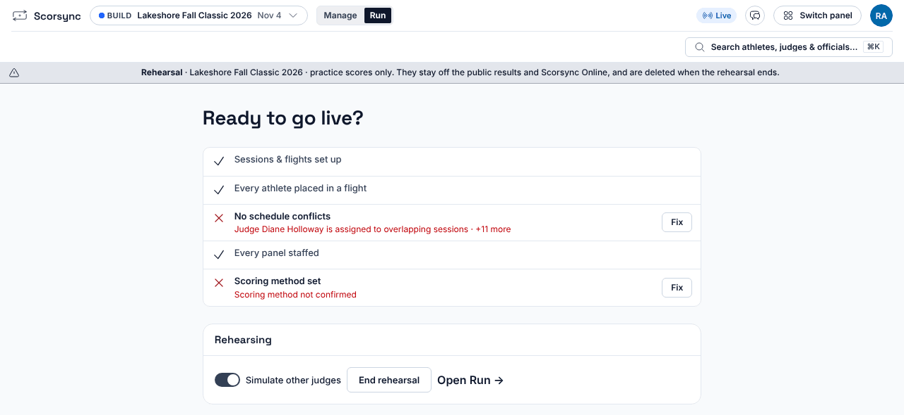
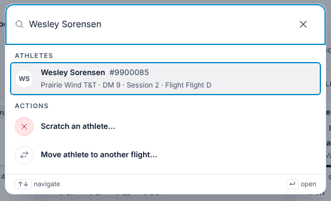
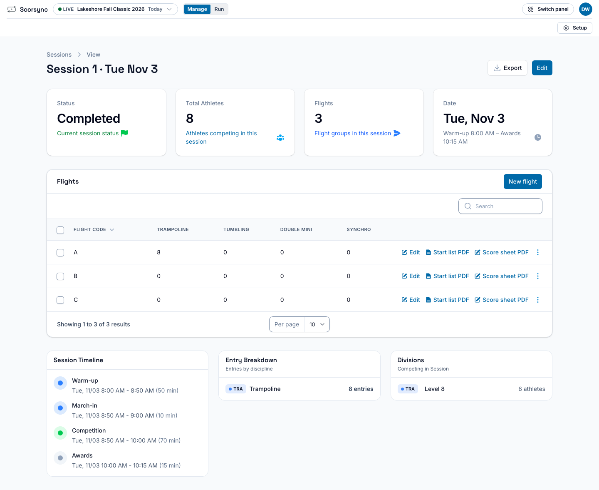
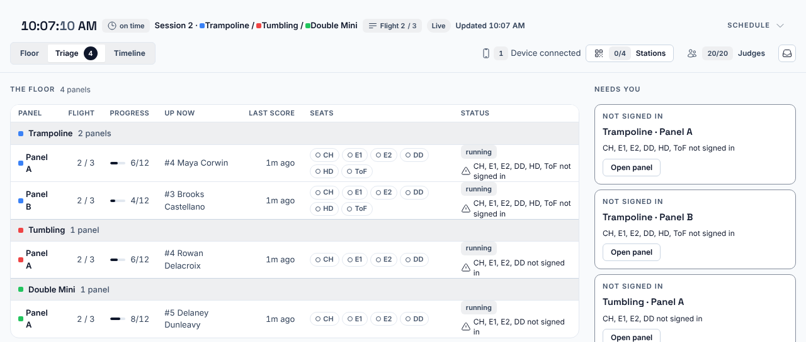

**Who it's for:** Hosts, the scoring table and chairs · Scorsync Cloud and Scorsync Desktop

## Rehearse with simulated judges

In a rehearsal, turn on **Simulate other judges** and Scorsync fills the empty seats once a real judge on the panel submits. Two tablets are enough to practise a whole panel.

See [Rehearse your meet](/host/before-meet-day/rehearse/).

## Chair keyboard shortcuts

With a keyboard on the chair's screen, Space starts or stops the routine timer, and a number key 0–9 sets **Skills performed**. They don't work while you're typing in a box. See [Override a mark, apply penalties or score 0](/judges/chair/override-and-penalties/).

## Find anyone with ⌘K

In Run, press ⌘K (Ctrl+K on Windows) and type a name to find any athlete, judge or official. Select an athlete to scratch them or move them.

See [Scratch an athlete](/host/meet-day-changes/scratch-an-athlete/).

## Paper backup sheets

Print each flight's start list and paper score sheet the day before, so the panel can keep scoring on paper if the tablets go down.

See [Print start lists and paper backup sheets](/host/before-meet-day/print-start-lists/) for where to find them.

## The tray menu

On Scorsync Desktop, the Scorsync icon in the menu bar (or notification area) shows whether Scorsync is running, the judges' address (click it to copy), and how long ago the last backup ran, even with the window closed. Select **Save Restore Key…** there once, before meet day, so a backup can be restored on another computer.

See [Use the Scorsync tray menu](/offline-host/tray-menu/) and [Back up your meet](/offline-host/backups/).

## Run views you can bookmark

Run has three views: **Floor**, **Triage** and **Timeline**. Pick one, then bookmark the page: the bookmark opens straight into that view, handy on a second screen at the table.

See [Getting started at the scoring table](/scoring-table/).

## Related

- [Meet-day runbook: Scorsync Cloud](/runbook/scorsync-cloud/)
- [Meet-day runbook: Scorsync Desktop](/runbook/scorsync-desktop/)
- [Frequently asked questions](/help/faq/)
