**Who it's for:** Host (meet director) · Scorsync Cloud and Scorsync Desktop

Do this first, once your account works (Scorsync Cloud: see [Sign up for Scorsync Cloud](/host/sign-up-for-scorsync-cloud/)) or first-run setup is done (Scorsync Desktop). Everything else on [Before meet day](/host/before-meet-day/) starts from a built meet.

## Before you start

- You're signed in as the host. On Scorsync Desktop, build the meet on the laptop itself, in the Scorsync window.
- You have your USAG sanction number, or your entries as a CSV file or a ProScore or TScore file.

## Create the meet

<Steps>

1. On **Choose a meet**, select **New meet**. If you don't see it, select the meet name at the top left, then **All meets**.

   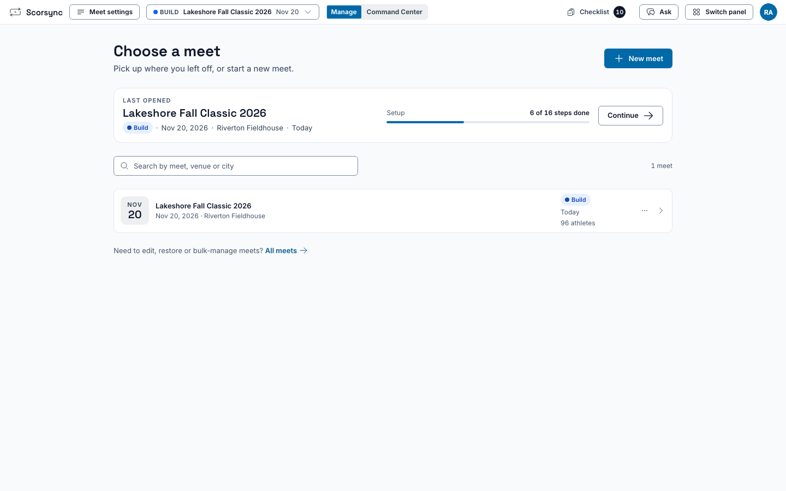

2. Under **USAG sanction ID**, type your sanction number, then select **Continue**. No sanction? Leave it blank and select **Continue**.

   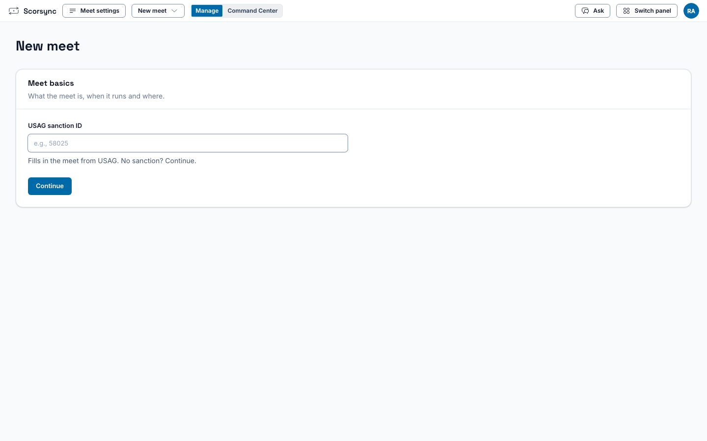

3. Check the title, dates, timezone and venue. If the sanction says "Sanction verified", Scorsync has filled them in from USAG. Otherwise, fill them in yourself.

   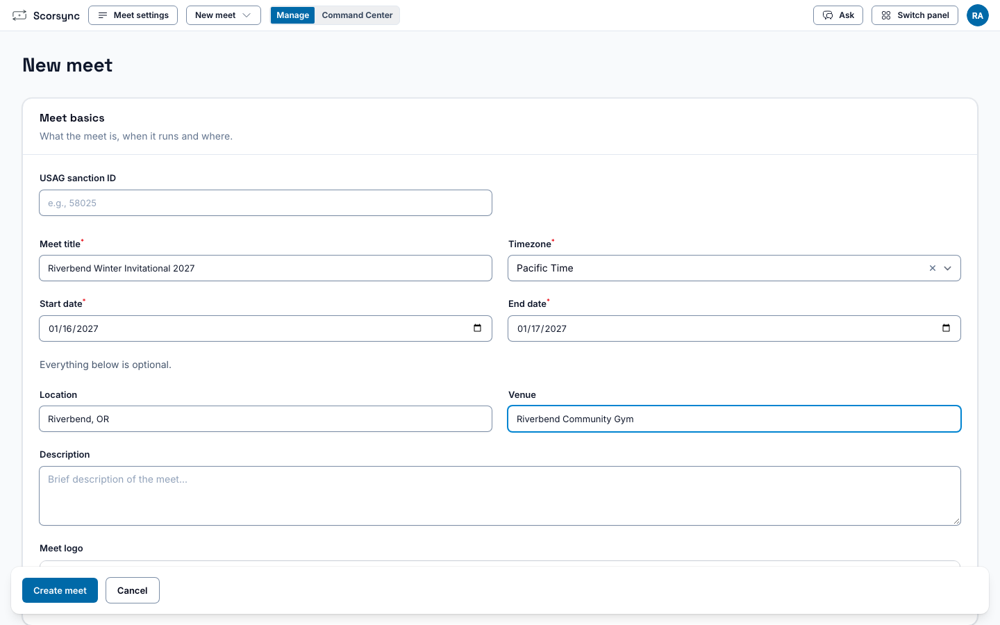

4. If your meet gives no awards, under **Scheduling**, set **Does this meet give awards?** to **No awards**.

5. Select **Create meet**. Without a verified sanction, Meet Builder opens with "Meet created successfully".

   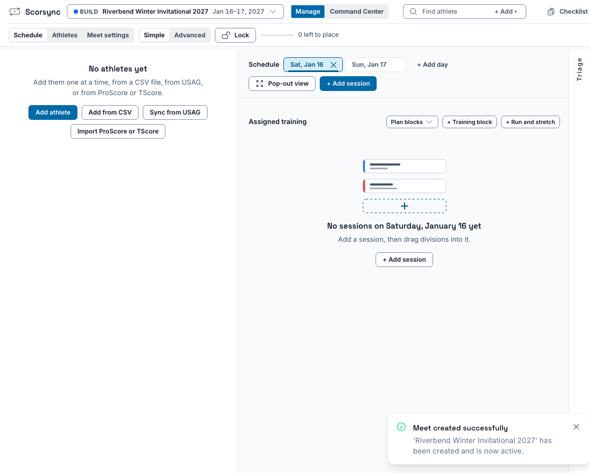

6. With a verified sanction, Scorsync first brings in the athletes registered for it and counts them as they arrive. When it's done, select **Open Meet Builder**.

</Steps>

Creating the meet also confirms the scoring method named on the **Scoring & options** header. Open it to check before you select **Create meet**.

Fill in the dates now: without them, Scorsync can't work out age groups. If the meet should use next year's ages (for example, a November meet using next year's age groups), set **Competition year** in **Meet settings** › **Meet and scoring**.

If you already have a meet with this sanction, Scorsync says so under the sanction box and links to it. You can still create another.

## Add your athletes

If your athletes came in from USAG when you created the meet, skip to [Add sessions and fill the flights](#add-sessions-and-fill-the-flights). Otherwise, or to add more:

<Steps>

1. In the **Find athlete** box at the top, select **+ Add** at its right end, then **Add from CSV**. (The same menu has **Add athlete**, **Sync from USAG** and **Import from ProScore or TScore**.)

2. Choose your file, check the preview of new athletes, then select **Apply changes**.

3. Check that your athletes are in the list on the left, or in the **Athletes** tab. Their divisions are worked out for you from level, age and gender.

</Steps>

:::tip
Bring everyone in before you arrange sessions: each import, and each **Add athlete**, clears Undo.
:::

On Scorsync Desktop, **Sync from USAG** needs the internet and a linked computer. If it asks, select **Link this computer**. If the meet says "Athletes not imported" after you create it, use **Sync from USAG** to try again.

## Add sessions and fill the flights

<Steps>

1. Select **+ Add session**. Each new session comes with three empty flights.

2. Fill the flights: drag athletes from the list onto a flight, or open **Divisions & auto-assign** on the session and select **Auto-assign athletes to session**.

3. Drag athletes within a flight to set the run order.

4. Check the top bar: it reads "0 left to place" once every entry is placed. An athlete in two events counts as two entries.

</Steps>

## Seat your judges

<Steps>

1. Select **Manage** at the top, then the **Meet settings** tab (next to **Schedule** and **Athletes**).

   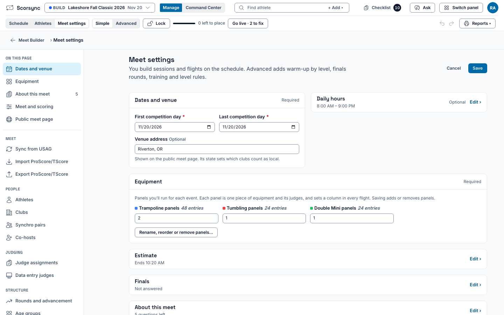

2. In the list on the left, under **Judging**, select **Judge assignments**.

   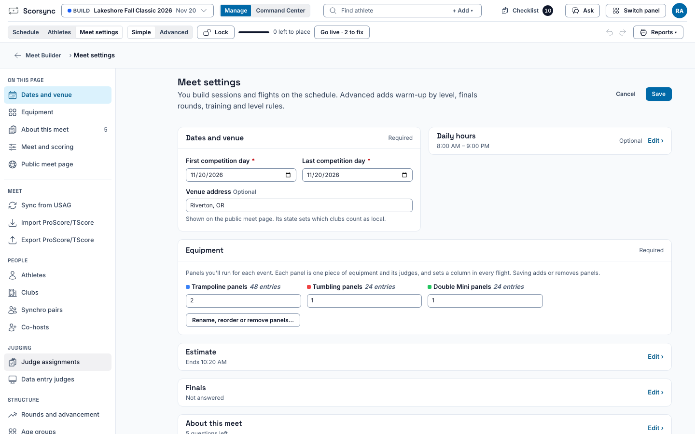

3. In **Judges** on the right, select **+** (**Add judge**), and add each judge. To add several at once, select **Paste a list**: one judge per line, as "USAG ID, last name, first name". No judges yet and the meet has a sanction? Select **Sync from USAG** in the empty **Judges** list to load your sanction's judges.

   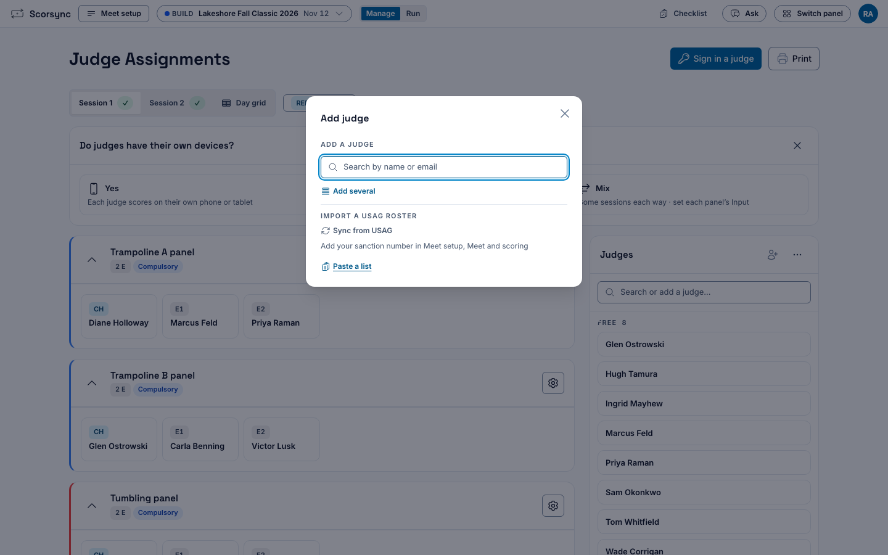

4. If a card asks **How will scores be entered?**, select **Own tablets** if each judge scores on their own phone or tablet. If judges mark paper and someone types the scores, select **Data entry** and see [Print judge sign-in sheets and data-entry cards](/host/before-meet-day/print-judge-sign-in-sheets/#give-each-data-entry-account-its-panel). **Mix** lets you choose per panel, from each panel's **Scores** chip. The same question is in **Meet settings** › **Meet and scoring**.

   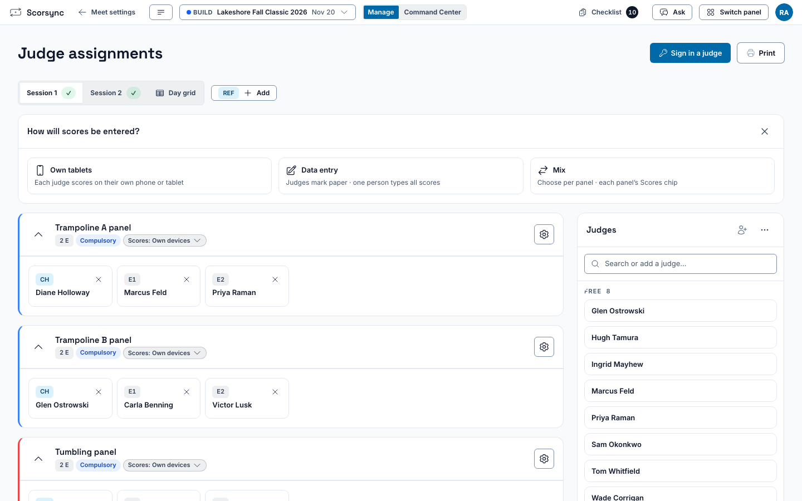

5. Select a session's tab above the panels.

   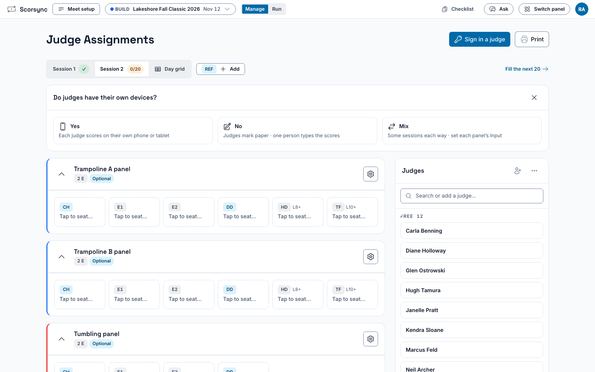

6. Select **Fill the next** (for example **Fill the next 12**). The first empty seat opens.

   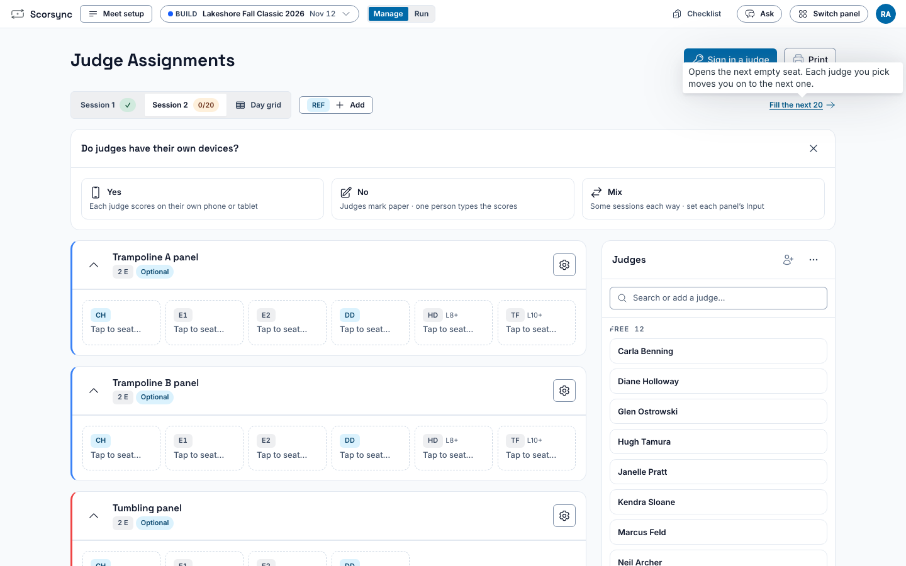

7. Select each judge in **Judges** in seat order (CH first). Each judge you pick takes the open seat, and the next empty seat opens. You can also drag a judge from **Judges** onto a seat.

   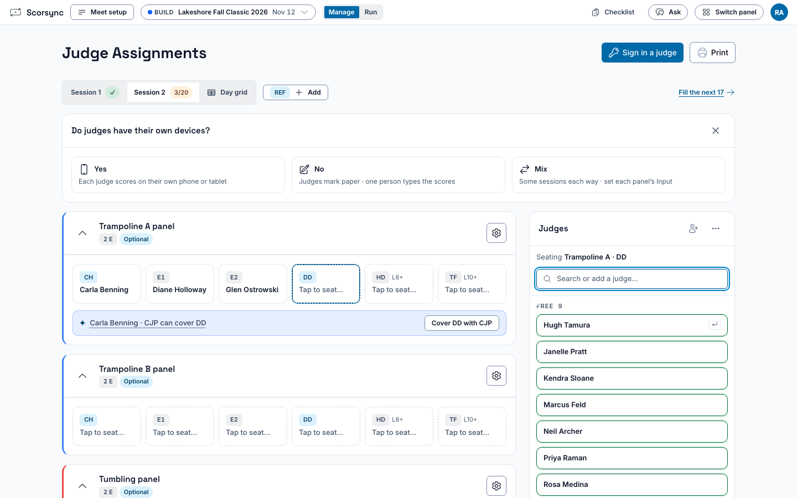

8. Check that the session's tab shows a ✓. Repeat for each session. To take a judge off a seat, select **×** on that seat.

   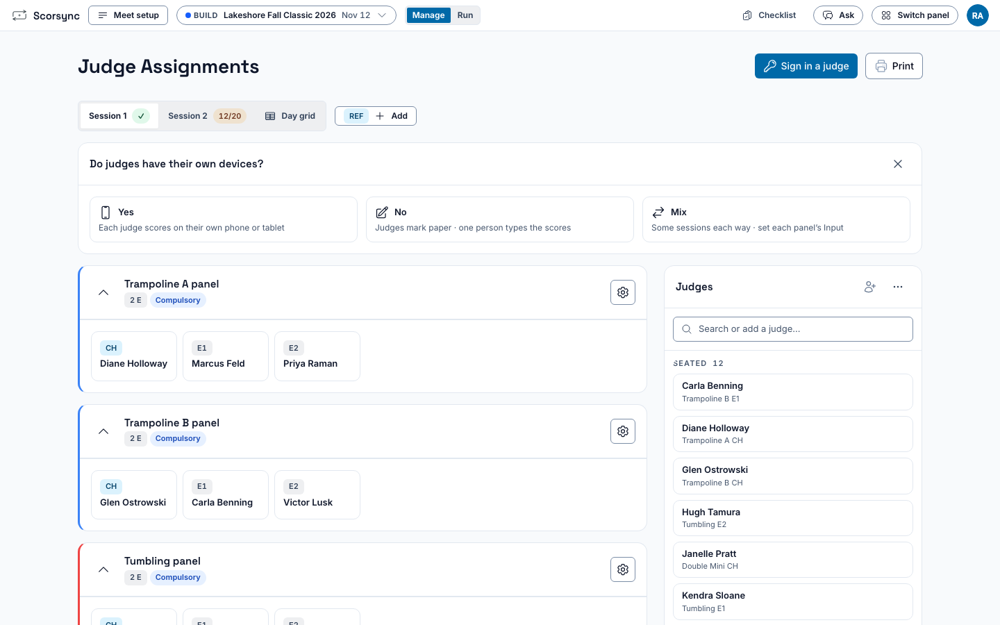

</Steps>

Scorsync sets each panel's number of E judges for you, from the meet type and the levels on that panel. To change one panel, select the gear on that panel, then a number under **# Execution**. **Default** puts it back.

:::review
The default E-judge count follows the app's rulebook table (meet type × level, #2553), not a meet-wide setting. No `:::rule` citation yet: check the wording, and add one from the rulebook if the page should say where the numbers come from.
:::

A session's panel appears only once the session has athletes in that event.

## If something goes wrong

- **"Schedule is locked"**. The schedule is locked. See [Lock the schedule](/host/before-meet-day/lock-the-schedule/#unlock-it), or for meet-day changes, [Meet-day changes](/host/meet-day-changes/).
- **A session shows "TRA: no panel" (or another event).** Its judges aren't seated yet. Seat them in **Judge assignments**.
- **The sanction says "Sanction not found at USAG".** Check the number and type it again. Scorsync won't create the meet with a sanction USAG can't find. If it still isn't found, clear the sanction box and fill in the meet yourself. If it says "Could not reach USAG", you can still continue.
- **An athlete you added isn't in the list.** Check they have a level for the event. If they still don't show, contact Scorsync support (support@scorsync.com).

## Related

- [Rehearse your meet](/host/before-meet-day/rehearse/)
- [Print judge sign-in sheets and data-entry cards](/host/before-meet-day/print-judge-sign-in-sheets/)
- [Lock the schedule](/host/before-meet-day/lock-the-schedule/)
- [Before meet day](/host/before-meet-day/)
