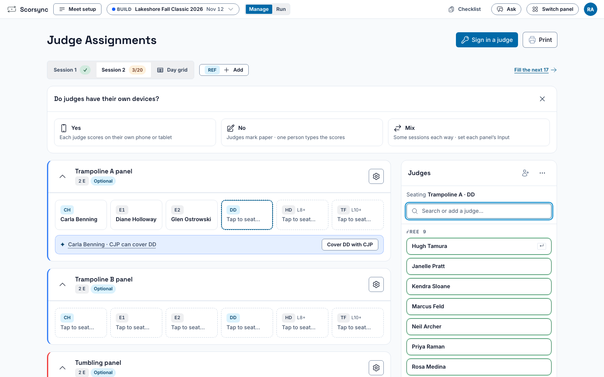

**Who it's for:** Host (meet director) · Scorsync Cloud and Scorsync Desktop

Do this first, once your account works (Scorsync Cloud) or first-run setup is done (Scorsync Desktop). Everything else on [Before meet day](/host/before-meet-day/) starts from a built meet.

## Before you start

- You're signed in as the host. On Scorsync Desktop, build the meet on the laptop itself, in the Scorsync window.
- You have your USAG sanction number, or your entries as a CSV file or a ProScore or TScore file.

## Create the meet

<Steps>

1. Select **Create a meet**. If you don't see it, select the meet name at the top left, then **All meets**.

2. Under **USAG Sanction ID**, type your sanction number, then select **Continue**. No sanction? Leave it blank and select **Continue**.

3. Check the title, dates, timezone and venue. If the sanction says "Sanction verified", Scorsync has filled them in from USAG. Otherwise, fill them in yourself.

4. Select **Create Meet**. Meet Builder opens. With a verified sanction, the athletes registered for it are already in the list on the left.

</Steps>

Fill in the dates now: without them, Scorsync can't work out age groups.

## Add your athletes

If your athletes came in from USAG when you created the meet, skip to [Add sessions and fill the flights](#add-sessions-and-fill-the-flights). Otherwise, or to add more:

<Steps>

1. Above the list on the left, select **+ Add**, then **Add from CSV**. (The same menu has **Add athlete**, **Sync from USAG** and **Import from ProScore or TScore**.)

2. Choose your file, check the preview of new athletes, then select **Apply Changes**.

3. Check that your athletes are in the list on the left. Their divisions are worked out for you from level, age and gender.

</Steps>

:::tip
Bring everyone in before you arrange sessions: each import, and each **Add athlete**, clears Undo.
:::

On Scorsync Desktop, **Sync from USAG** needs the internet and a linked computer. If it asks, select **Link this computer**. If the meet says "Athletes not imported" after you create it, use **Sync from USAG** to try again.

## Add sessions and fill the flights

<Steps>

1. Select **+ Add session**. Each new session comes with three empty flights.

2. Fill the flights: drag athletes from the list onto a flight, or open **Divisions & auto-assign** on the session and select **Auto-assign athletes to session**.

3. Drag athletes within a flight to set the run order.

4. Check the top bar: every athlete is placed, for example "8 of 8 entries placed".

</Steps>

## Seat your judges

<Steps>

1. Select **Manage** at the top, then **Meet setup** (⚙) at the left of the row under the top bar.

2. In the list on the left, under **Judging**, select **Judge assignments**.

3. In **Judges** on the right, select **+** (**Add judge**), and add each judge. To add several at once, select **Paste a list**: one judge per line, as "USAG ID, last name, first name".

4. If a card asks **Do judges have their own devices?**, select **Yes** if each judge scores on their own phone or tablet. If judges mark paper and someone types the scores, see [Print judge sign-in sheets and data-entry cards](/host/before-meet-day/print-judge-sign-in-sheets/#give-each-data-entry-account-its-panel).

5. Select a session's tab above the panels.

6. Select **Fill the next** (for example **Fill the next 12**). The first empty seat opens.

7. Select each judge in **Judges** in seat order (CH first). Each judge you pick takes the open seat, and the next empty seat opens. You can also drag a judge from **Judges** onto a seat.

   

8. Check that the session's tab shows a ✓. Repeat for each session.

</Steps>

Scorsync sets each panel's number of E judges for you, from the meet type and the levels on that panel. To change one panel, select the gear on that panel, then a number under **# Execution**. **Default** puts it back.

:::review
The default E-judge count follows the app's rulebook table (meet type × level, #2553), not a meet-wide setting. No `:::rule` citation yet: check the wording, and add one from the rulebook if the page should say where the numbers come from.
:::

A session's panel appears only once the session has athletes in that event.

## If something goes wrong

- **"Schedule locked. Unlock to edit."** The schedule is locked. See [Lock the schedule](/host/before-meet-day/lock-the-schedule/#unlock-it), or for meet-day changes, [Meet-day changes](/host/meet-day-changes/).
- **A session shows "TRA: no panel" (or another event).** Its judges aren't seated yet. Seat them in **Judge assignments**.
- **The sanction says "Sanction not found at USAG".** Check the number and type it again. If it still isn't found, select **Continue** and fill in the meet yourself.
- **An athlete you added isn't in the list.** Check they have a level for the event. If they still don't show, contact Scorsync support (support@scorsync.com).

## Related

- [Rehearse your meet](/host/before-meet-day/rehearse/)
- [Print judge sign-in sheets and data-entry cards](/host/before-meet-day/print-judge-sign-in-sheets/)
- [Lock the schedule](/host/before-meet-day/lock-the-schedule/)
- [Before meet day](/host/before-meet-day/)
