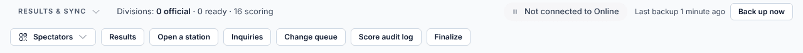
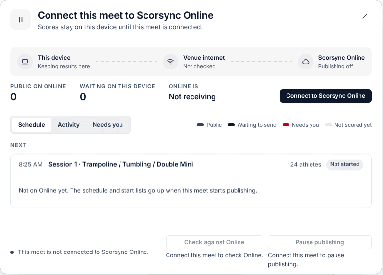
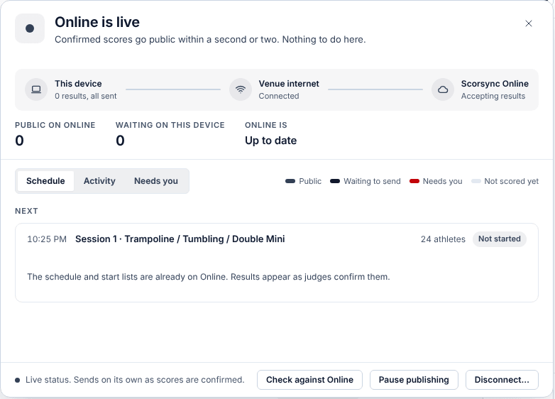

**Who it's for:** Host (meet director) · Scorsync Cloud and Scorsync Desktop

Skip this page if your meet won't publish results to scorsync.com. Otherwise, do it the day before the meet, while you have internet.

## Before you start

- You can sign in to scorsync.com with your own account. Only the person who starts the connection can finish it.
- The computer has internet. On Scorsync Desktop, the internet comes in through your travel router. See [Set up Scorsync Desktop and the venue network](/offline-host/set-up-the-venue-network/).
- The rehearsal is over. See [Rehearse your meet](/host/before-meet-day/rehearse/).

## Connect and turn on publishing

<Steps>

1. Select **Run** at the top. In the **Results & Sync** strip at the bottom, select **Not connected to Online**.

   

2. Select the "Connect to Scorsync Online" button.

   

3. scorsync.com opens. Sign in with your own account if it asks.

4. On **Sync a meet to Scorsync**, select the blue button within 10 minutes of step 2. scorsync.com names it for you:

   | The button says | Because |
   | -- | -- |
   | **Create meet** | This is the first time this meet goes on scorsync.com. |
   | **Link meet** | The meet already exists on scorsync.com. |
   | **Add device & create meet** (or **& link meet**) | This computer isn't known to scorsync.com yet. Select it. |

   If it lists meets to choose from, pick yours, or **Create a new meet instead**.

5. Back in Run, check for "This meet is now connected to Scorsync Online."

6. Open the chip again and select **Turn on Online publishing**. Nothing goes to scorsync.com until you do.

7. Wait while it sends your clubs, athletes and, if the schedule is locked, the schedule. Check that the panel says **Online is live**.

   

</Steps>

On Scorsync Cloud the panel shows **Scorsync** and **Scorsync Online**, with no **Venue internet** step. Everything else is the same.

## What reaches scorsync.com, and when

| When | What families see |
| -- | -- |
| You turn on publishing | The meet, clubs and athletes. The schedule too, if it's locked. |
| You [lock the schedule](/host/before-meet-day/lock-the-schedule/) or [go live](/host/before-meet-day/go-live/) | Sessions, flights and start lists |
| Every judge's score is in, or the chair moves on | That score, marked unofficial |
| The chair confirms the flight official | Official results |
| The chair reopens a flight | Its results go back to unofficial until it's confirmed again |
| Never | Rehearsal scores |

More in [What families see on scorsync.com](/start-here/what-families-see/). For families' own accounts and subscriptions, see [help.scorsync.com](https://help.scorsync.com).

:::review[Needs Austin's review: scorsync.com accounts]
This page says the host connects with their own scorsync.com account. Which account or plan a host needs, and what families need to see full results, isn't settled for the help site.
:::

## The buttons at the bottom of the panel

| Button | What it does |
| -- | -- |
| **Pause publishing** | Stops sending. Scores are kept, and **Turn on Online publishing** sends what was missed. |
| **Check against Online** | Compares scorsync.com with your meet and sends anything missing. |
| **Disconnect…** | Asks "Disconnect this meet from Scorsync Online?", then cuts the link. To publish again, connect again and turn on publishing. |

## If something goes wrong

- **"Can't reach Scorsync Online."** The computer has no internet, or scorsync.com isn't answering. Check the internet, then try again. Scoring isn't affected.
- **"Something answered, but it wasn't Scorsync Online."** The venue Wi-Fi wants you to sign in first. Sign in to it on this computer, then try again.
- **"That connection link is no longer valid. Start again from the sync panel."** You took longer than 10 minutes, or used an old link. Start again from step 1.
- **"Connecting to Scorsync Online was cancelled."** Someone selected **Cancel** on scorsync.com. Start again from step 1.
- **"Scorsync Online could not complete the connection."** Start again from step 1. If it fails twice, contact Scorsync support (support@scorsync.com).
- **"That connection link was started by a different user."** Finish the connection while signed in as the person who started it.
- **Turn on Online publishing does nothing.** The meet is still rehearsing. [End the rehearsal](/host/before-meet-day/rehearse/#end-the-rehearsal), then try again.

## Related

- [Go live](/host/before-meet-day/go-live/)
- [Check scores are reaching scorsync.com](/scoring-table/watch-publishing/)
- [What families see on scorsync.com](/start-here/what-families-see/)
