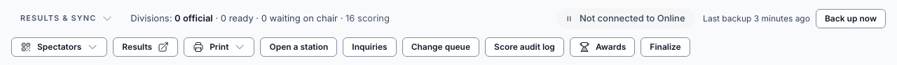
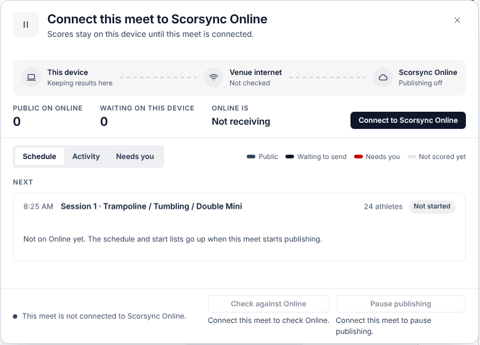
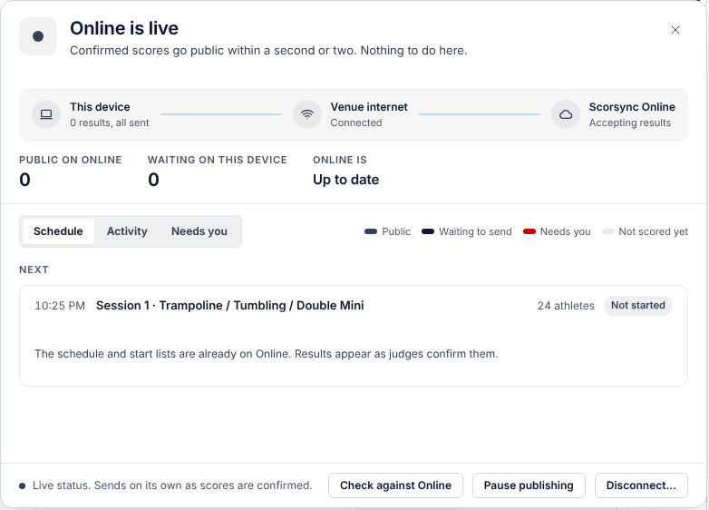

**Who it's for:** Host (meet director) · Scorsync Cloud and Scorsync Desktop

Skip this page if your meet won't publish results to scorsync.com. Otherwise, do it the day before the meet, while you have internet.

## Before you start

- The rehearsal is over. See [Rehearse your meet](/host/before-meet-day/rehearse/).
- On Scorsync Cloud, [lock the schedule](/host/before-meet-day/lock-the-schedule/) first. Then connecting also turns on publishing for you.
- On Scorsync Desktop, sign in with any scorsync.com account; no subscription is needed to connect. That account becomes the meet's host on scorsync.com. Only the person who starts the connection can finish it.
- On Scorsync Desktop, the computer has internet. It comes in through your travel router. See [Set up Scorsync Desktop and the venue network](/offline-host/set-up-the-venue-network/).

:::tip
The Checklist shows this step on Scorsync Cloud as **Publish results on Scorsync Online**. Its **Fix** link opens the sync panel.
:::

## Connect on Scorsync Cloud

Scorsync Cloud connects to scorsync.com by itself. You don't sign in to scorsync.com.

<Steps>

1. In Meet Control, select **Command Center** at the top. In the **Results & Sync** strip at the bottom, select **Not connected to Online**.

   

2. Select the "Connect to Scorsync Online" button. The line under the heading says **Connecting…**.

3. If it asks **Is this your meet?**, select **Link to it** for your meet on scorsync.com, or **Create a new one**.

   If you link, the line says **Waiting for the scorsync.com meet host to approve** until that host approves from their email or on scorsync.com.

4. Read the line under the heading:

   | The line says | Do this |
   | -- | -- |
   | "Connected. Online publishing turned on, so parents see results on scorsync.com." | Nothing. Go to step 5. |
   | "Connected. Turn on Online publishing…" or "…still off because the schedule is not locked…" | Select **Turn on Online publishing** at the top of the panel. |
   | "…still off because the meet is rehearsing…" | [End the rehearsal](/host/before-meet-day/rehearse/#end-the-rehearsal), then select **Turn on Online publishing**. |

5. Check that the panel says **Online is live**.

</Steps>

The panel shows **Scorsync** and **Scorsync Online**, with no **Venue internet** step.

## Connect on Scorsync Desktop

:::review[Needs Austin's review: connecting from Scorsync Desktop]
Connecting from Scorsync Desktop was being fixed (see the hardware check): scorsync.com could refuse it. scorsync.com now says "This pairing link did not work" when it refuses a link. Check that a Desktop connect works end to end, then remove this callout. Until then, contact Scorsync support to connect a Desktop meet.
:::

<Steps>

1. In Meet Control, select **Command Center** at the top. In the **Results & Sync** strip at the bottom, select **Not connected to Online**.

2. Select the "Connect to Scorsync Online" button.

   

3. scorsync.com opens. Sign in with your own account if it asks.

4. On **Sync a meet to Scorsync**, select the blue button within 10 minutes of step 2. scorsync.com names it for you:

   | The button says | Because |
   | -- | -- |
   | **Create meet** | This is the first time this meet goes on scorsync.com. |
   | **Link meet** | The meet already exists on scorsync.com. |
   | **Add device & create meet** (or **& link meet**) | This computer isn't known to scorsync.com yet. Select it. |

   If it lists meets to choose from, pick yours, or **Create a new meet instead**.

5. Back in Command Center, check that the chip says **Turn on publishing**. The meet is connected. (If this meet published before, the chip says **Online publishing off**.)

6. Select the chip, then select **Turn on Online publishing**. Nothing goes to scorsync.com until you do.

7. Wait while the chip says **Getting Online ready**. It sends your clubs, athletes and, if the schedule is locked, the schedule. Check that the panel says **Online is live**.

   

</Steps>

## What reaches scorsync.com, and when

| When | What families see |
| -- | -- |
| Publishing turns on | The meet, clubs and athletes. The schedule too, if it's locked. |
| You [lock the schedule](/host/before-meet-day/lock-the-schedule/) or [go live](/host/before-meet-day/go-live/) | Sessions, flights and start lists |
| You add, edit, move or scratch an athlete while the schedule is locked | That change, right away |
| Every judge's score is in, or the chair moves on | That score, marked unofficial |
| The chair confirms the flight official | Official results |
| The chair reopens a flight | Its results go back to unofficial until it's confirmed again |
| Never | Rehearsal scores |

More in [What families see on scorsync.com](/start-here/what-families-see/). For families' own accounts and subscriptions, see [help.scorsync.com](https://help.scorsync.com).

## The buttons at the bottom of the panel

| Button | What it does |
| -- | -- |
| **Pause publishing** | Stops sending. Scores are kept. **Turn on Online publishing** sends what was missed, and removes from scorsync.com anything you deleted while paused. |
| **Check against Online** | Compares scorsync.com with your meet and sends anything missing. |
| **Disconnect…** | Asks "Disconnect this meet from Scorsync Online?", then cuts the link. To publish again, connect again, then select **Turn on Online publishing**. |

## If something goes wrong

**On Scorsync Cloud:**

- **"Linked to another account".** scorsync.com links this meet to a different account. Select **Contact support**. When support has fixed it, select **Try again**.
- **"Can't reach Online".** Select **Try again** if it shows. If not, Scorsync reconnects on its own.
- **"Online is not answering".** Scorsync keeps trying. If it stops, select **Try again**.
- **"Request declined".** The scorsync.com meet's host said no. Select **Create a separate Online meet**.
- **"Request expired".** Nobody approved within 7 days. Select **Ask again**, or **Create a separate Online meet**.
- **"Meet dates missing".** Add the meet's start and end dates in Meet settings, then select **Try again**.

**On Scorsync Desktop:**

- **"Can't reach Scorsync Online."** The computer has no internet, or scorsync.com isn't answering. Check the internet, then try again. Scoring isn't affected.
- **"Something answered, but it wasn't Scorsync Online."** The venue Wi-Fi wants you to sign in first. Sign in to it on this computer, then try again.
- **"That connection link is no longer valid. Start again from the sync panel."** You took longer than 10 minutes, or used an old link. Start again from step 1.
- **"Connecting to Scorsync Online was cancelled."** Someone selected **Cancel** on scorsync.com. Start again from step 1.
- **"Scorsync Online could not complete the connection."** Start again from step 1. If it fails twice, contact Scorsync support (support@scorsync.com).
- **"That connection link was started by a different user."** Finish the connection while signed in as the person who started it.

**On both:**

- **The panel says "Refusing results", and the Needs you tab says "USAG identifier must be numeric."** scorsync.com only takes athletes whose USAG number is all digits, so it refuses those athletes and their scores. Scoring isn't affected. Contact Scorsync support (support@scorsync.com).
- **Turn on Online publishing does nothing.** The meet is still rehearsing. [End the rehearsal](/host/before-meet-day/rehearse/#end-the-rehearsal), then try again.

## Related

- [Go live](/host/before-meet-day/go-live/)
- [Check scores are reaching scorsync.com](/scoring-table/watch-publishing/)
- [What families see on scorsync.com](/start-here/what-families-see/)
