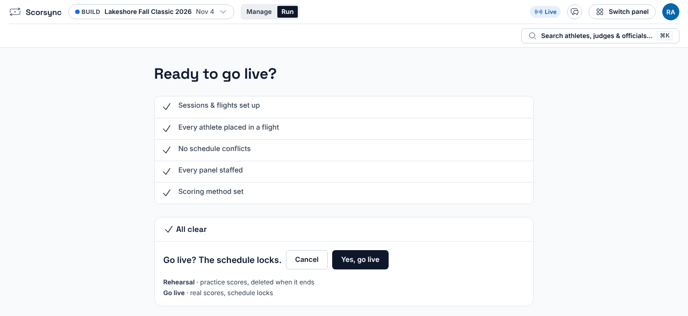
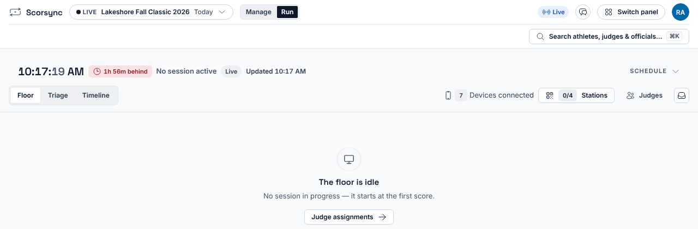
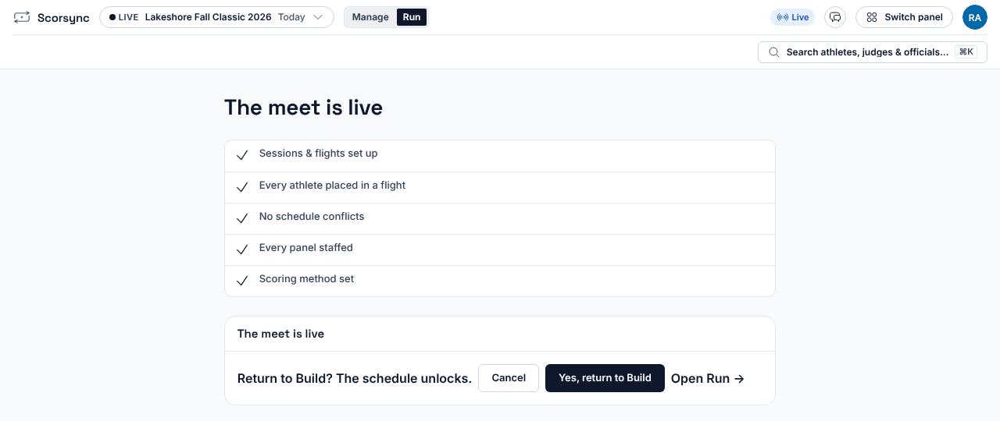

**Who it's for:** Host (meet director) · Scorsync Cloud and Scorsync Desktop

Go live on the morning of the meet, once judges are signed in. Scores from then on are real.

## Before you start

- The rehearsal is over. See [Rehearse your meet](/host/before-meet-day/rehearse/).
- If the meet publishes, it's connected to scorsync.com. See [Connect your meet to scorsync.com](/host/before-meet-day/connect-to-scorsync-com/).

## Go live

<Steps>

1. Select **Run** at the top, then **Ready to go live?** in the blue bar.

2. Check that every row is ticked. If one has a red cross, select **Fix** next to it and fix it. **Go live** stays greyed out until every row is ticked.

3. Select **Go live**.

4. When it asks "Go live? The schedule locks.", select **Yes, go live**.

   

5. Check that Run opens, with **LIVE** next to the meet name and "The floor is idle". That's expected: there's no start button. Each session starts when its chair opens the first athlete.

   

</Steps>

## What going live changes

| What happens | Can you undo it? |
| -- | -- |
| The meet is live: every score from now on is real | Only until the first score. See [Go back to Build](#go-back-to-build). |
| The schedule locks | Yes. You can [unlock it](/host/before-meet-day/lock-the-schedule/#unlock-it) for a late entry. |
| A publishing meet sends its schedule to scorsync.com | No. It stays there, even if you go back to Build. |

:::caution[After the first score, there's no way back]
You can return the meet to Build only until the first score is saved. After that, **Return to Build** disappears. If you need to start over, contact Scorsync support (support@scorsync.com).
:::

## Go back to Build

Use this if you went live too early, or need to change the schedule before anyone has scored.

<Steps>

1. Open the go-live screen again. Once the meet is live, no button leads there: in a web browser, type the address you sign in at, followed by `/meet-control/build-readiness`. On Scorsync Desktop, use a browser on the laptop. The screen now says "The meet is live".

2. Select **Return to Build**.

3. When it asks "Return to Build? The schedule unlocks.", select **Yes, return to Build**.

   

4. Check for "Back in Build". Make your changes, then go live again.

</Steps>

## If something goes wrong

- **Go live is greyed out.** A row has a red cross. Select **Fix** next to it.
- **"Scoring method not confirmed".** **Fix** opens Judge Assignments. Select the **Scoring** button at the top (for example **Scoring: 2 E**), check the settings, then select **Confirm method**.
- **"Judge … is assigned to overlapping sessions", but the times look back to back.** The later session's march-in starts before the earlier session ends. In Meet Builder, move the later session's start time later.
- **There's no Go live button.** You're still rehearsing. Select **End rehearsal** first. See [Rehearse your meet](/host/before-meet-day/rehearse/#end-the-rehearsal).
- **There's no Return to Build button.** Someone has already scored. Contact Scorsync support (support@scorsync.com).
- **The Scorsync license row has a red cross or a warning** (Scorsync Desktop only). Select **Fix** or **Open** next to it. If you can't sort it out, contact support before the meet.

:::review[Needs Austin's review: the license row]
The license row comes from the code; it wasn't seen in a walkthrough. What we tell hosts about license codes and linking isn't settled (see the Scorsync Desktop runbook).
:::

## Related

- [Start a session](/scoring-table/start-a-session/)
- [Get judges signed in and scoring](/scoring-table/get-judges-signed-in/)
- [Meet-day runbook: Scorsync Cloud](/runbook/scorsync-cloud/)
- [Meet-day runbook: Scorsync Desktop](/runbook/scorsync-desktop/)
