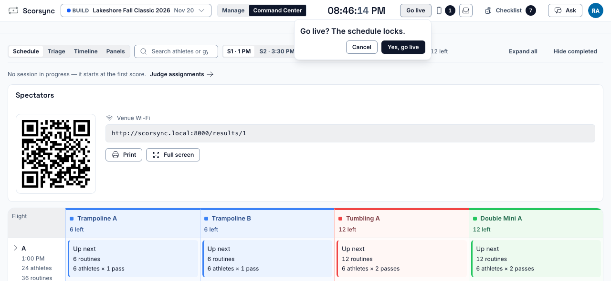
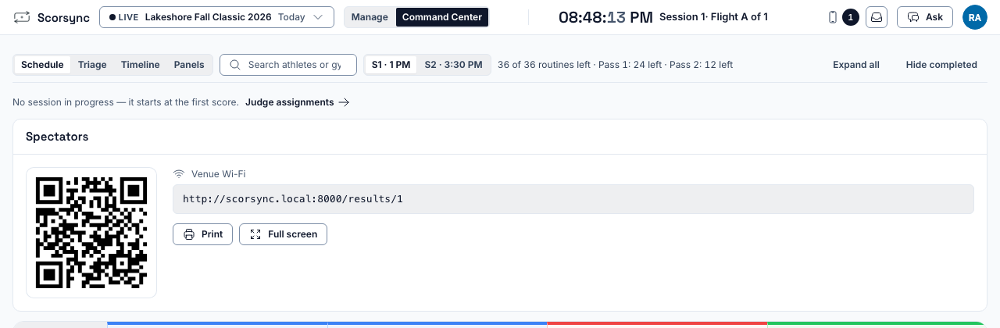
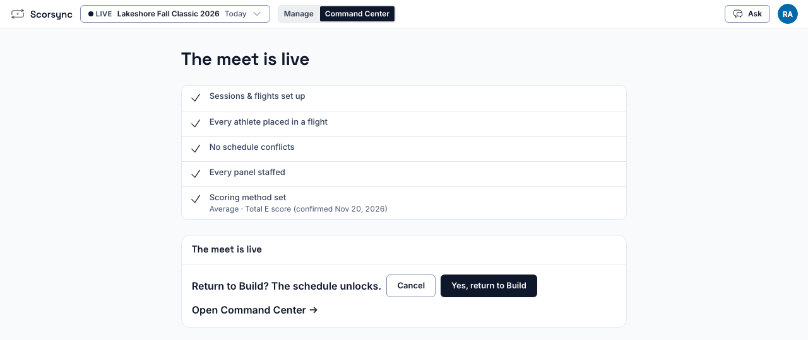

**Who it's for:** Host (meet director) · Scorsync Cloud and Scorsync Desktop

Go live on the morning of the meet, once judges are signed in. Scores from then on are real.

## Before you start

- If the meet publishes, it's connected to scorsync.com. See [Connect your meet to scorsync.com](/host/before-meet-day/connect-to-scorsync-com/).
- If you're still rehearsing, you can go live straight away: Go live ends the rehearsal and deletes its practice scores. See [Rehearse your meet](/host/before-meet-day/rehearse/).

## Go live

<Steps>

1. Select **Command Center** at the top. (Meet Builder has the same **Go live** button in its top bar.)

2. Look at the button at the top right. If it reads **Go live · N to fix**, select it. **Ready to go live?** opens. Select **Fix** (or **Confirm**) next to each row that needs it, then come back.

3. Select **Go live**.

4. Check the question, then select **Yes, go live**. It says one of these:
   - "Go live? The schedule locks."
   - "N entries aren't in a flight yet. Go live anyway? You can still place them while the meet runs."
   - "End rehearsal and go live?", with the number of practice scores it deletes.

   

5. Check that Command Center opens, with **Live** next to the meet name and "No session in progress". That's expected: there's no start button. Each session starts when its chair opens the first athlete.

   

</Steps>

Amber rows on **Ready to go live?**, such as entries not in a flight or empty judge seats, are warnings. They don't stop you going live. Meet Builder's top bar then reads "Ready, with N warnings".

## What going live changes

| What happens | Can you undo it? |
| -- | -- |
| The meet is live: every score from now on is real | Only until the first score. See [Go back to Build](#go-back-to-build). |
| The schedule locks | Yes. You can [unlock it](/host/before-meet-day/lock-the-schedule/#unlock-it), but you rarely need to: athletes stay editable and movable while it's locked. |
| A publishing meet sends its schedule to scorsync.com | No. It stays there, even if you go back to Build. |

:::caution[After the first score, there's no way back]
You can return the meet to Build only until the first score is saved. After that, **Return to Build** disappears. If you need to start over, contact Scorsync support (support@scorsync.com).
:::

## Go back to Build

Use this if you went live too early, or need to change the schedule before anyone has scored.

<Steps>

1. Open the go-live screen again. Once the meet is live, no button leads there: in a web browser, type the address you sign in at, followed by `/meet-control/build-readiness`. On Scorsync Desktop, use a browser on the laptop. The screen now says "The meet is live".

2. Select **Return to Build**.

3. When it asks "Return to Build? The schedule unlocks.", select **Yes, return to Build**.

   

4. Check for "Back in Build". Make your changes, then go live again.

</Steps>

## If something goes wrong

- **The button reads "Go live · N to fix".** A row on **Ready to go live?** has a red cross or needs confirming. Select the button, then **Fix** or **Confirm** next to the row.
- **"Confirm the scoring method".** Select **Confirm**. Meet and scoring opens. Check how the meet is scored, then select **Confirm scoring method**. If you changed something, the button reads **Save and confirm**.
- **"Judge … is assigned to overlapping sessions", but the times look back to back.** The later session's march-in starts before the earlier session ends. In Meet Builder, move the later session's start time later.
- **"A rehearsal started".** Someone started a rehearsal after your screen loaded. Select **Go live** again: the question now says it ends the rehearsal.
- **"The meet is live" with "Setup changes not sent to Online. Run Check against Online."** You went live from a rehearsal on a meet that publishes to scorsync.com. In Command Center, select the sync chip in the **Results & Sync** bar at the bottom, then **Check against Online**.
- **There's no Return to Build button.** Someone has already scored. Contact Scorsync support (support@scorsync.com).
- **The Scorsync license row has a red cross or a warning** (Scorsync Desktop only). Select **Fix** or **Open license** next to it, and link this computer while you have internet. See [First-run setup](/offline-host/first-run-setup/#about-the-license). If linking fails, email support@scorsync.com before the meet.

## Related

- [Start a session](/scoring-table/start-a-session/)
- [Get judges signed in and scoring](/scoring-table/get-judges-signed-in/)
- [Meet-day runbook: Scorsync Cloud](/runbook/scorsync-cloud/)
- [Meet-day runbook: Scorsync Desktop](/runbook/scorsync-desktop/)
