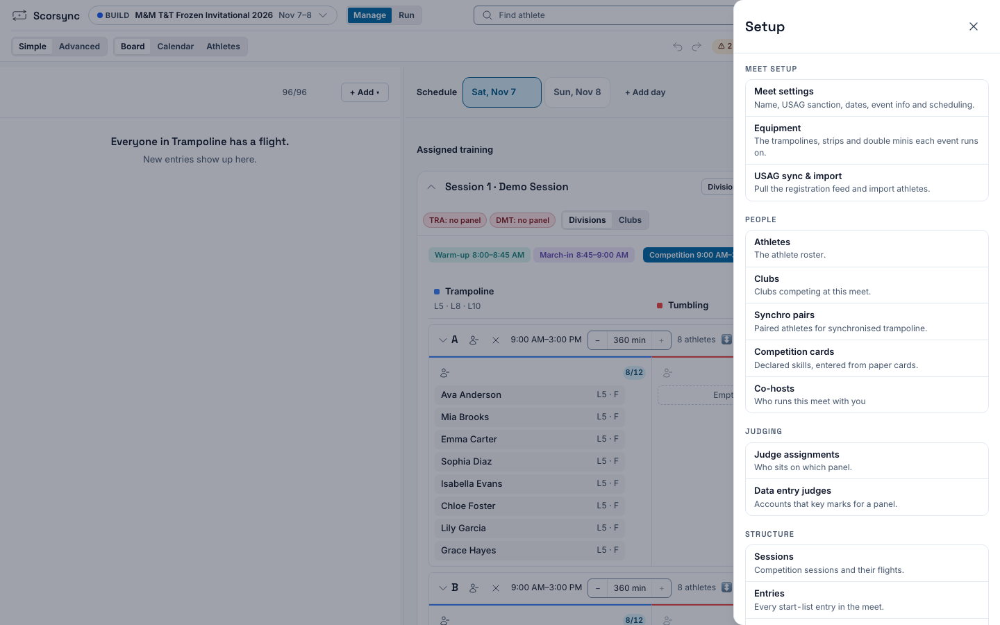
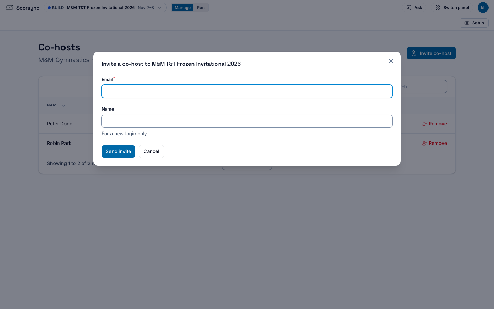
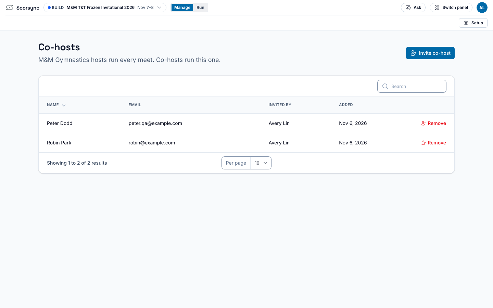

**Who it's for:** Host (meet director) · Scorsync Cloud

A co-host builds and runs one meet with you. They see only that meet, not your organization's other meets. Use it for a club that co-runs the meet with you, or a helper who builds the schedule.

To share **every** meet of your organization, add the person as an admin instead: select your initials at the top right, then **Organization**, **Members** and **Invite member**.

## Before you start

- You're an owner or admin of the organization that runs the meet. Co-hosts can't invite other co-hosts.
- The meet is open in Meet Builder.

## Invite a co-host

<Steps>

1. Select **Setup** at the top right, then **Co-hosts** under **People**.

   

2. Select **Invite co-host**.

3. Type their **Email**. If they don't have a Scorsync login yet, type their **Name** too.

   

4. Select **Send invite**.

5. Check that they're now in the list of co-hosts.

   

</Steps>

They get an email. A new person sets a password from the link in it, then lands on the meet. Someone who already has a login just signs in: the meet is in their meet list.

## What a co-host can and can't do

| A co-host can | A co-host can't |
| --- | --- |
| Build the meet in Meet Builder | See your other meets |
| Run it in Meet Control | Delete, archive or reset the meet |
| Print start lists and see results | Invite or remove co-hosts |
| Assign judges | Create meets for your organization |
| | Show or reset the PIN of a judge who also works your other meets |
| | Make someone a Meet Referee |
| | Read your Messages with the Scorsync team |

## Remove a co-host

<Steps>

1. Open **Setup**, then **Co-hosts**.

2. Select **Remove** next to their name, then confirm.

</Steps>

They lose the meet the next time their page loads.

## If something goes wrong

- **"… can't co-host this meet. Use a different email address."** That email belongs to a judge's login, a data-entry login, or someone another organization uses. Ask the person for a different email address, and invite that one: Scorsync creates a new login for it.
- **"… already hosts this meet."** They're an owner or admin of your organization, or already a co-host. Nothing to do.
- **There's no Co-hosts item in Setup.** You're on Scorsync Desktop, where everyone at the venue already runs the meet together. Co-hosts are for Scorsync Cloud.
- **There's no Invite co-host button.** You're a co-host yourself. Ask the meet's organization to invite the person.
- **The invite email didn't arrive, or its link expired.** Ask them to use **Forgot password?** on the login page, or contact support from [Get help](/help/faq/).

## Related

- [Build your meet in Meet Builder](/host/before-meet-day/build-your-meet/)
- [Before meet day](/host/before-meet-day/)
