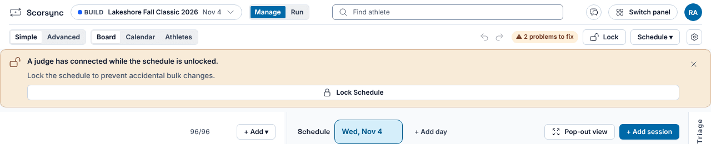
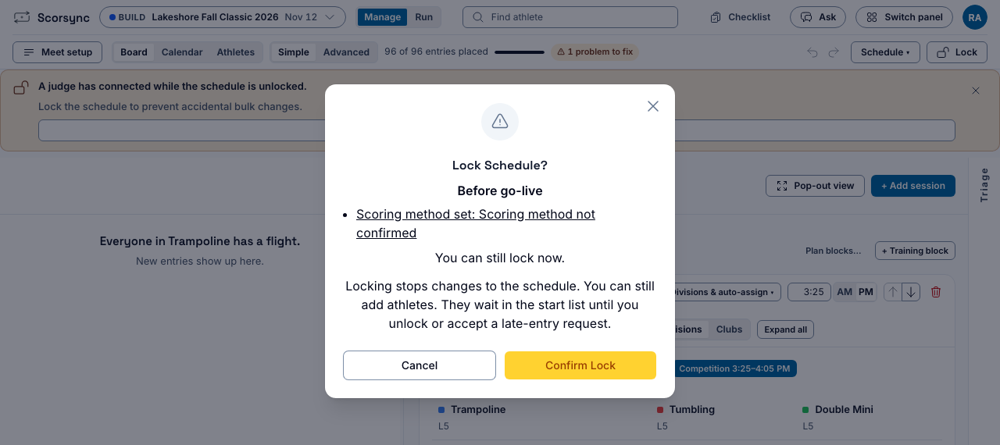
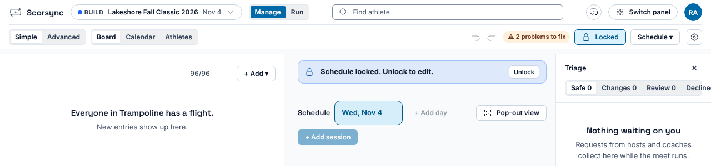
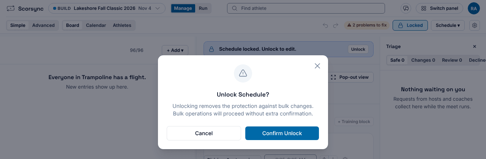

**Who it's for:** Host (meet director) · Scorsync Cloud and Scorsync Desktop

Lock the schedule once sessions, flights and run orders are final, and before you print start lists.

## Before you start

- Every athlete is placed in a flight in Meet Builder.
- If the meet will publish to scorsync.com, decide whether the schedule is ready for families to see: locking is what sends the start list there. See [What families see on scorsync.com](/start-here/what-families-see/).

## Lock it

<Steps>

1. Select **Manage** at the top to open Meet Builder.

2. Select **Lock** at the top right. (If a yellow banner says "A judge has connected while the schedule is unlocked", its **Lock Schedule** button does the same.)

   

3. In **Lock Schedule?**, select **Confirm Lock**. Anything listed under "Before go-live" still needs fixing before you go live, but it doesn't stop the lock. If the meet publishes to scorsync.com, the window also says "Locking publishes the start list to Scorsync Online."

   

4. Check that the button now reads **Locked**, and the board says "Schedule locked. Unlock to edit."

   

</Steps>

## What locking changes

| | Unlocked | Locked |
| -- | -- | -- |
| Move athletes, flights and sessions in Meet Builder | Yes | No |
| Add an athlete | Yes | Yes. They wait unplaced until you unlock or accept a late-entry request. |
| scorsync.com | Gets no schedule | Gets the schedule, if the meet is [publishing](/host/before-meet-day/connect-to-scorsync-com/) |

Going live locks the schedule too, so a meet that's live is always locked.

:::caution[What you can't take back]
Once the locked schedule is on scorsync.com, unlocking doesn't remove it. Families keep seeing that version, and your changes only reach scorsync.com when you lock again.
:::

Locking a connected meet puts athletes' names, clubs and divisions on scorsync.com, and scores follow as they come in. Make sure your entry form says results are published online.

## Unlock it

Unlock only for a real change, such as [placing a late entry](/host/meet-day-changes/add-a-late-entry/).

<Steps>

1. In Meet Builder, select **Locked** (or **Unlock** above the board).

2. Select **Confirm Unlock**.

   

3. Make your change.

4. Select **Lock**, then **Confirm Lock**.

</Steps>

## If something goes wrong

- **"The schedule is locked. Level, birth date, gender, flight and scratch go through Triage."** Don't unlock for these. After the lock, do them from Run instead: see [Scratch an athlete](/host/meet-day-changes/scratch-an-athlete/) and [Change an athlete's level or flight](/host/meet-day-changes/change-level-or-flight/).
- **A change you made doesn't show on scorsync.com.** You made it while the schedule was unlocked. Lock it again.
- **Undo is greyed out ("Schedule is locked").** Undo only works while the schedule is unlocked.

## Related

- [Print start lists and paper backup sheets](/host/before-meet-day/print-start-lists/)
- [Add a late entry](/host/meet-day-changes/add-a-late-entry/)
- [Connect your meet to scorsync.com](/host/before-meet-day/connect-to-scorsync-com/)
