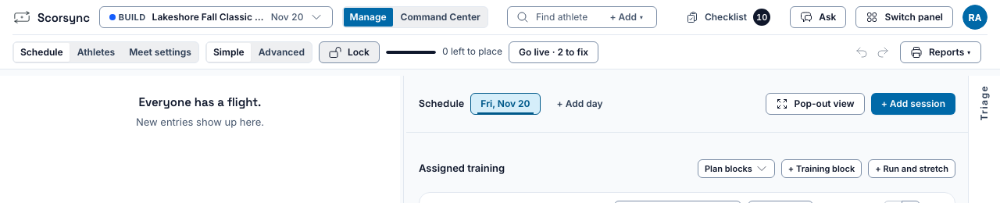
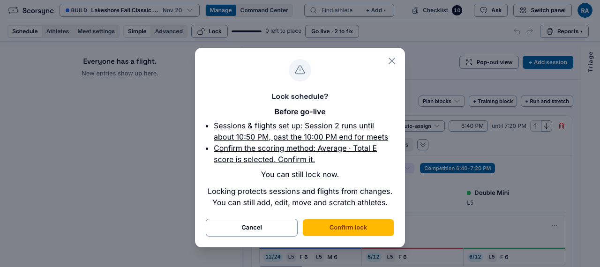
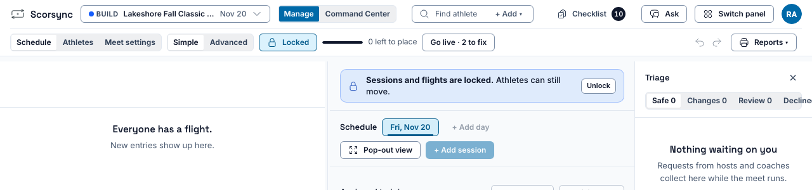
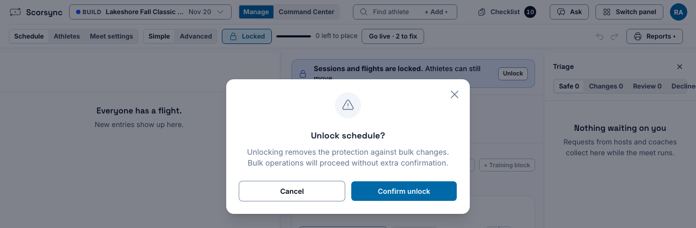

**Who it's for:** Host (meet director) · Scorsync Cloud and Scorsync Desktop

Lock the schedule once sessions and flights are final, and before you print start lists. The lock protects sessions and flights. You can still add, edit, move and scratch athletes.

## Before you start

- Sessions and flights are final in Meet Builder.
- If the meet will publish to scorsync.com, decide whether the schedule is ready for families to see: locking is what sends the start list there. See [What families see on scorsync.com](/start-here/what-families-see/).

## Lock it

<Steps>

1. Select **Manage** at the top to open Meet Builder.

2. Select **Lock** in the top bar, just left of "N left to place". (If a yellow banner says "A judge has connected while the schedule is unlocked", its **Lock Schedule** button does the same.)

   

3. In **Lock schedule?**, select **Confirm lock**. Anything listed under "Before go-live" still needs fixing before you go live, but it doesn't stop the lock. If the meet publishes to scorsync.com, the window also says "Locking publishes the start list to Scorsync Online."

   

4. Check that the button now reads **Locked**, and the bar above the board says "Sessions and flights are locked. Athletes can still move."

   

</Steps>

## What locking changes

| | Unlocked | Locked |
| -- | -- | -- |
| Sessions, flights, awards, breaks, warm-up, training and finals | Change freely | Can't change |
| Bulk actions, such as auto-assign, sort, bulk scratch or dragging a whole group | Yes | No |
| One athlete (or a few you select): edit, place, move, reorder, scratch | Yes | Yes |
| Add an athlete | Yes | Yes, and you can place them in a flight |
| scorsync.com | Gets no schedule | Gets the schedule and each athlete change, if the meet is [publishing](/host/before-meet-day/connect-to-scorsync-com/) |

Going live locks the schedule too, so a meet that's live is always locked.

:::caution[What you can't take back]
Once the locked schedule is on scorsync.com, unlocking doesn't remove it. Families keep seeing that version, and changes you make while unlocked only reach scorsync.com when you lock again.
:::

Locking a connected meet puts athletes' names, clubs and divisions on scorsync.com, and scores follow as they come in. Make sure your entry form says results are published online.

## Unlock it

Unlock only to change a session, a flight, awards, breaks, warm-up, training or finals, or to use a bulk action. A late entry, a scratch or a level change doesn't need it.

<Steps>

1. In Meet Builder, select **Locked** (or **Unlock** in the bar above the board).

2. In **Unlock schedule?**, select **Confirm unlock**.

   

3. Make your change.

4. Select **Lock**, then **Confirm lock**.

</Steps>

## If something goes wrong

- **"Schedule is locked. Unlock it to make changes."** You tried to change a session or a flight, or to use a bulk action. Unlock, make the change, then lock again. To change one athlete, you don't need to unlock: see [Scratch an athlete](/host/meet-day-changes/scratch-an-athlete/) and [Change an athlete's level or flight](/host/meet-day-changes/change-level-or-flight/).
- **A change you made doesn't show on scorsync.com.** You made it while the schedule was unlocked. Lock it again.
- **Undo is greyed out ("Schedule is locked").** That step was made before you locked. Undo works for steps made while locked. To undo older steps, unlock first.

## Related

- [Print start lists and paper backup sheets](/host/before-meet-day/print-start-lists/)
- [Add a late entry](/host/meet-day-changes/add-a-late-entry/)
- [Connect your meet to scorsync.com](/host/before-meet-day/connect-to-scorsync-com/)
