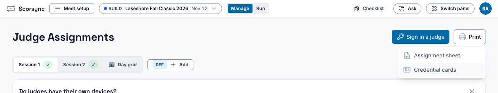
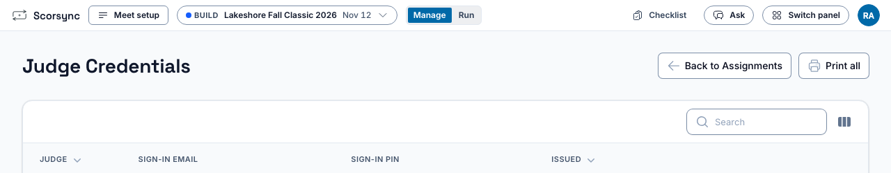
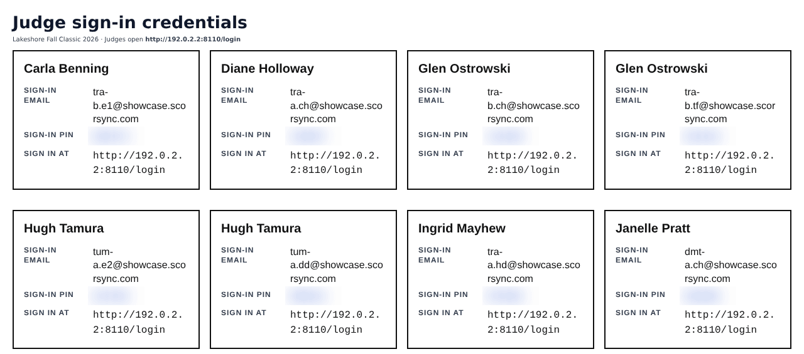
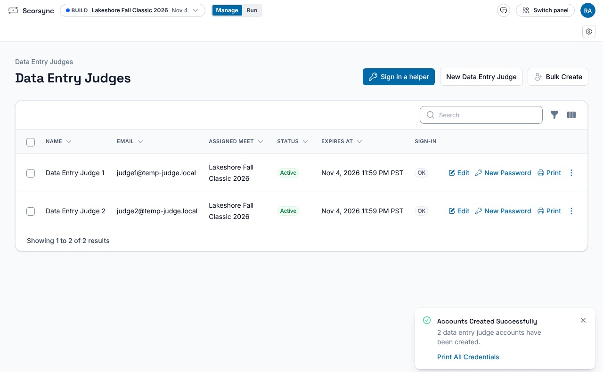
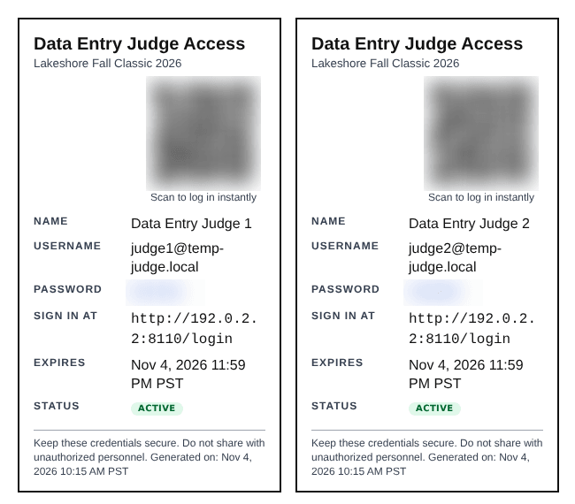
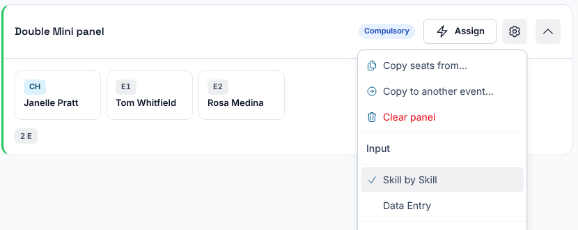
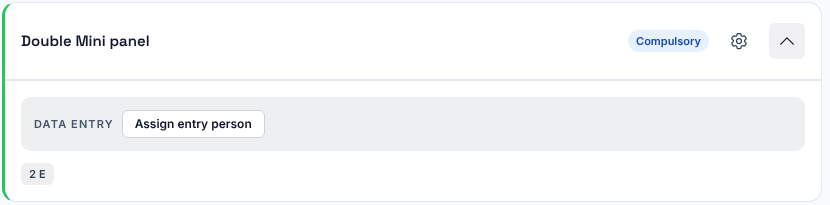

**Who it's for:** Host (meet director) · Scorsync Cloud and Scorsync Desktop

Print these a few days before the meet, so each judge and data-entry helper has their sign-in on paper.

## Before you start

- Judges are seated on their panels (Setup → **Judge assignments**).
- On Scorsync Desktop, the laptop is on your travel router, so the address printed on the cards is the one tablets will use. See [Set up Scorsync Desktop and the venue network](/offline-host/set-up-the-venue-network/).

## Print the judges' sheet

<Steps>

1. Select **Manage** at the top, then the gear (**Setup**), then **Judge assignments**.

2. Select **All credentials** at the top right.

   

3. Select **Print all**. The sheet opens in a new tab, and your printer window opens over it.

   

4. Print it. Each card has the judge's sign-in email, PIN and the address to sign in at.

5. Cut the cards apart, and give each judge their own.

   

</Steps>

:::caution
The sheet holds every judge's PIN. Keep it with you until you hand the cards out. **New PIN** stops the judge's old PIN at once and signs their tablet out, so their printed card no longer works: print it again.
:::

## Create and print data-entry cards

Data-entry helpers key the marks for a panel that scores on paper. Their password is on the printed card, not on screen.

<Steps>

1. In Setup, select **Data entry judges**, then **Bulk Create**.

2. Under **Assign to Meet**, type your meet's name and choose it.

3. Under **Number of Accounts**, type how many you need, then select **Create Accounts**.

4. In the "Accounts Created Successfully" message, select **Print All Credentials**.

   

5. Print the cards. Each has a sign-in QR code, a username, a password and the date the account expires: the end of the meet's last day.

   

</Steps>

## Give each data-entry account its panel

<Steps>

1. In Setup, select **Judge assignments**, and find the panel that scores on paper.

2. Select the gear on that panel, then **Data Entry** under **Input**.

   

3. Select **Assign entry person** on the panel, and choose the account.

   

</Steps>

:::tip
To reprint one card, select **Print** on that account's row in Data entry judges. A helper who turns up on the day can get a one-time code instead: select **Sign in a helper**.
:::

## If something goes wrong

- **A judge's card has no PIN** ("Not issued — reissue on the credential screen"). Select **New PIN** on that judge's row in **All credentials**, then print again. See [Show or reset a judge's PIN](/scoring-table/show-or-reset-a-pin/).
- **A tablet can't open the address on the card** (Scorsync Desktop). Type the address after **Judges open** in the Scorsync menu instead, or the one after **Or:**.
- **A data-entry card was lost.** In Data entry judges, select **New Password** on its row, so the old card stops working. Then select **Print** for a new card.

## Related

- [Connect your meet to scorsync.com](/host/before-meet-day/connect-to-scorsync-com/)
- [Get judges signed in and scoring](/scoring-table/get-judges-signed-in/)
- [Key scores as a data-entry judge](/scoring-table/key-scores/)
