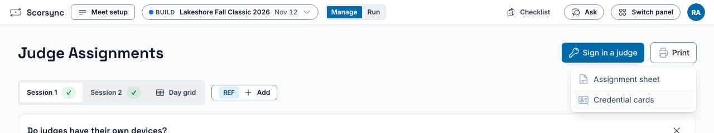
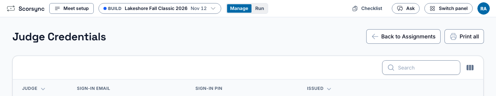
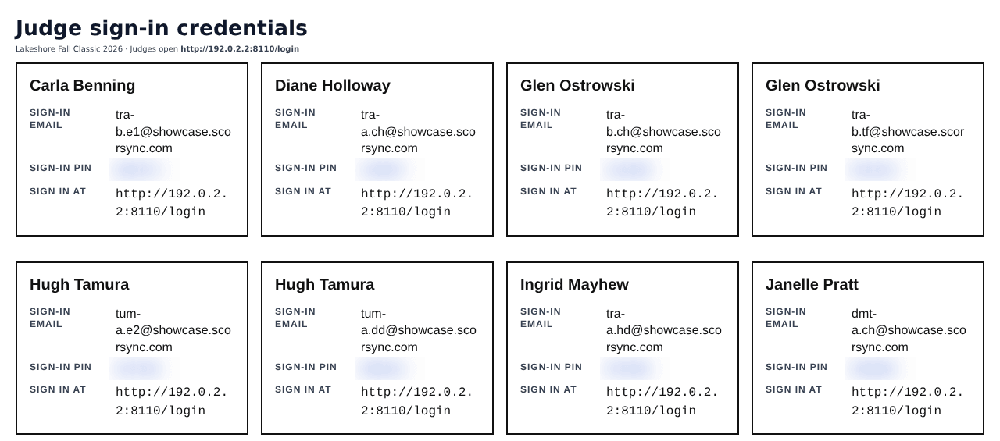
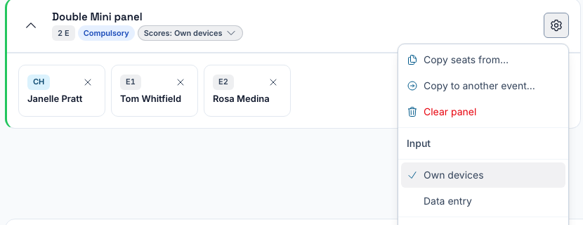
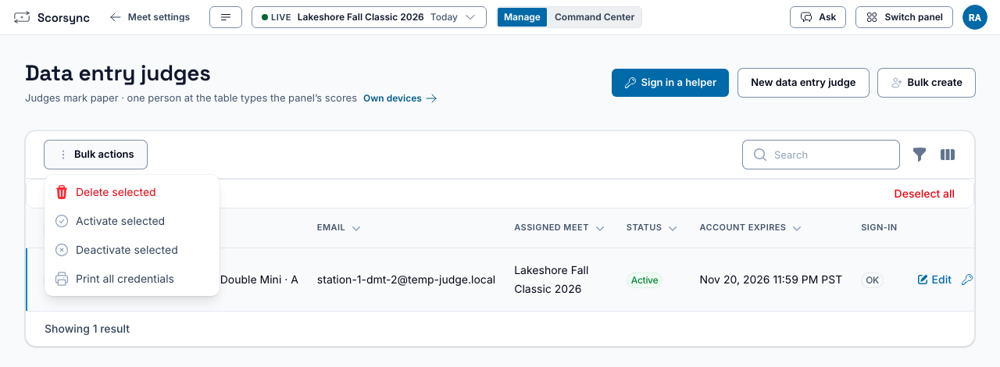

**Who it's for:** Host (meet director) · Scorsync Cloud and Scorsync Desktop

Print these a few days before the meet, so each judge and data-entry helper has their sign-in on paper.

## Before you start

- Judges are seated on their panels (**Meet settings** → **Judge assignments**).
- On Scorsync Desktop, the laptop is on your travel router, so the address printed on the cards is the one tablets will use. See [Set up Scorsync Desktop and the venue network](/offline-host/set-up-the-venue-network/).

## Print the judges' sheet

<Steps>

1. Select **Manage** at the top, then the **Meet settings** tab in Meet Builder.

2. In the list on the left, under **Judging**, select **Judge assignments**.

3. Select **Print** at the top right, then **Credential cards**.

   

4. Select **Print all**. The sheet opens in a new tab, and your printer window opens over it.

   

5. Print it. Each card has the judge's sign-in email, PIN and the address to sign in at.

6. Cut the cards apart, and give each judge their own.

   

</Steps>

:::caution
The sheet holds every judge's PIN. Keep it with you until you hand the cards out. **New PIN** stops the judge's old PIN at once and signs their tablet out, so their printed card no longer works: print it again.
:::

## Set paper panels to data entry

On a panel that scores on paper, the judges write their marks and one person keys them in. When you set a panel to data entry, Scorsync gives its station a sign-in account, for example "Data entry · Trampoline A". The seated judges stay on the panel, so you keep a record of who judged.

<Steps>

1. In **Judge assignments**, find the panel that scores on paper.

2. Select the gear on that panel, then **Data entry** under **Input**. (The other choice, **Own devices**, is for judges who score on their own phone or tablet.)

   

3. Check the panel's chip. It says "Scores: Data entry" and the station account's name.

</Steps>

If every panel scores on paper, answer **How will scores be entered?** above the panels with **Data entry** instead: it sets every panel to data entry. **Mix** changes nothing, so set each panel yourself. To bring the question back, select **Own devices or data entry?**.

## Print the data-entry cards

<Steps>

1. In **Meet settings**, under **Judging**, select **Data entry judges**.

2. Tick the accounts for your meet, for example "Data entry · Trampoline A".

3. Select **Bulk actions**, then **Print all credentials**.

   

4. Print the cards. Each has a sign-in QR code, a username, a password and the date the account expires.

5. Check the line under each QR code: "Scan once to sign in · works until" a date. The QR code works once, until then. After that, the helper signs in with the username and password.

</Steps>

:::note[Scorsync Desktop]
The QR code holds the laptop's address. Print the cards at the venue, with the laptop on the scoring Wi-Fi. If the laptop's address changes, print them again.
:::

:::tip
To reprint one card, select **Print** on that account's row in Data entry judges. Need more accounts than one per station? Select **Bulk create**. A helper who turns up on the day can get a one-time code instead: select **Sign in a helper**.
:::

## If something goes wrong

- **A judge's card has no PIN** ("Not issued — reissue on the credential screen"). Select **Print**, then **Credential cards**, and select **New PIN** on that judge's row. Then print again. See [Show or reset a judge's PIN](/scoring-table/show-or-reset-a-pin/).
- **A data-entry panel shows Assign entry person.** The panel has no account, for example because someone deactivated its station account. Select **Assign entry person**, and choose an account.
- **A tablet can't open the address on the card** (Scorsync Desktop). Type the address after **Judges open** in the Scorsync menu instead, or the one after **Or**.
- **A data-entry card was lost.** In Data entry judges, select **New Password** on its row, so the old card stops working, QR code included. Then select **Print** for a new card.
- **A helper sees "This QR code was replaced when the PIN was reset."** The account got a new password after the card was printed. Give them the new card.
- **A card's QR code opens nothing** (Scorsync Desktop). The laptop's address changed since you printed it. Select **Print** on that account's row to print it again.

## Related

- [Connect your meet to scorsync.com](/host/before-meet-day/connect-to-scorsync-com/)
- [Get judges signed in and scoring](/scoring-table/get-judges-signed-in/)
- [Key scores as a data-entry judge](/scoring-table/key-scores/)
