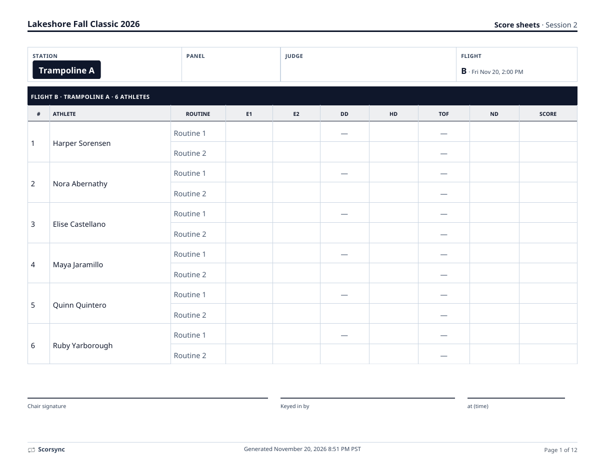

**Who it's for:** Host (meet director) · Scorsync Cloud and Scorsync Desktop

Print these the day before the meet, after you've locked the schedule.

## Before you start

- The schedule is locked. A sheet printed before the lock can go out of date. See [Lock the schedule](/host/before-meet-day/lock-the-schedule/).

## Open the Print menu

Every printout is in one **Print** menu. You can open it from Meet Builder or from Command Center.

<Steps>

1. In Meet Builder, select **Reports ▾** at the top, then **All printouts…**.

   In Command Center, select **Print** in the bar at the bottom of the screen.

2. The Print menu opens. It lists **Schedule**, **By session** and **Whole meet**.

</Steps>

## Print a session's start lists

<Steps>

1. In the Print menu, under **By session**, find the session.

2. Select **Start lists**. The PDF opens in a new tab: each flight in run order, with each piece of equipment on its own page.

3. Print it. Repeat for each session.

</Steps>

## Print the paper backup

If the tablets go down, the panel writes scores on these and someone keys them in later.

<Steps>

1. In the Print menu, under **By session**, find the session.

2. Select **Score sheets**. The PDF opens in a new tab, with every flight in the session: a page per piece of equipment, a row for each routine an athlete does, and a column for each judge's mark. A box that doesn't count for that routine prints as a dash.

   

3. Print it, and repeat for each session. Keep the backup sheets at the scoring table.

</Steps>

## If something goes wrong

- **The printout doesn't match the board.** Something changed after you printed: a late entry, a scratch or a new run order. Print that session again.
- **There's no Print menu.** Only the host and co-hosts of the meet see it. Check that you're signed in with your own account.
- **There's no button for the whole meet's start lists.** Start lists print per session. **Whole meet** has the results and the judge schedule, not start lists.

## Related

- [Print judge sign-in sheets and data-entry cards](/host/before-meet-day/print-judge-sign-in-sheets/)
- [Key scores as a data-entry judge](/scoring-table/key-scores/)
- [Meet-day runbook: Scorsync Desktop](/runbook/scorsync-desktop/)
