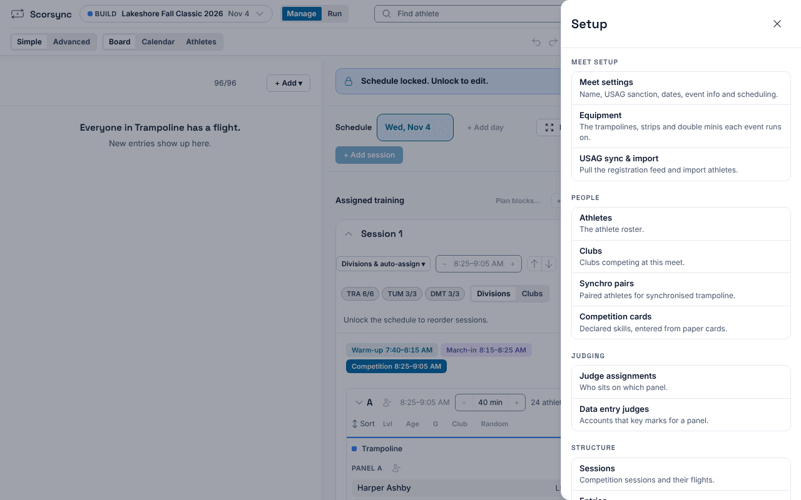
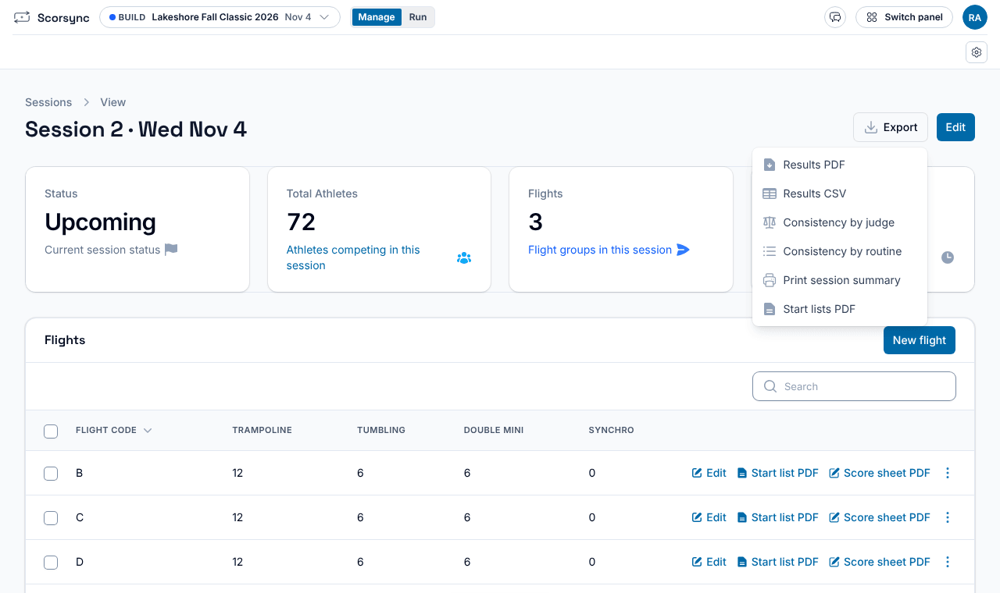
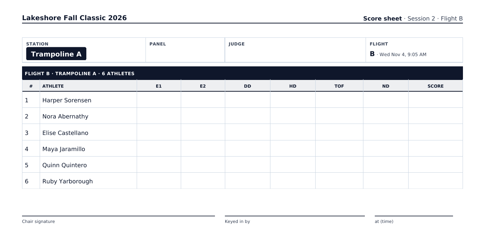

**Who it's for:** Host (meet director) · Scorsync Cloud and Scorsync Desktop

Print these the day before the meet, after you've locked the schedule.

## Before you start

- The schedule is locked. A sheet printed before the lock can go out of date. See [Lock the schedule](/host/before-meet-day/lock-the-schedule/).

## Print a session's start lists

<Steps>

1. Select **Manage** at the top, then the gear (**Setup**) at the top right.

2. Under **Structure**, select **Sessions**.

   

3. Select the session.

4. Select **Export**, then **Start lists PDF**. The PDF opens in a new tab: each flight in run order, with each piece of equipment on its own page.

   

5. Print it. Repeat for each session.

</Steps>

## Print the paper backup

If the tablets go down, the panel writes scores on these and someone keys them in later.

<Steps>

1. On the same session page, find the flight's row under **Flights**.

2. Select **Score sheet PDF**. It has a page per piece of equipment: a row per athlete, and a column for each judge's mark.

   

3. Print it, and repeat for each flight. Keep the backup sheets at the scoring table.

   **Start list PDF** on the same row prints that one flight's start list, if a panel needs its own copy.

</Steps>

:::tip
On trampoline, the score sheet has one line per athlete. For a flight with two routines, print two copies: one per routine.
:::

## If something goes wrong

- **The printout doesn't match the board.** Something changed after you printed: a late entry, a scratch or a new run order. Print that flight again.
- **There's no button for the whole meet.** Start lists print per session (**Export**) or per flight (the row). There's no meet-wide list.

## Related

- [Print judge sign-in sheets and data-entry cards](/host/before-meet-day/print-judge-sign-in-sheets/)
- [Key scores as a data-entry judge](/scoring-table/key-scores/)
- [Meet-day runbook: Scorsync Desktop](/runbook/scorsync-desktop/)
