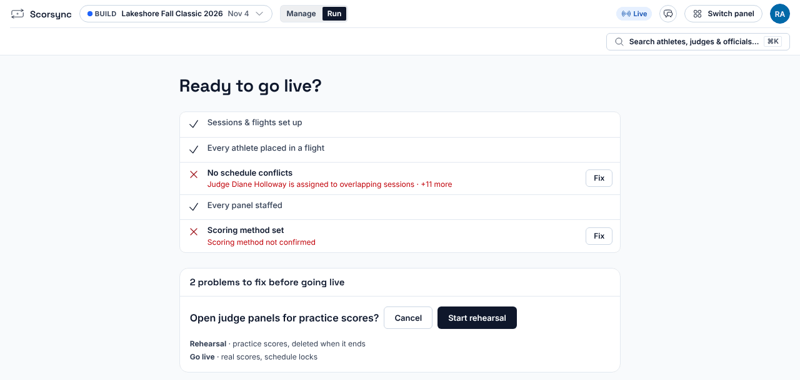
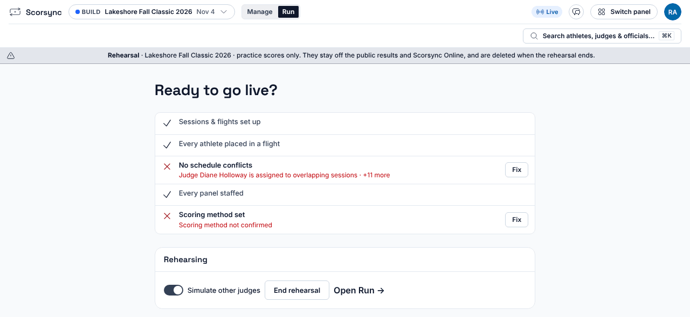
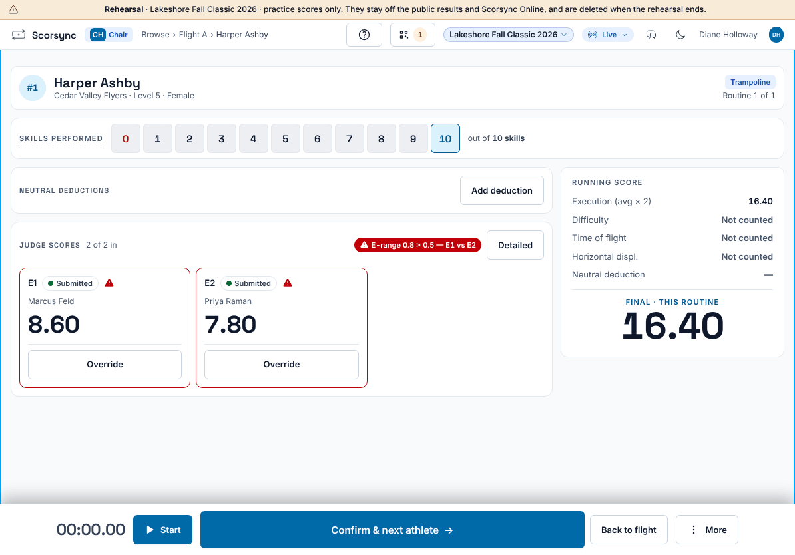
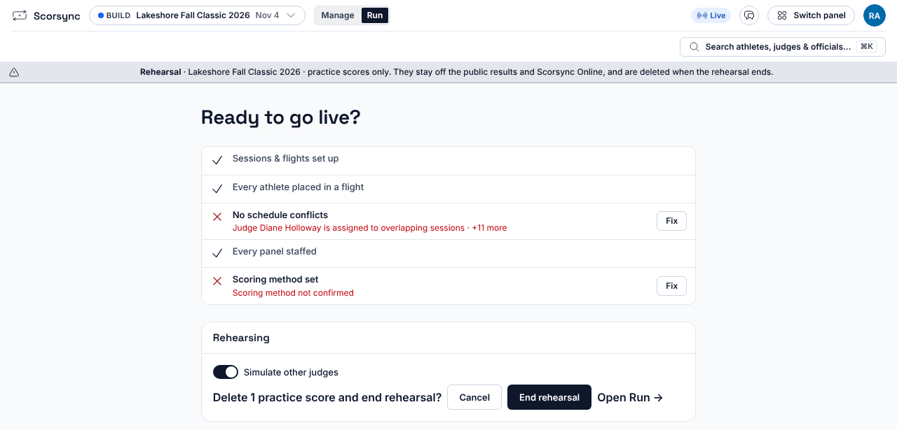

**Who it's for:** Host (meet director) · Scorsync Cloud and Scorsync Desktop

Do this a few days before the meet, so you, the chair and a judge know the screens before anything counts.

## Before you start

- The meet is built in Meet Builder and judges are seated. It doesn't need to be ready to go live.
- The meet hasn't gone live and has no scores.
- A chair and at least one judge can sign in on tablets. See [Get judges signed in and scoring](/scoring-table/get-judges-signed-in/).

## Start the rehearsal

<Steps>

1. Select **Run** at the top, then **Ready to go live?** in the blue bar.

2. Select **Start rehearsal**.

3. When it asks "Open judge panels for practice scores?", select **Start rehearsal** again.

   

4. To have Scorsync play the judges who aren't there, turn on **Simulate other judges**.

   

5. Check that the **Rehearsal** bar shows at the top of every screen, tablets included.

</Steps>

## Score a few athletes

<Steps>

1. The chair selects **Open Flight**, then **P1 Score** next to the first athlete, just like on meet day.

2. A judge enters their marks and selects **Submit Score**.

3. With **Simulate other judges** on, the empty seats fill in on the chair's tablet a few seconds later.

   

4. The chair selects **Confirm & next athlete**. Carry on for as long as you need.

</Steps>

:::note
Practice scores never appear on the venue results screen or on scorsync.com. Now and then one simulated score is set well apart from the others, so the chair sees the [out-of-range flag](/judges/chair/out-of-range-flag/) before meet day.
:::

## End the rehearsal

<Steps>

1. Open **Ready to go live?** again. From Run, select **End rehearsal →** in the blue bar.

2. Select **End rehearsal**.

3. Check the number in "Delete … practice scores and end rehearsal?", then select **End rehearsal**.

   

4. Check that you see "Rehearsal ended", and the **Start rehearsal** and **Go live** buttons are back.

</Steps>

:::caution
End rehearsal deletes every practice score, and you can't get them back. Your setup, the judge seats and the signed-in tablets stay as they are.
:::

## If something goes wrong

- **There's no Start rehearsal button.** The meet is live, or it already has scores. If it's live and nobody has scored yet, [return it to Build](/host/before-meet-day/go-live/#go-back-to-build) first. Otherwise, contact Scorsync support (support@scorsync.com).
- **No simulated scores arrive.** Check that **Simulate other judges** is on. Scorsync fills a seat only after a real judge on the same panel submits, and only seats that have a judge assigned.
- **There's no Go live button.** You're still rehearsing. End the rehearsal first.
- **"Setup changes not sent to Online. Run Check against Online."** You changed the setup during the rehearsal, on a meet that already publishes to scorsync.com. In Run, select the sync chip at the bottom right, then **Check against Online**.

## Related

- [Lock the schedule](/host/before-meet-day/lock-the-schedule/)
- [Get judges signed in and scoring](/scoring-table/get-judges-signed-in/)
- [Go live](/host/before-meet-day/go-live/)
