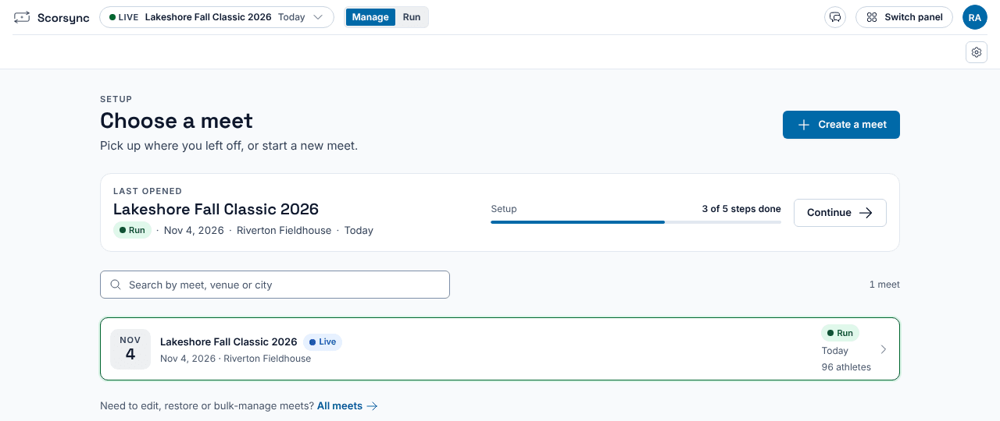
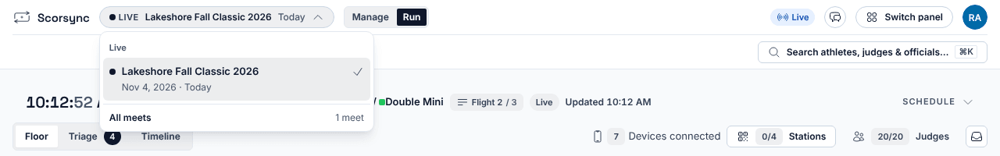

**Who it's for:** Host (meet director) · Scorsync Cloud and Scorsync Desktop

Start here if you're running a meet in Scorsync for the first time. These pages start once your meet is built in Meet Builder.

## Sign in and pick your meet

<Steps>

1. Sign in with your own email and password: at scoring.scorsync.com on Scorsync Cloud, or in the Scorsync window on Scorsync Desktop.

2. If Scorsync shows **Choose a meet**, select your meet.

   

3. Check the meet name at the top left. To change meets later, select it and pick another from the list.

   

</Steps>

## The three stages

Every meet goes through the same three stages. The **Manage** and **Run** switch at the top takes you between the first two.

| Stage | What you do | Where |
| -- | -- | -- |
| Build | Rehearse, lock the schedule, print, connect to scorsync.com | **Manage** (Meet Builder) |
| Run | Go live, sign judges in, watch the floor, handle changes | **Run** |
| Finalize | Check every division is official | **Finalize**, at the bottom of Run |

[Go live](/host/before-meet-day/go-live/) moves the meet from Build to Run. You can go back to Build only until the first score comes in.

## Your path

1. **Not sure which setup you have?** See [Which setup do I have?](/start-here/which-setup/). On Scorsync Desktop, set up the laptop first: [Getting started with Scorsync Desktop](/offline-host/).
2. **The week before:** work through [Before meet day](/host/before-meet-day/): rehearse, print, lock, and connect to scorsync.com.
3. **Morning of:** [get judges signed in](/scoring-table/get-judges-signed-in/), then [go live](/host/before-meet-day/go-live/).
4. **During the meet:** watch the floor from Run (see [Getting started at the scoring table](/scoring-table/)), and handle scratches and late entries from [Meet-day changes](/host/meet-day-changes/).
5. **End of day:** [mark divisions official](/scoring-table/mark-divisions-official/) in Finalize.

:::tip
Want it all on one sheet? Print the meet-day runbook for [Scorsync Cloud](/runbook/scorsync-cloud/) or [Scorsync Desktop](/runbook/scorsync-desktop/) and tick it off.
:::

## If something goes wrong

- **"That email and password or PIN do not match."** Check your email and password, and type them again. Lost your password? On Scorsync Cloud, select **Forgot password?**. On Scorsync Desktop, contact Scorsync support (support@scorsync.com).
- **Your meet isn't in the list.** If it has finished, select **Past**. Otherwise your account isn't an admin of the organization that holds the meet: sign in with the account that created it, or ask that person to add you.

## Related

- [Before meet day](/host/before-meet-day/)
- [Meet-day runbook: Scorsync Cloud](/runbook/scorsync-cloud/)
- [What families see on scorsync.com](/start-here/what-families-see/)
