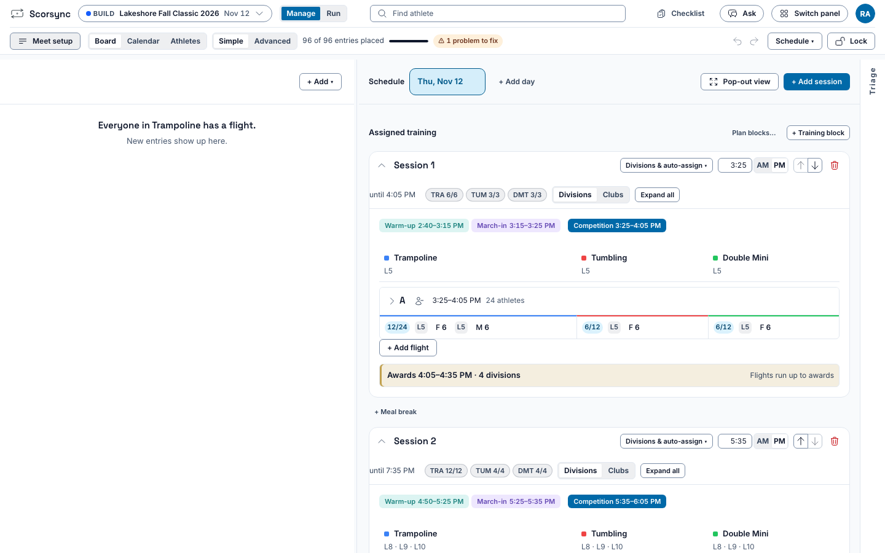
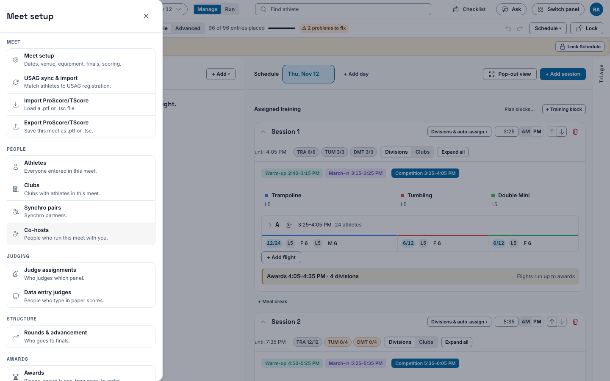
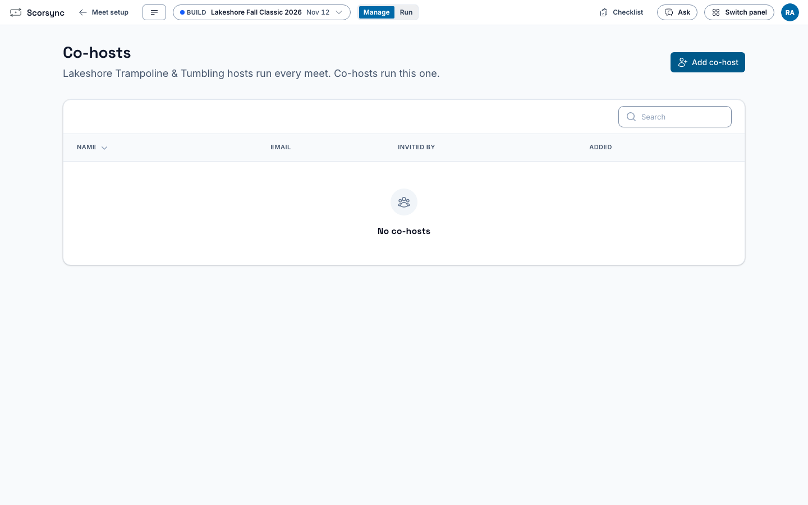
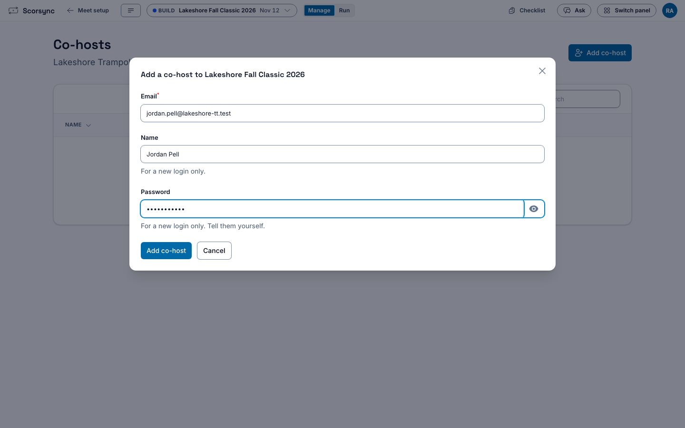
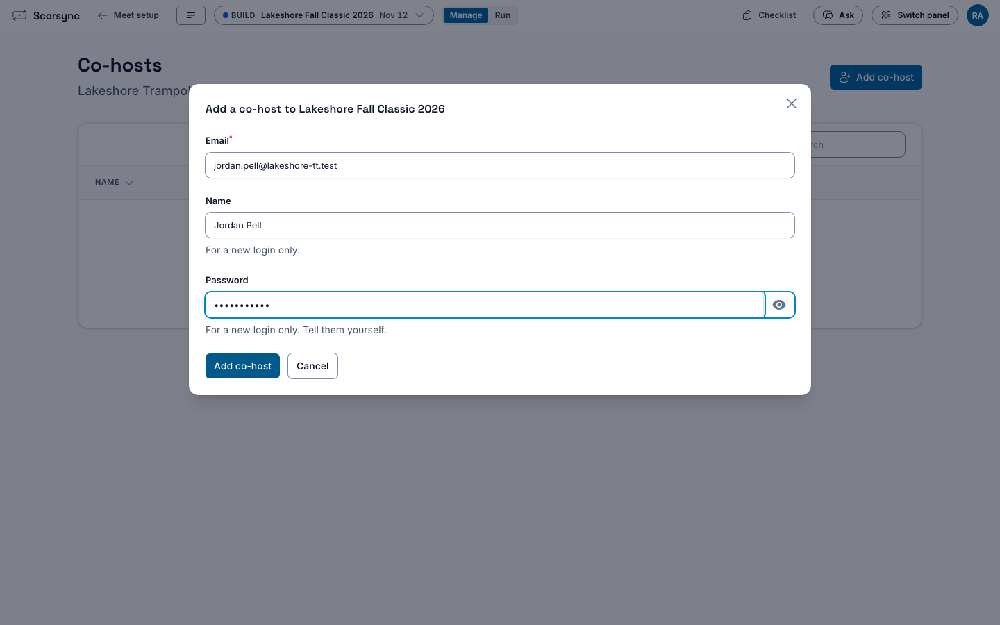
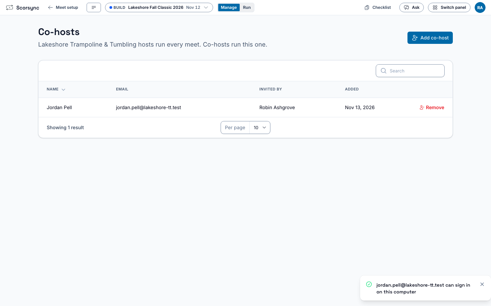

**Who it's for:** Host (meet director) · Scorsync Cloud and Scorsync Desktop

Start here if you're running a meet in Scorsync for the first time.

## Sign in and pick your meet

<Steps>

1. Sign in. On Scorsync Cloud, go to app.scorsync.com and sign in with your own email and password. On Scorsync Desktop, in the Scorsync window on the laptop, select **Continue as** followed by your name. No password is needed there.

2. If Scorsync shows **Choose a meet**, select your meet.

   

3. Check the meet name at the top left. To change meets later, select it and pick another from the list.

   

</Steps>

## The three stages

Every meet goes through the same three stages. The **Manage** and **Run** switch at the top takes you between the first two.

| Stage | What you do | Where |
| -- | -- | -- |
| Build | Build the meet, rehearse, lock the schedule, print, connect to scorsync.com | **Manage** (Meet Builder) |
| Run | Go live, sign judges in, watch the floor, handle changes | **Run** |
| Finalize | Check every division is official | **Finalize**, at the bottom of Run |

[Go live](/host/before-meet-day/go-live/) moves the meet from Build to Run. You can go back to Build only until the first score comes in.

## Your path

1. **Not sure which setup you have?** See [Which setup do I have?](/start-here/which-setup/). On Scorsync Desktop, set up the laptop first: [Getting started with Scorsync Desktop](/offline-host/).
2. **Build the meet:** [Build your meet in Meet Builder](/host/before-meet-day/build-your-meet/).
3. **The week before:** work through [Before meet day](/host/before-meet-day/): rehearse, print, lock, and connect to scorsync.com.
4. **Morning of:** [get judges signed in](/scoring-table/get-judges-signed-in/), then [go live](/host/before-meet-day/go-live/).
5. **During the meet:** watch the floor from Run (see [Getting started at the scoring table](/scoring-table/)), and handle scratches and late entries from [Meet-day changes](/host/meet-day-changes/).
6. **End of day:** [mark divisions official](/scoring-table/mark-divisions-official/) in Finalize.

:::tip
Want it all on one sheet? Print the meet-day runbook for [Scorsync Cloud](/runbook/scorsync-cloud/) or [Scorsync Desktop](/runbook/scorsync-desktop/) and tick it off.
:::

## Run a meet with a co-host

A co-host builds and runs this one meet with you, without seeing your organization's other meets. A co-host can't delete or reset the meet, add other co-hosts or create meets.

<Steps>

1. Select **Manage** at the top, then **Meet setup** (⚙) at the left of the row under the top bar.

   

2. In the list on the left, under **People**, select **Co-hosts**.

   

3. Select **Invite co-host** on Scorsync Cloud, or **Add co-host** on Scorsync Desktop.

   

4. Fill in their **Email** and **Name**. On Scorsync Desktop, also choose a **Password** for them, at least 8 characters.

   

5. Select **Send invite** on Scorsync Cloud, or **Add co-host** on Scorsync Desktop.

   

6. Check that they're in the list. On Scorsync Cloud, they get an email with a link to set their password. On Scorsync Desktop, nothing is emailed: tell them the password yourself.

   

</Steps>

If the email already has a Scorsync login, they keep their own password. To take a co-host off the meet, select **Remove** on their row.

## If something goes wrong

- **"That email and password or PIN do not match."** Check your email and password, and type them again. Lost your password? On Scorsync Cloud, select **Forgot password?**. On Scorsync Desktop, sign in from the Scorsync window on the laptop instead: select **Continue as** and your name.
- **Your meet isn't in the list.** If it has finished, select **Past**. Otherwise your account doesn't host that meet: sign in with the account that created it, or ask that person to add you as a co-host (see [Run a meet with a co-host](#run-a-meet-with-a-co-host)).

## Related

- [Build your meet in Meet Builder](/host/before-meet-day/build-your-meet/)
- [Before meet day](/host/before-meet-day/)
- [Meet-day runbook: Scorsync Cloud](/runbook/scorsync-cloud/)
- [What families see on scorsync.com](/start-here/what-families-see/)
