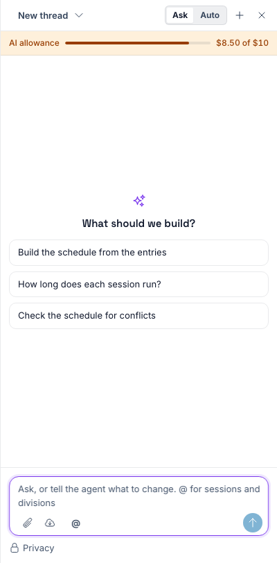

**Who it's for:** Host (meet director) and co-hosts · Scorsync Cloud only

:::review
Money and limits. Not yet signed off. Numbers are from the app code (`config/ai_pricing.php`) on Nov 26, 2026.
:::

## The meet's AI allowance

Each request to the agent uses a small part of the meet's AI allowance.

| Meet | Allowance |
| --- | --- |
| 1,000 entries or fewer | $10 |
| More than 1,000 entries | $20 |

- The allowance is for the meet, not for each person or month. Everyone who uses the agent on the meet shares it.
- From 80%, a bar shows at the top of the panel, for example **$8.50 of $10**.

  

- When it is used up, the panel shows **This meet used its AI allowance.** Select **Ask the Scorsync team for more** (if Messages is on for you), or send a message from **Messages**. The Scorsync team can raise it.

As a guide: on a test meet of 100 entries, building the whole schedule and about 15 more requests used about $1.

## Limits on one request

| Limit | What you see | What to do |
| --- | --- | --- |
| 25 steps (10 for simple requests) | "I reached the step limit for one request. Send a message to continue." | Send "Continue", or ask for a smaller part |
| Cost of one request | "This request reached its cost limit. Send a smaller request." | Split the job into smaller requests |

A step is one turn of the agent's work. It can read several things in one step.

## Limits on files and threads

- Files: 5 MB, 2,000 rows, 100 PDF pages.
- 20 files in one thread.
- A message: 4,000 characters.

## Related

- [Troubleshooting the agent](/host/meet-builder-agent/troubleshooting/)
- [Attach a file](/host/meet-builder-agent/attach-a-file/)
