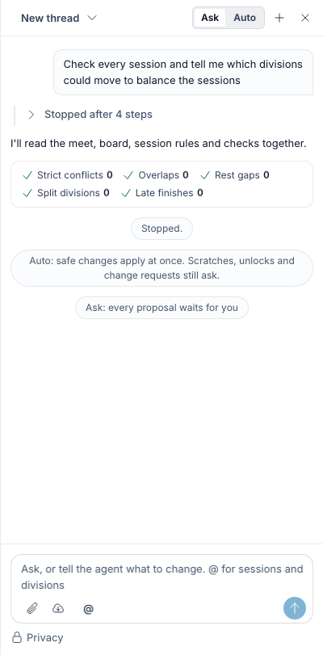

**Who it's for:** Host (meet director) and co-hosts · Scorsync Cloud only

The **Ask** / **Auto** switch is at the top of the agent panel. **Ask** is the default.

| | Ask (default) | Auto |
| --- | --- | --- |
| Proposals | Every proposal waits for you | Safe changes apply at once |
| Big jobs | The agent shows a plan and waits for **Go** | The agent starts at once |
| Trade-offs (for example, rest gaps against a later finish) | The agent asks you | The agent takes the recommended option and tells you which |
| Scratches, unlocks, change requests, new athletes | Ask | Still ask |

## Change the mode

<Steps>

1. Select **Ask** or **Auto** at the top of the panel.

2. Read the note in the thread:

   - "Auto: safe changes apply at once. Scratches, unlocks and change requests still ask."
   - "Ask: every proposal waits for you"

   

</Steps>

The mode belongs to the thread. A new thread starts in the mode you used last on this page. After you reload the page, a new thread starts in Ask.

## What always asks, in both modes

- Scratching an athlete. You can undo it.
- Unlocking the schedule. You can undo it.
- Accepting a club change request. You **can't** undo it.
- Adding new athletes. You **can't** undo it.

A change that has a warning to confirm also waits for you. In Auto mode the card says why, for example "Scratches always ask".

See [Changes that can't be undone](/host/meet-builder-agent/changes-that-cant-be-undone/).

:::tip
Start in Ask mode. Use Auto when you trust the agent with small, clear edits, such as "Place the unplaced entries".
:::

## Related

- [Review, apply and undo a proposal](/host/meet-builder-agent/review-apply-undo/)
- [The agent panel](/host/meet-builder-agent/the-agent-panel/)
