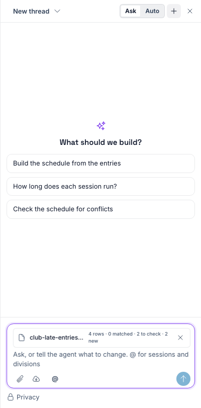

**Who it's for:** Host (meet director) and co-hosts · Scorsync Cloud only

## Before you start

- The file has one row per athlete.
- Each row has a USA Gymnastics number, or a first name, last name, gender and birth date. A name alone never matches.
- The file is one of: XLSX, CSV, PDF with text (not a scan), Markdown, TXT, .ptf or .tsc.
- It is 5 MB or less, with 2,000 rows or fewer. A PDF has 100 pages or fewer.

## Attach the file

<Steps>

1. Select the paper clip under the message box.

2. Pick the file. The chip shows **Reading…**, then the row counts.

   

3. Type what you want, for example "Make the changes in this file." Then send it.

4. Review each proposal card, then apply it. See [Review, apply and undo a proposal](/host/meet-builder-agent/review-apply-undo/).

</Steps>

## What the counts mean

| Count | Meaning | What the agent does |
| --- | --- | --- |
| **matched** | The row fits exactly one athlete in the meet | Proposes the change (placement, scratch, level change) |
| **to check** | The row fits more than one athlete, or disagrees with one | Lists the row for you. It changes nothing |
| **new** | No athlete in the meet fits | Can propose **Add new athletes**. That can't be undone |

A new athlete's club must already be in the meet. The agent doesn't add synchro pairs from a file.

## What happens to the file

- Scorsync reads the file on its own server once. It doesn't keep the file.
- It keeps the rows it read, encrypted, with the thread. They are deleted with the thread.
- The AI gets row numbers, match results and levels. It doesn't get the names, birth dates or USA Gymnastics numbers in the file. See [Privacy and data](/host/meet-builder-agent/privacy-and-data/).

## USA Gymnastics reservations

If your meet has a USA Gymnastics sanction, select the cloud button (**Read the USAG reservations**). The agent reads the reservation list the same way as a file.

## If something goes wrong

- **"Attach an XLSX, CSV, PDF, Markdown, TXT, .ptf or .tsc file."** Save the file as XLSX or CSV and attach it again.
- **"That PDF has no text to read (it looks scanned). Attach the list as XLSX, CSV or a text PDF."** or **"That PDF's table could not be read reliably. Attach the list as XLSX or CSV."** Ask the club for an XLSX or CSV.
- **"That file has no name or USAG number column, so its rows can't be matched to athletes."** Add column headings, such as First, Last, Sex, DOB.
- **"That file has more than 2000 rows. Split it and attach the parts."** Split the file.
- **"This thread already holds 20 files. Start a new thread to attach more."** Select **+** for a new thread.
- **The file is bigger than 5 MB.** You see an error under the box. Remove extra sheets or columns, and attach it again.

## Related

- [Import a club's late entries from a spreadsheet](/host/meet-builder-agent/guides/late-entries-from-a-file/)
- [Changes that can't be undone](/host/meet-builder-agent/changes-that-cant-be-undone/)
