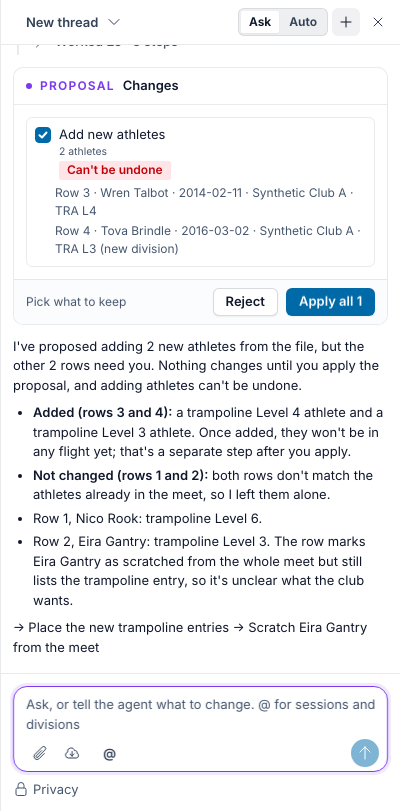
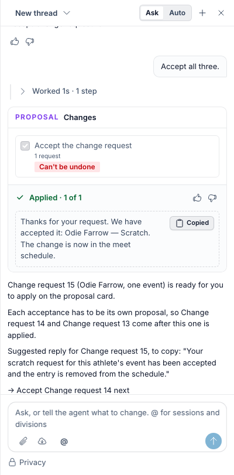

**Who it's for:** Host (meet director) and co-hosts · Scorsync Cloud only

Two agent changes can't be undone:

| Change | Why |
| --- | --- |
| **Accept the change request** | The club's request is closed, and the result can already be on scorsync.com |
| **Add new athletes** | The athlete can already be on scorsync.com |

For these two, the agent always:

- asks, also in Auto mode
- puts the change on its own card, never with other changes
- marks it **Can't be undone** in red

## Before you apply

- Read every line. For new athletes, check the name, birth date, club and level on each row.
- If the change needs a new flight or other schedule work, the agent proposes that first, on a separate card. Apply it before you accept.
- After you accept a request, the Meet Builder undo steps that touch it are cleared for everyone on the meet.

## After you accept a change request

The card shows a reply for the club, with a **Copy** button. The agent sends nothing. Paste the reply where you talk to the club.

If the agent writes a different reply in its answer, use the one on the card.

## Fix a mistake

- **Wrong athlete added:** scratch the athlete. See [Scratch an athlete](/host/meet-day-changes/scratch-an-athlete/).
- **Wrong request accepted:** make the opposite change by hand, or ask the agent (for example, "Unscratch …").

## Related

- [Handle a batch of coach change requests](/host/meet-builder-agent/guides/change-requests/)
- [Import a club's late entries from a spreadsheet](/host/meet-builder-agent/guides/late-entries-from-a-file/)
- [Review, apply and undo a proposal](/host/meet-builder-agent/review-apply-undo/)
