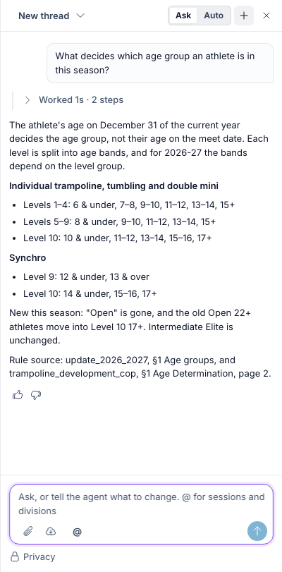

**Who it's for:** Host (meet director) and co-hosts · Scorsync Cloud only

The agent reads the USA Gymnastics T&T rulebook: the Codes of Points (2025–2029), Rules & Policies, and the 2026–27 changes. It reads the 2026–27 changes first. It never answers a rule from memory.

## Copy this

```text
What decides which age group an athlete is in this season?
```

## Steps

<Steps>

1. Send the question.

2. Read the answer, then the **Rule source** line at the end.

   

3. Check the source in your copy of the rulebook before you act on it.

</Steps>

:::rule[What the rulebook says]
The athlete's age on December 31 of the current year decides their age group.

**Source:** USA Gymnastics, *Development Program Code of Points: Trampoline* (2025–2029), Section 1, Rule 1 (Age Determination), page 2.
:::

:::review
Rules statement and the agent's answer. Not yet signed off.
:::

## More questions to try

```text
How many judges does a Level 8 trampoline panel need?
```

```text
How long is the warm-up for each flight?
```

```text
Is Open still a level this season?
```

On the test meet, the last one got: "No. From the 2026-27 season (August 2026), Open is retired." The first one got two different answers on two tries. Check its source line.

## Check the answer

- The agent can be wrong, or answer the same question in different words on different days. The **Rule source** line is the part to trust: open it and read the rule.
- If the rulebook doesn't say, the agent says so.
- If the answer is wrong, select the thumbs down (**Bad answer**).

## Related

- [Troubleshooting the agent](/host/meet-builder-agent/troubleshooting/)
