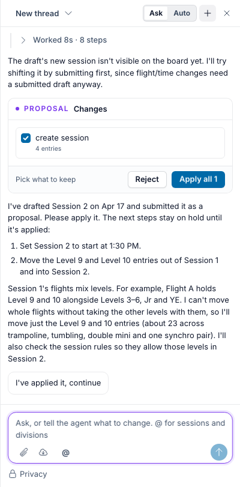
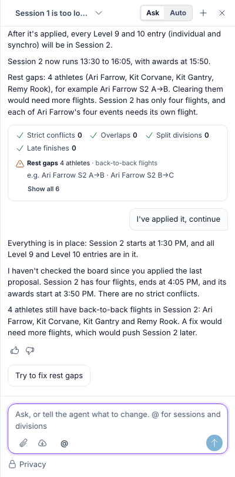

**Who it's for:** Host (meet director) and co-hosts · Scorsync Cloud only

The agent can add sessions on your existing days, move flights and entries between sessions, add flights, shift session times, set session rules, and add meal breaks, warm-ups and awards blocks.

It can't add a day, or change judges, panels or equipment. Change those in **Setup** first.

## Copy this

```text
Session 1 is too long. Add a Session 2 at 1:30 PM and move the Level 9 and Level 10 flights into it.
```

## Steps

<Steps>

1. Send the request. The agent reads the board and proposes the new session first.

   

2. Apply the card, then select **I've applied it, continue**.

3. Repeat for each card: the 1:30 PM start, the entry moves, and any extra flight.

4. Read the final report and the checks card.

   

</Steps>

## What happened on the test meet

- Session 1's flights mixed levels, so the agent moved only the Level 9 and 10 entries, not whole flights. It said so.
- One athlete was in all four events. The agent added a fourth flight to Session 2 for them, and said it ends Session 2 20 minutes later.
- Result: 5 cards, no strict conflicts, 4 rest gaps left.

## More requests to try

```text
How long does each session run?
```

```text
Add a 45-minute meal break after Session 1.
```

On the test meet, this gave one card. It said Session 2 moves 45 minutes later, from 13:30 to 14:15.

:::tip
Ask a question before a big change: "How long does each session run?" Then check the answer against the board. Session times are easier to read on the board.
:::

## Related

- [Check a move before you make it](/host/meet-builder-agent/guides/what-if-move/)
- [Find and fix rest-gap conflicts](/host/meet-builder-agent/guides/fix-rest-gaps/)
