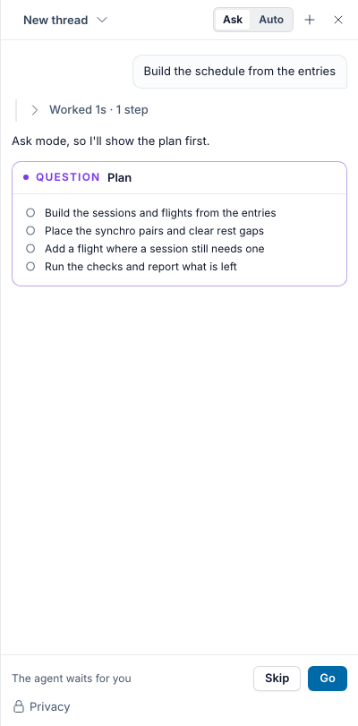
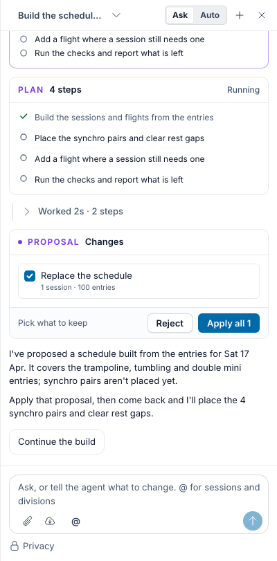
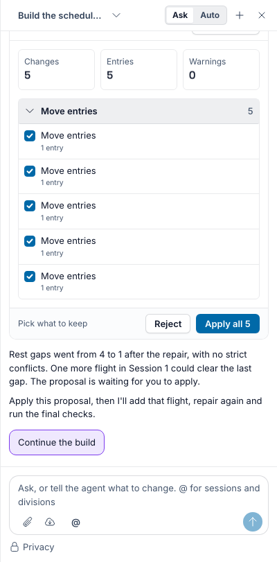
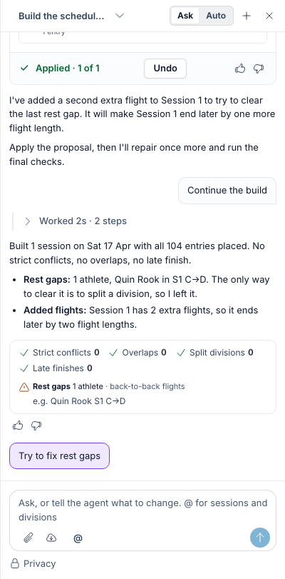

**Who it's for:** Host (meet director) and co-hosts · Scorsync Cloud only

## Before you start

- Your athletes and entries are in the meet.
- Meet days, hours, equipment and panels are set up. The agent uses them as they are. It can't add a day or equipment.
- The schedule isn't locked.

## Copy this

```text
Build the schedule from the entries
```

It is also the first suggestion in a new thread.

## Steps

<Steps>

1. In a new thread, in **Ask** mode, send the request.

2. Read the plan, then select **Go**.

   

3. Check the first card, **Replace the schedule**, then select **Apply all 1**. This builds every session and flight from the planner.

   

4. Select **Continue the build**. The agent places the synchro pairs and moves entries to clear rest gaps. Apply the card.

   

5. Repeat: select **Continue the build** and apply each card. The agent can add one or two flights where a session needs them.

6. Read the final report and the checks card.

   

</Steps>

## What happened on the test meet

| Card | Result |
| --- | --- |
| 1 | Replace the schedule: 1 session, 100 entries |
| 2 | 29 changes: 4 synchro pairs placed, rest gaps 17 → 4 |
| 3 | Add a flight to Session 1 |
| 4 | 5 moves: rest gaps 4 → 1 |
| 5–6 | One more flight and a final check |

Final report: "Built 1 session on Sat 17 Apr with all 104 entries placed. No strict conflicts, no overlaps, no late finish." One rest gap stayed, because clearing it would split a division. About 10 minutes, most of it reading and applying cards.

## Tips

- **Want it faster?** Use **Auto** mode. Safe cards apply at once, and the agent doesn't stop after each card.
- **Already have sessions?** The agent replaces them. Training blocks, days and equipment stay. Undo the first card to get your old schedule back.
- **Don't like a card?** Select **Reject** and say why: "Keep Levels 1–4 in the morning."

## Related

- [Find and fix rest-gap conflicts](/host/meet-builder-agent/guides/fix-rest-gaps/)
- [Review, apply and undo a proposal](/host/meet-builder-agent/review-apply-undo/)
- [Build your meet in Meet Builder](/host/before-meet-day/build-your-meet/)
