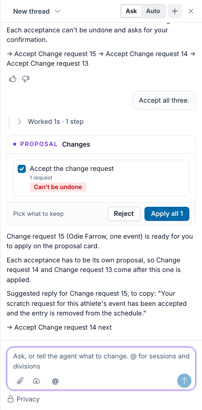
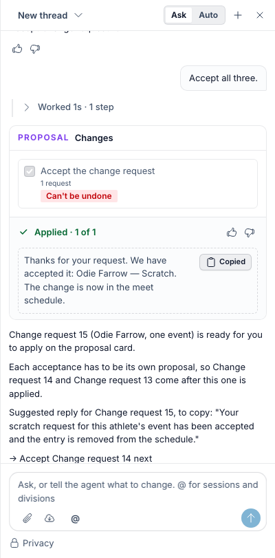

**Who it's for:** Host (meet director) and co-hosts · Scorsync Cloud only

## Before you start

- You have not gone live. After go live, use [Approve requests](/host/meet-day-changes/approve-requests/).
- The requests are in your Meet Builder **Inbox**.

## What the agent can accept

| Accepts | Refuses (do these by hand) |
| --- | --- |
| Scratch, unscratch | Synchro partner change |
| Flight move | Score, penalty or difficulty corrections |
| Late entry (athlete already in the meet) | Inquiries |
| Level change (before scores) | Administrative corrections |
| New athlete | |

The agent never reads the coach's note. It gets the type of request and the athlete.

## Copy this

```text
What change requests are waiting?
```

Then:

```text
Accept all three.
```

## Steps

<Steps>

1. Send the first request. The agent lists each waiting request: athlete and scope.

2. Tell it which to accept. Each acceptance comes alone on its own card, marked **Can't be undone**.

   

3. Select **Apply all 1**.

4. Select **Copy** on the reply, and paste it to the club. The agent sends nothing.

   

5. Ask for the next one ("Next one."), and repeat for each request.

</Steps>

On the test meet, three scratch requests took three cards and about two minutes. At the end the agent checked again and said no requests were waiting.

## Tips

- **A request that needs a new flight:** the agent proposes the flight first, on its own card. Apply it, then accept the request.
- **Want to say no?** Reject the request in the **Inbox**. The agent only accepts.
- **Accepting clears the Meet Builder undo history** of everyone on the meet.

## Related

- [Changes that can't be undone](/host/meet-builder-agent/changes-that-cant-be-undone/)
- [Approve requests](/host/meet-day-changes/approve-requests/)
