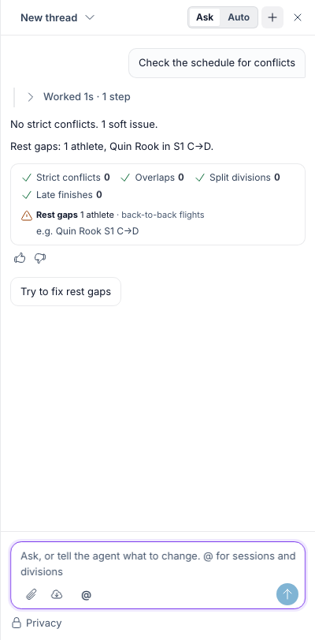
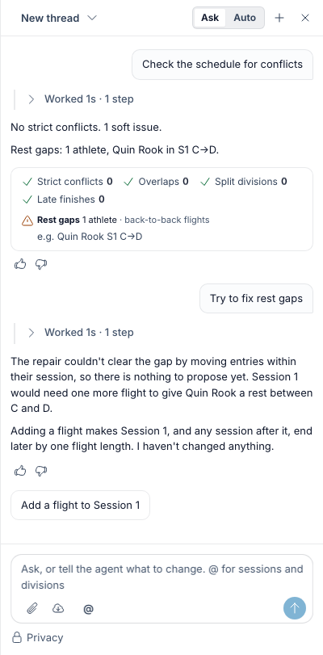
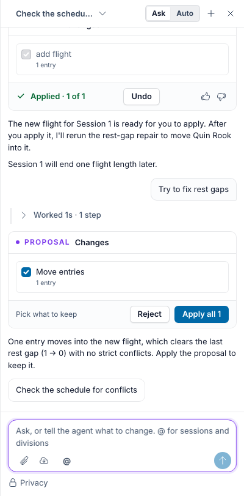

**Who it's for:** Host (meet director) and co-hosts · Scorsync Cloud only

A **rest gap** is an athlete with back-to-back flights. A **strict conflict** is an athlete in two places at once. The agent never adds a strict conflict.

## Copy this

```text
Check the schedule for conflicts
```

## Steps

<Steps>

1. Send the request. Read the verdict line and the checks card.

   

2. Select **Try to fix rest gaps**. The agent moves entries inside their session, and keeps each division in order.

3. If moves can't fix it, the agent says a session needs one more flight. Nothing changes yet. If you accept a later finish, select the button under the answer (on the test meet: "Add a flight to Session 1").

   

4. Apply the new flight. Then select **Try to fix rest gaps** again, and apply the moves.

   

5. Send `Check the schedule for conflicts` again to confirm.

</Steps>

## How the agent reads rest gaps

- **20 athletes or fewer:** it offers **Try to fix rest gaps**.
- **More than 20:** it says "likely intentional" and offers no fix. Ask for one if you want it.
- It never splits a division to clear a gap. If that is the only way, it leaves the athlete back-to-back and says so.
- Each added flight makes that session, and the sessions after it, end later. The agent says how much.

## More requests to try

```text
Try to fix the rest gaps in Session 2. You may add one flight.
```

On the test meet, this cleared 4 of 6 gaps and stopped at one flight, as asked: "Session 2 now ends at 16:25, 20 minutes later than before."

## Related

- [Build a whole schedule from your entries](/host/meet-builder-agent/guides/build-a-schedule/)
- [Check a move before you make it](/host/meet-builder-agent/guides/what-if-move/)
