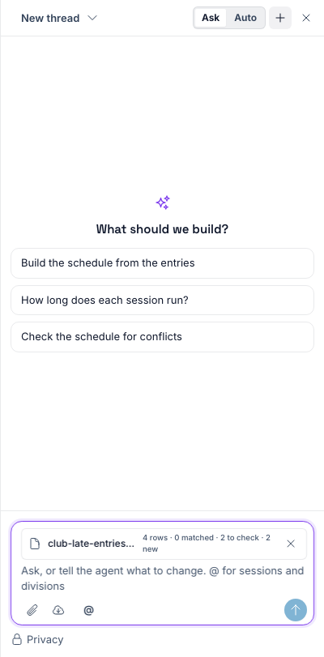
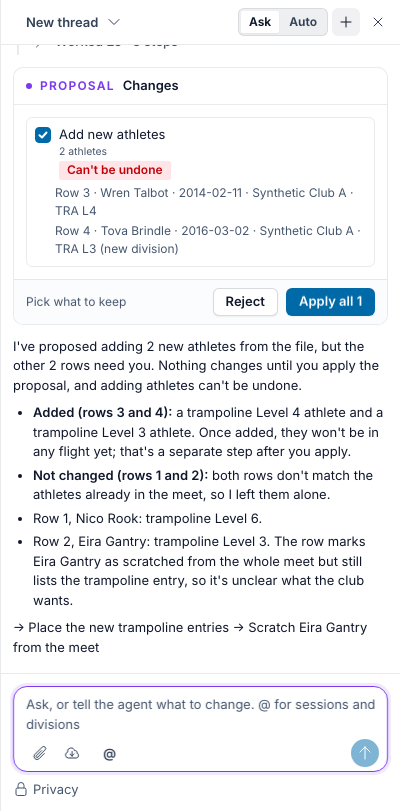
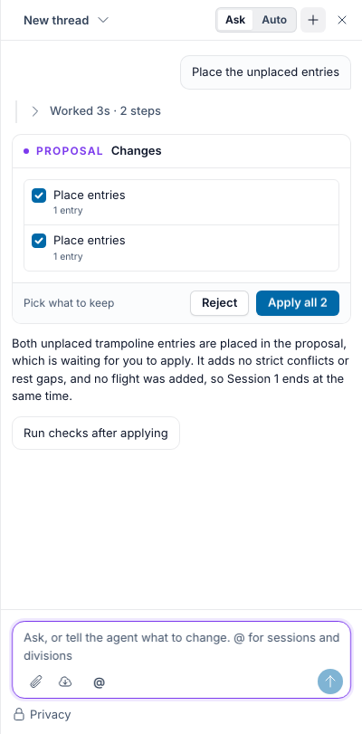

**Who it's for:** Host (meet director) and co-hosts · Scorsync Cloud only

## Before you start

- You have not gone live. After go live, use [Add a late entry](/host/meet-day-changes/add-a-late-entry/).
- The club is already in the meet.
- The file has first name, last name, gender, birth date, club and level (or USA Gymnastics numbers). See [Attach a file](/host/meet-builder-agent/attach-a-file/).

An example file:

```text
First,Last,Sex,DOB,Club,Trampoline,Status
Nico,Rook,M,2013-07-09,Synthetic Club D,Level 6,
Eira,Gantry,F,2015-05-20,Synthetic Club A,Level 3,Scratched
Wren,Talbot,F,2014-02-11,Synthetic Club A,Level 4,
Tova,Brindle,F,2016-03-02,Synthetic Club A,Level 3,
```

## Steps

<Steps>

1. Select the paper clip and pick the file. Read the counts on the chip.

   

2. Send:

   ```text
   Make the changes in this file. It is from our late-entry form.
   ```

3. Check each row on the **Add new athletes** card: name, birth date, club, level. This card can't be undone.

   

4. Select **Apply all 1**. The new athletes are in the meet, but not in a flight yet.

5. Send:

   ```text
   Place the unplaced entries
   ```

6. Apply the placement card.

   

</Steps>

## Rows the agent leaves for you

On the test meet, rows 1 and 2 were **to check**: they didn't match the athletes in the meet exactly. Row 2 also said "Scratched" but still listed an event. The agent changed nothing for them and listed them. Fix those by hand, or ask the club.

## Tips

- **Mixed files work.** The same file can hold scratches and level changes for matched athletes. The agent proposes those on separate cards, before the new athletes.
- **The file isn't stored.** Only the rows are kept with the thread. See [Privacy and data](/host/meet-builder-agent/privacy-and-data/).
- **Synchro pairs** in a file aren't added. Add them by hand.

## Related

- [Attach a file](/host/meet-builder-agent/attach-a-file/)
- [Changes that can't be undone](/host/meet-builder-agent/changes-that-cant-be-undone/)
