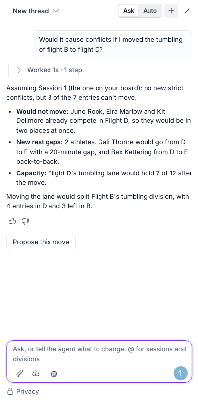
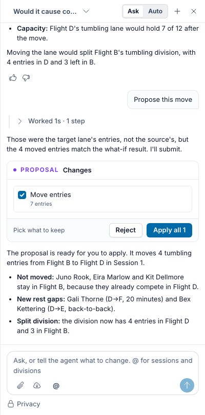

**Who it's for:** Host (meet director) and co-hosts · Scorsync Cloud only

## Copy this

```text
Would it cause conflicts if I moved the tumbling of flight B to flight D?
```

"The tumbling of flight B" means only flight B's tumbling lane, not the whole flight. Add the session if more than one has a flight B: "…in session 2".

## Steps

<Steps>

1. Send the question. The agent tries the move on a copy. Your board doesn't change.

2. Read the answer.

   

3. To make the move, select **Propose this move**. Check the card, then apply or reject it.

   

</Steps>

## What the answer tells you

The agent writes the answer, so the words change. It covers:

| Line | Meaning |
| --- | --- |
| Verdict | New strict conflicts, or none |
| Would not move | Entries that can't move, and why. For example, the athlete already competes in the target flight |
| New rest gaps | Athletes who would get back-to-back flights |
| **Capacity** | Entries in the target lane against its size, for example 7 of 12 |
| Split | If the move splits a division across flights |

On the test meet, the answer showed the move would split a division and add 2 rest gaps. That is a good reason to reject it.

## Limits

- The what-if tries moves of lanes and entries. It doesn't try a swap of two flights' times.
- If the thing you name is already where you want it, the agent says so. For example: "The Level 10 double mini is already in Session 2, so there is nothing to move."

## Related

- [Find and fix rest-gap conflicts](/host/meet-builder-agent/guides/fix-rest-gaps/)
- [Review, apply and undo a proposal](/host/meet-builder-agent/review-apply-undo/)
