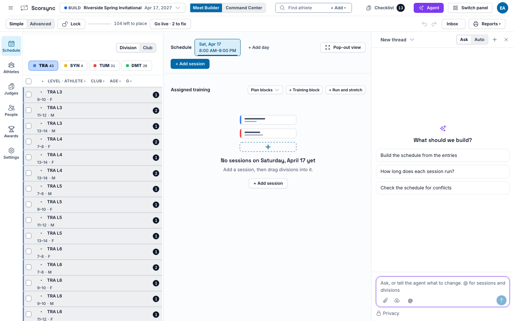

**Who it's for:** Host (meet director) and co-hosts · Scorsync Cloud only

The Meet Builder agent is an AI assistant in a panel beside the Meet Builder board. You type what you want in plain words. The agent reads your meet and answers, or it proposes a change. Nothing changes until you apply it.

## What it can do

| Job | Example request |
| --- | --- |
| Build a schedule from your entries | "Build the schedule from the entries" |
| Answer questions and run checks | "Check the schedule for conflicts" |
| Test a move before you make it | "Would it cause conflicts if I moved the tumbling of flight B to flight D?" |
| Make targeted edits | "Place the unplaced entries" · "Add a Session 2 at 1:30 PM" |
| Read a file a club sent you | Attach a CSV, then "Make the changes in this file" |
| Accept club change requests | "What change requests are waiting?" |
| Look up the T&T rulebook | "What decides which age group an athlete is in this season?" |

It can also scratch and unscratch athletes, change a level, add flights, move flights between sessions, change session times and session rules, and add warm-ups, awards blocks and meal breaks.

See the [guides](/host/meet-builder-agent/guides/) for real requests and what the agent did with them.

## What it never does

- It never deletes a meet, a day or an athlete.
- It never changes scores, results, rankings or award results.
- It never changes judges, equipment or meet settings.
- It never sends a message to a club or a coach. For an accepted change request, it gives you a reply to copy.
- It never works on a meet after you go live.

## Who gets it

- **Scorsync Cloud only** (app.scorsync.com). Scorsync Desktop shows a notice instead. Use the agent before you move the meet to the venue.
- **Scorsync turns it on for each organization.** It is off until then.
- **You need to be able to build the meet's schedule:** an owner or admin of the organization, or a co-host of the meet.
- **Before go live only.** After you go live, the agent stops. Use [Meet-day changes](/host/meet-day-changes/) instead.

## Turn it on

You can't turn the agent on yourself. Ask the Scorsync team: send a message from **Messages** in the app, or contact support from [Get help](/help/faq/). Tell them your organization's name.

When it is on, an **Agent** button shows at the top of Meet Builder, next to **Checklist**.

## Related

- [The agent panel](/host/meet-builder-agent/the-agent-panel/)
- [Ask mode and Auto mode](/host/meet-builder-agent/ask-and-auto/)
- [Review, apply and undo a proposal](/host/meet-builder-agent/review-apply-undo/)
- [Privacy and data](/host/meet-builder-agent/privacy-and-data/)
- [Build your meet in Meet Builder](/host/before-meet-day/build-your-meet/)
