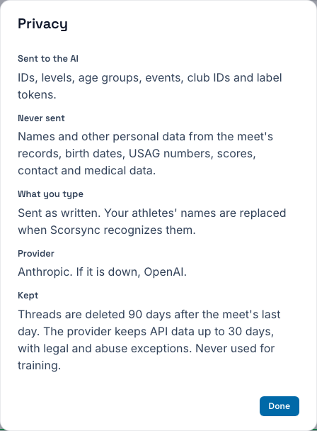

**Who it's for:** Host (meet director) and co-hosts · Scorsync Cloud only

:::review
Data privacy statement. Not yet signed off. Keep it in step with the app's Privacy dialog and [app.scorsync.com/privacy](https://app.scorsync.com/privacy).
:::

To see this in the app, select **Privacy** at the bottom of the agent panel.

## What the AI gets

- IDs instead of names: for example, an athlete is `ath_12` and a club is `club_3`. The panel shows you the names. The AI never sees them.
- Levels, age groups, events, sessions, flights and times.
- Session names, flight labels and notes, as IDs too.

## What it never gets

- Athletes' and clubs' names from the meet's records
- Birth dates
- USA Gymnastics numbers
- Scores
- Contact and medical details

Before each request leaves Scorsync, Scorsync checks it for the meet's athlete names, club names, birth dates and USA Gymnastics numbers. If it finds one, it stops the request.

## What you type

Your messages go as you type them. When Scorsync recognizes one of your athletes' names, it replaces the name with an ID first.

- Use **@** to pick an athlete. That is the safest way.
- If you type a birth date, Scorsync stops the message: "Your message names someone the agent may not see. Use @ to pick them."
- Don't type contact or medical details. Scorsync can't recognize all of them.

Club change requests: the agent gets the type of request and the athlete's ID. It never gets the coach's text.

## Who sees a thread

- Only the person who started it. Your co-hosts and other admins don't see your threads.
- The Scorsync team can see a replay of a thread's steps, with IDs, to fix problems and improve the agent.

## How long it is kept

| What | Deleted |
| --- | --- |
| Threads, file rows, proposals and the records of what was applied | 90 days after the meet's last day |
| The same, for a meet with no dates | 1 year after the meet was created |
| Files you attach | Never stored |
| Meet Builder undo history | After the meet's last day |

Changes you applied stay part of the meet.

## The AI provider

- **Anthropic** runs the agent. If Anthropic is down, **OpenAI** runs it.
- They keep requests for up to 30 days, longer only when the law requires it or to look into abuse.
- They don't use your data to train their models.

Full policy: [app.scorsync.com/privacy](https://app.scorsync.com/privacy).

## Related

- [Attach a file](/host/meet-builder-agent/attach-a-file/)
- [Meet Builder agent](/host/meet-builder-agent/)
