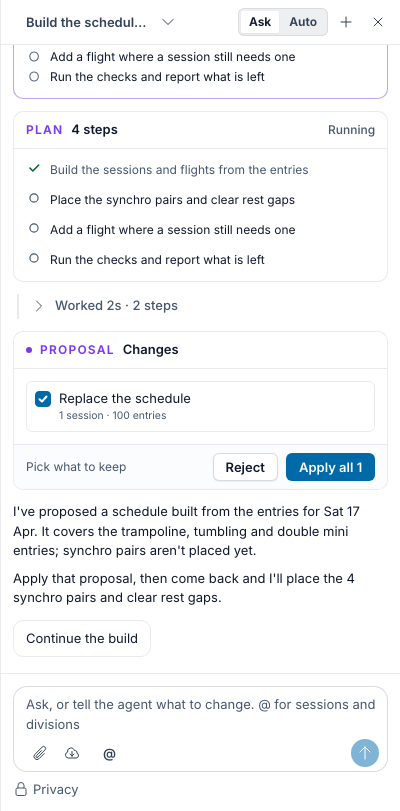
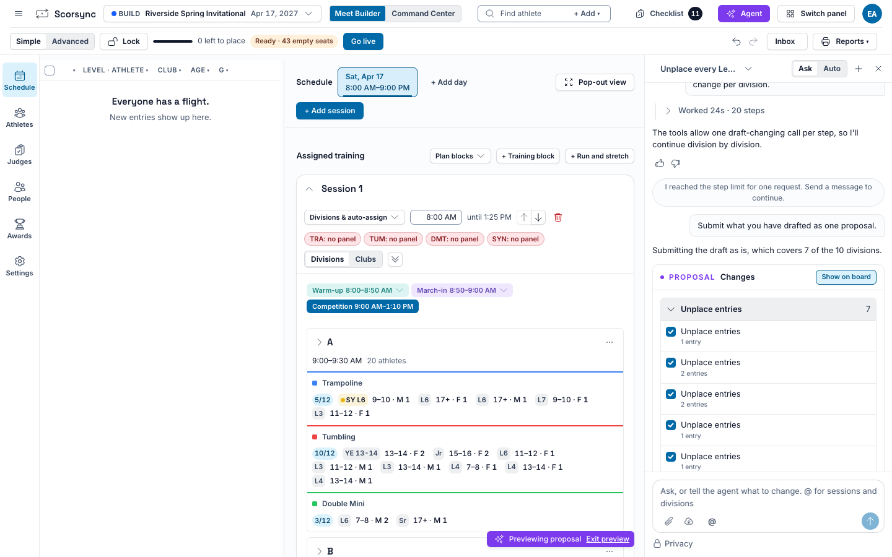
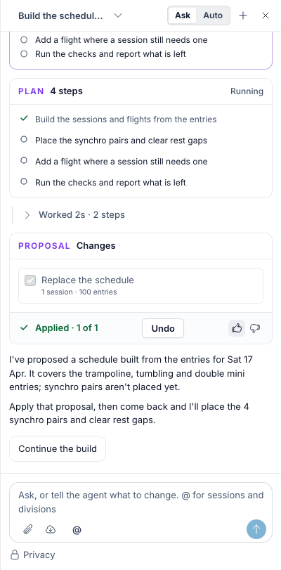
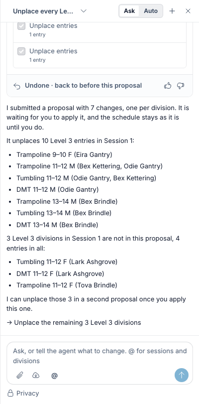
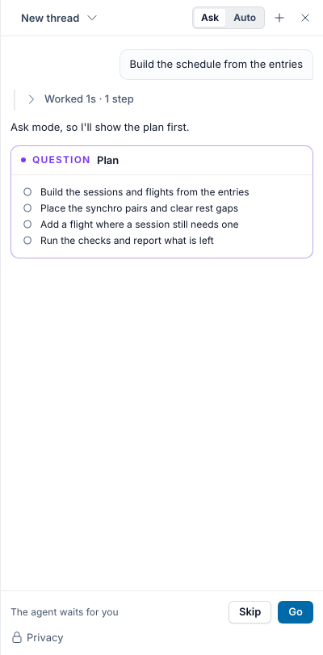

**Who it's for:** Host (meet director) and co-hosts · Scorsync Cloud only

Every change the agent makes comes as a **proposal** card. Nothing changes on the board until you apply it.

## Review and apply

<Steps>

1. Read the card. Each line is one change, with a checkbox.

   

2. Clear the checkbox of any change you don't want. The button changes to **Apply n of N**.

3. On a big card, select **Show on board** to see the result on the board first. A **Previewing proposal** bar shows at the bottom. Select **Exit preview** when you're done.

   

4. If a warning has a checkbox, read it and select it. You must confirm each one before you apply.

5. Select **Apply all N**, or **Reject** to keep the board as it is.

6. Check the card. It now reads **Applied · n of N**, or **Rejected · nothing changed**.

   

</Steps>

If someone changed the meet since the card was made, you see "This changed since the preview. Review the update." The card shows the new result. Check it and apply again.

## Undo a proposal

<Steps>

1. Select **Undo** on the card.

2. Check the card. It reads **Undone · back to before this proposal**.

   

</Steps>

- Undo on a card works only for your **latest** change. Undo newer changes first, with the Meet Builder undo arrows at the top.
- Agent changes are in your normal Meet Builder undo history. It keeps your last 50 steps for this meet, on any device.
- A change can't be undone after an athlete in it has a score, after its flight started, or after you go live.
- Accepting a change request and adding new athletes have no **Undo**. See [Changes that can't be undone](/host/meet-builder-agent/changes-that-cant-be-undone/).

## Plans and questions

For a big job in Ask mode, the agent shows a **Plan** first and waits.

Select **Go** to start, or **Skip** to stop. The agent may also ask a **Question**: pick an option, then select **Answer**.

## Rate an answer

Use the thumbs under an answer or a card. **Good answer** / **Bad answer** and **Good result** / **Bad result** go to the Scorsync team. They use them to make the agent better.

## If something goes wrong

- **"Only your latest change can be undone. Undo the newer ones first."** You or the agent made a change after this one. Undo that first.
- **"Schedule is locked. Unlock it to make changes."** [Unlock the schedule](/host/before-meet-day/lock-the-schedule/), or ask the agent to unlock it (it always asks).
- **"The meet has started, so the agent's change can't be undone or redone."** You went live. Change the athlete or flight by hand.

## Related

- [Ask mode and Auto mode](/host/meet-builder-agent/ask-and-auto/)
- [Changes that can't be undone](/host/meet-builder-agent/changes-that-cant-be-undone/)
