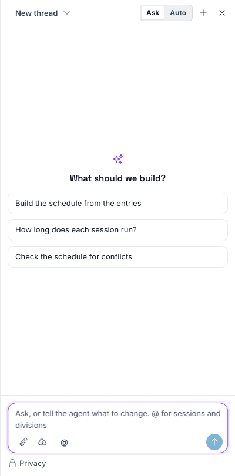
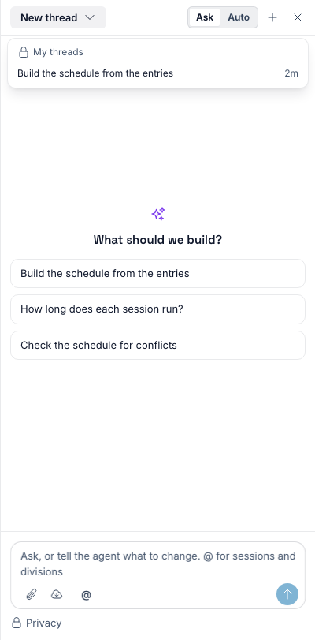

**Who it's for:** Host (meet director) and co-hosts · Scorsync Cloud only

## Before you start

- Scorsync turned the agent on for your organization. See [Turn it on](/host/meet-builder-agent/#turn-it-on).
- Your meet is open in Meet Builder, and you have not gone live.
- Your screen is wide enough. On a narrow window or a phone, the **Agent** button is hidden.

## Open the panel and send a request

<Steps>

1. In Meet Builder, select **Agent** at the top right.

2. Select a suggestion, or type your request in the box. Type `@` to pick a session, flight, division or athlete.

   

3. Press **Enter**, or select the arrow. (**Shift+Enter** starts a new line.)

4. Read the answer. The first line is the verdict. Buttons under the answer send a next request for you.

</Steps>

## What's in the panel

| Part | What it does |
| --- | --- |
| Thread title (**New thread** at first) | Opens **My threads**, your earlier threads for this meet |
| **Ask** / **Auto** | Sets if changes wait for you. See [Ask mode and Auto mode](/host/meet-builder-agent/ask-and-auto/) |
| **+** | Starts a new thread |
| **×** | Closes the panel (or press **Esc**) |
| Paper clip | Attaches a file. See [Attach a file](/host/meet-builder-agent/attach-a-file/) |
| Cloud | Reads your meet's USA Gymnastics reservations (the panel says "USAG") |
| **@** | Picks a session, flight, division or athlete |
| Arrow / **Stop** | Sends. While the agent works, it turns into a red **Stop** |
| **Privacy** | Shows what is sent to the AI and how long it is kept |
| Thumbs up / down | Tells the Scorsync team if an answer or a result was good or bad |

## Cards in a thread

- **Worked … · N steps.** What the agent read or did. Select it to see each step.
- **Plan.** The steps for a big job. In Ask mode, select **Go** to start or **Skip** to stop.
- **Question.** The agent needs a choice from you. The first option is marked **Recommended**. Select **Answer** or **Skip**.
- **Checks.** Counts of strict conflicts, overlaps, split divisions, late finishes and rest gaps, with examples.
- **Proposal.** A change for you to check. See [Review, apply and undo a proposal](/host/meet-builder-agent/review-apply-undo/).

## Find an earlier thread

<Steps>

1. Select the thread title at the top left of the panel.

2. Select a thread under **My threads**.

   

</Steps>

Only you see your threads. Your co-hosts have their own. Threads are deleted 90 days after the meet's last day.

## If something goes wrong

- **There's no Agent button.** The agent is off for your organization, you can't build this meet's schedule, or the window is too narrow. See [Troubleshooting](/host/meet-builder-agent/troubleshooting/).
- **"Wait for the agent to finish, or press Stop."** The agent is still working. Wait, or select **Stop**.

## Related

- [Meet Builder agent](/host/meet-builder-agent/)
- [Troubleshooting the agent](/host/meet-builder-agent/troubleshooting/)
