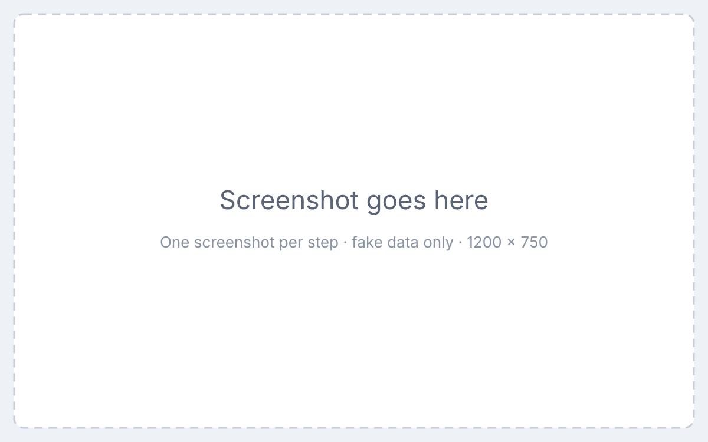
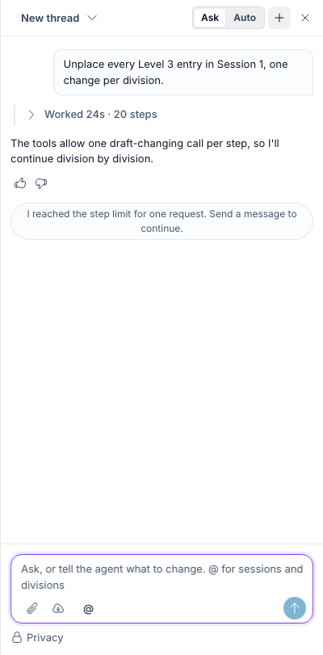
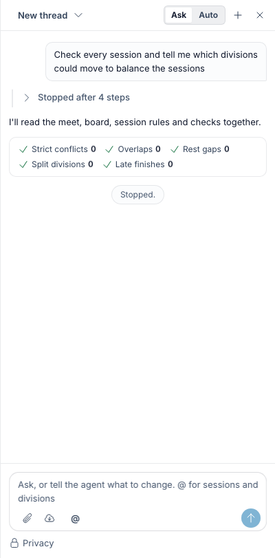

**Who it's for:** Host (meet director) and co-hosts · Scorsync Cloud only

## The agent isn't there

- **There's no Agent button.**
  - Scorsync hasn't turned it on for your organization. See [Turn it on](/host/meet-builder-agent/#turn-it-on).
  - You can't build this meet's schedule. Ask an owner or admin of the organization to make you a [co-host](/host/before-meet-day/invite-a-co-host/).
  - The window is too narrow. Make it wider, or use a laptop or tablet in landscape.
- **"Cloud only" and "Use the agent on app.scorsync.com before you move the meet to the venue."** You're on Scorsync Desktop. The agent works only on Scorsync Cloud. Build the schedule with the agent on app.scorsync.com, then move the meet to the venue.

  {/* SCREENSHOT PLACEHOLDER: the Cloud only notice on Scorsync Desktop. Retake from a venue install. */}
  

- **"The agent works only before the meet starts."** You went live. Use [Meet-day changes](/host/meet-day-changes/) instead.
- **"The agent is not on for this organization."** or **"The agent was turned off for this organization."** Ask the Scorsync team.
- **"The agent needs an internet connection".** Your device is offline. Everything else in Meet Builder still works. The panel shows **Back online** when the connection returns.

## The agent stopped

- **"I reached the step limit for one request. Send a message to continue."** The job was too big for one request. Send "Continue" or "Submit what you have drafted as one proposal".

  

- **Stopped after N steps / "Stopped."** You selected **Stop**. Changes you applied before the stop stay. Nothing else changed.

  

- **"This request stopped before it finished."** or **"Something went wrong. Try again."** Select **Retry**. It puts your message back in the box.
- **"This question expired. Ask again."** Send your request again.
- **"This meet has used its AI allowance."** See [AI allowance and limits](/host/meet-builder-agent/allowance-and-limits/).

## The agent says no

- **It says it can't do something.** Some jobs aren't in the agent: deleting a meet, day or athlete; scores and results; judges, equipment and meet settings; messages to clubs. Do them by hand.
- **"Your message names someone the agent may not see. Use @ to pick them."** Your message has a birth date or a name the agent may not see. Pick the athlete with **@**.
- **"Answer or skip the open question first."** A Question or Plan card is waiting. Select **Answer**, **Go** or **Skip**.
- **"The schedule is locked."** Unlock it, or ask the agent to propose the unlock. See [Lock the schedule](/host/before-meet-day/lock-the-schedule/).
- **It asks "which session?"** Flight letters repeat in each session. Name the session ("session 1 flight B"), or open that session on the board first.

## The answer is wrong

- **The agent can be wrong.** Check counts and rules before you act on them. Ask "Check the schedule for conflicts" after big changes.
- **For rules,** read the source line the agent gives and check it in the rulebook.
- **Tell us.** Select the thumbs down (**Bad answer** or **Bad result**). For more detail, send a message from **Messages** or contact support from [Get help](/help/faq/). Say the meet and what you asked.
- **Undo a bad change.** Select **Undo** on the card. See [Review, apply and undo a proposal](/host/meet-builder-agent/review-apply-undo/).

## Related

- [Meet Builder agent](/host/meet-builder-agent/)
- [Troubleshooting](/help/troubleshooting/) for the rest of Scorsync
