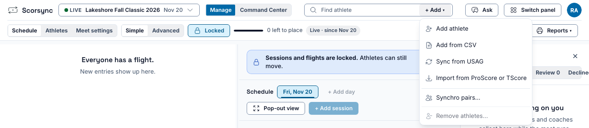
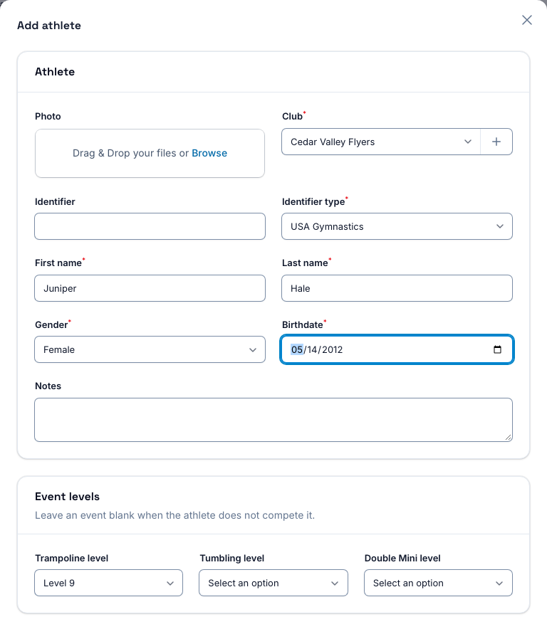
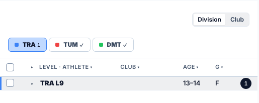
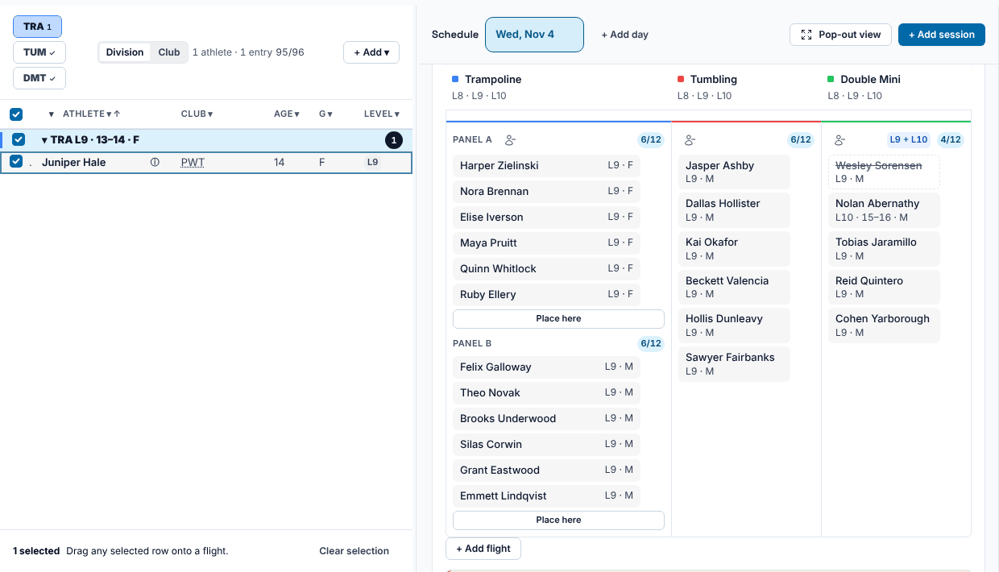
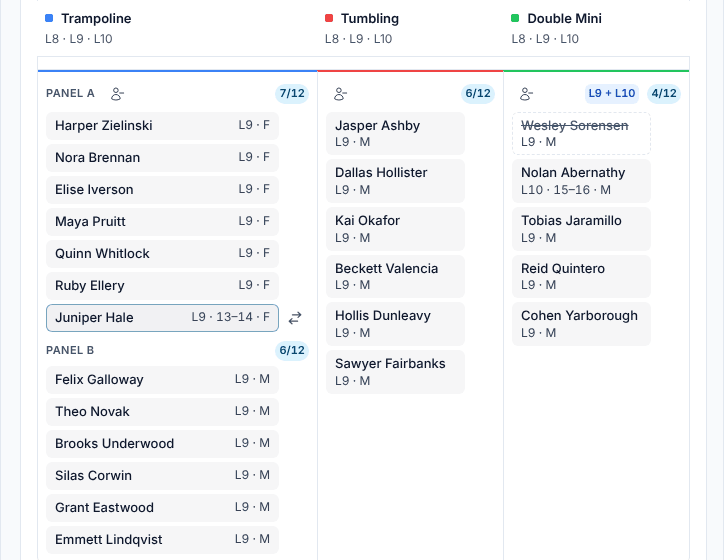

**Who it's for:** Host (meet director) · Scorsync Cloud and Scorsync Desktop

Use this when an athlete turns up who isn't entered in the meet. You don't need to unlock the schedule.

| How the athlete reaches you | What to do |
| -- | -- |
| Their coach added them on the coach roster tablet | Approve the request and pick the flight. See [Approve or reject requests](/host/meet-day-changes/approve-requests/#a-new-athlete-from-a-coach). |
| You're adding them yourself | Follow the steps below. |

## Before you start

- You're signed in to Meet Control as the host.
- You have the athlete's club, name, gender, birth date, and their level for each event.

## Add the athlete

<Steps>

1. In Meet Control, select **Manage** at the top to open Meet Builder.

2. In the **Find athlete** box at the top, select **+ Add ▾**, then **Add athlete**.

   

3. Fill in **Club**, **First name**, **Last name**, **Gender** and **Birthdate**. Their USAG number goes under **Identifier**.

4. Under **Event levels**, choose a level for each event they compete in. Leave the other events blank. Without a level, they don't reach the start list.

   

5. Select **Save athlete**. The athlete appears in the start list on the left, under their division.

   

</Steps>

## Place them in a flight

<Steps>

1. On the **Schedule** tab, tick the athlete in the start list. Each panel on the board now shows **Place here**.

   

2. Select **Place here** under the panel and flight they compete in.

3. Check that their name now shows at the bottom of that panel.

   

</Steps>

The schedule stays locked the whole time. The bar at the top reads "Sessions and flights are locked. Athletes can still move."

The athlete runs last on that panel. To run them somewhere else in the order, ask the chair: see [Reorder, mark DNS or reinstate an athlete](/judges/chair/reorder-dns-reinstate/).

**Billable add:** an athlete added by request after entries closed. The **Roster changes** page counts them per club.

## If something goes wrong

- **"… added. Give them an event level to put them on the start list."** You saved without a level. Open the **Athletes** tab and select their name, then **Edit**. Select **Add event** and choose the event, choose its **Level**, then select **Apply**.
- **There are no Place here buttons.** The athlete isn't ticked.
- **The club isn't in the Club list.** Select the **+** next to **Club** to add it.

## Related

- [Approve or reject requests](/host/meet-day-changes/approve-requests/)
- [Change an athlete's level or flight](/host/meet-day-changes/change-level-or-flight/)
- [Lock the schedule](/host/before-meet-day/lock-the-schedule/)
- [Scratch an athlete](/host/meet-day-changes/scratch-an-athlete/)
