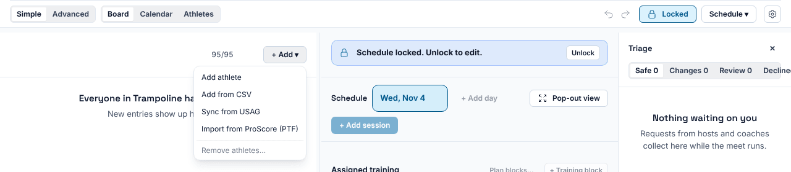
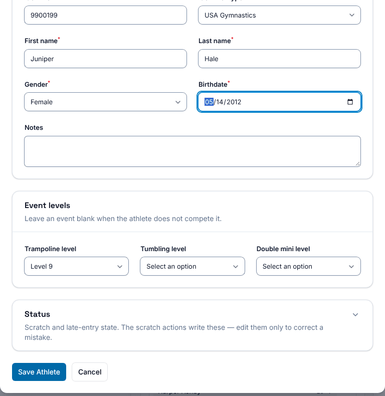
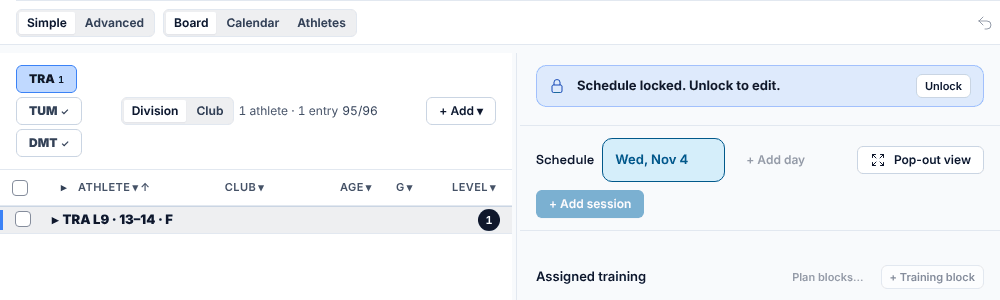
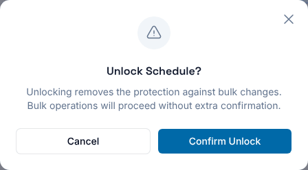
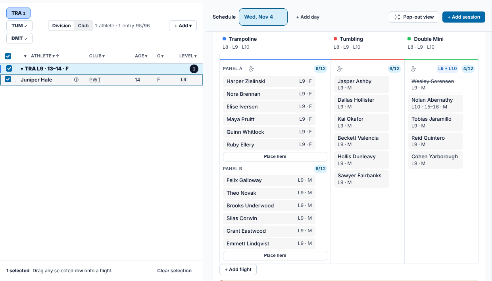
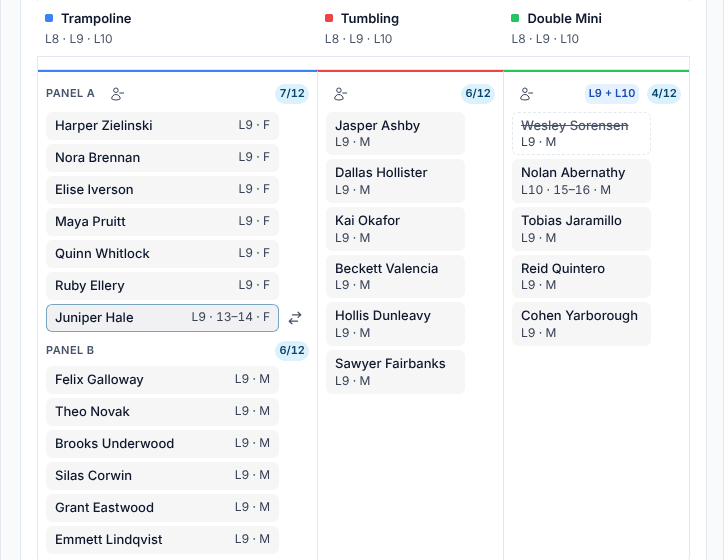

**Who it's for:** Host (meet director) · Scorsync Cloud and Scorsync Desktop

Use this when an athlete turns up who isn't entered in the meet.

| How the athlete reaches you | What to do |
| -- | -- |
| Their coach added them on the coach roster tablet | Approve the request and pick the flight. No unlock needed. See [Approve or reject requests](/host/meet-day-changes/approve-requests/#a-new-athlete-from-a-coach). |
| You're adding them yourself | Follow the steps below. Placing them means unlocking the schedule for a minute. |

## Before you start

- You're signed in to Meet Builder as the host.
- You have the athlete's club, name, gender, birth date, and their level for each event.

## Add the athlete

<Steps>

1. In Meet Control, select **Manage** at the top to open Meet Builder.

2. Select **+ Add**, then **Add athlete**.

   

3. Fill in **Club**, **First name**, **Last name**, **Gender** and **Birthdate**. Their USAG number goes under **Identifier**.

4. Under **Event levels**, choose a level for each event they compete in. Leave the other events blank. Without a level, they don't reach the start list.

   

5. Select **Save Athlete**. The athlete appears in the start list on the left, under their division.

   

</Steps>

## Place them in a flight

<Steps>

1. In the "Schedule locked. Unlock to edit." bar, select **Unlock**.

2. Select **Confirm Unlock**.

   

3. Tick the athlete in the start list. Each panel on the board now shows **Place here**.

   

4. Select **Place here** under the panel and flight they compete in.

5. Check that their name now shows at the bottom of that panel.

   

6. Select **Lock** at the top right, then **Confirm Lock**. Check that the button reads **Locked** again.

</Steps>

:::caution[Lock again straight away]
While the schedule is unlocked, bulk changes on the board go through without asking, and scorsync.com doesn't get schedule changes until you lock again. Place the athlete, then lock.
:::

The athlete runs last on that panel. To run them somewhere else in the order, ask the chair: see [Reorder, DNS and reinstate](/judges/chair/reorder-dns-reinstate/).

:::review[Needs Austin's review: late-entry fees]
The app labels an athlete added by request as a "billable add". Whether a late entry costs the host anything isn't settled, so this page says nothing about cost.
:::

## If something goes wrong

- **"… added. Give them an event level to put them on the start list."** You saved without a level, and Meet Builder can't add one afterwards. Unlock the schedule, then in Run press ⌘K, select the athlete, then **View full athlete card** → **Edit**. Choose the level under **Event levels** and select **Save changes**.
- **There are no Place here buttons.** The schedule is still locked, or the athlete isn't ticked.
- **The club isn't in the Club list.** Select the **+** next to **Club** to add it.
- **The lock window lists items under "Before go-live".** You can still lock: select **Confirm Lock**.

## Related

- [Approve or reject requests](/host/meet-day-changes/approve-requests/)
- [Change an athlete's level or flight](/host/meet-day-changes/change-level-or-flight/)
- [Lock the schedule](/host/before-meet-day/lock-the-schedule/)
- [Scratch an athlete](/host/meet-day-changes/scratch-an-athlete/)
