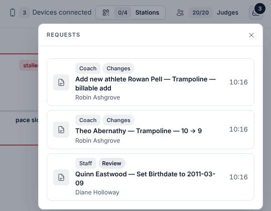
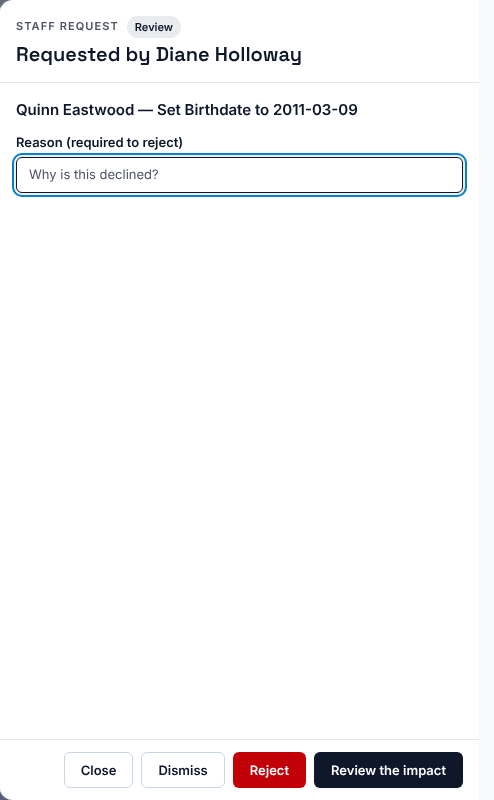
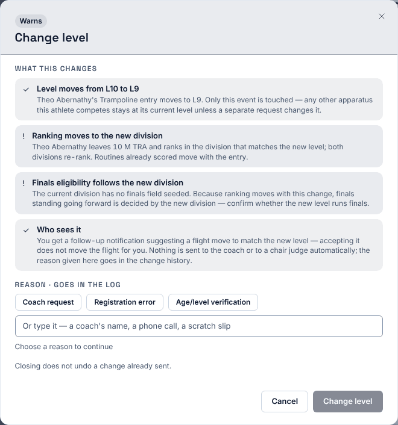
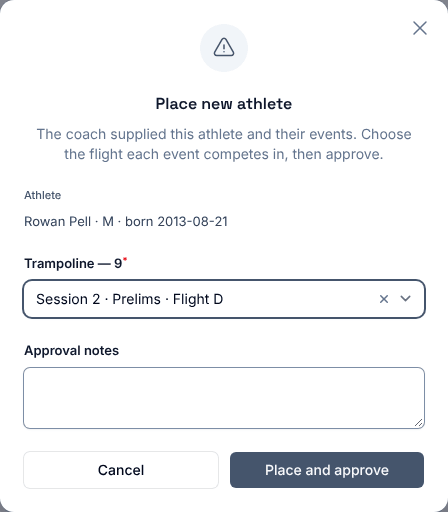
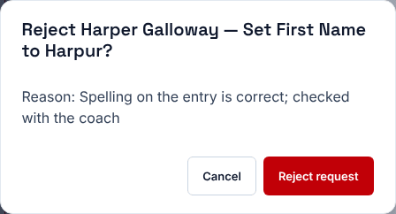
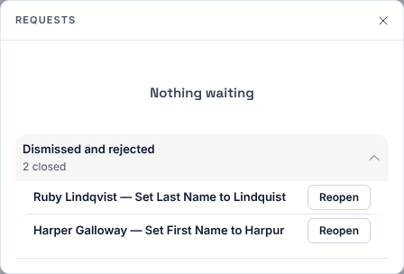

**Who it's for:** Host (meet director) · Scorsync Cloud and Scorsync Desktop

Use this when the inbox button in **Run** shows a number. Each request waits for you: nothing changes until you approve it.

| Tag | Who sent it | For example |
| -- | -- | -- |
| **Coach** | A coach, on the coach roster tablet | A level change, or a new athlete |
| **Staff** | The chair, from their tablet | A name, gender or birth date fix |
| **Door** | The door volunteer | A late arrival |

The second tag tells you what approving does: **Safe** (a scratch or restore: one tap), **Changes** (moves results or the schedule) or **Review** (look closely first).

## Before you start

- You're signed in to Meet Control as the host.

## Approve a request

<Steps>

1. In **Run**, select the inbox button at the top right, next to **Judges**. The number on it is how many requests are waiting.

   

2. Select a request.

   

3. Select **Approve** (Safe requests) or **Review the impact** (the rest).

4. Read **What this changes**, choose a reason or type one, then select the button at the bottom. It's named after the change, such as **Change level**.

   

5. Check that the request has gone from the list.

</Steps>

:::caution[A chair's fix applies straight away]
For a name, gender or birth date fix, **Review the impact** applies the change at once, with no preview. Check the new value first. A new birth date can move the athlete to another age group.
:::

After a level change, a "Level Changed" message asks whether to move the athlete to a different flight. Select **Keep in Current Flight**. If they do need another flight, move them from Run: see [Change an athlete's level or flight](/host/meet-day-changes/change-level-or-flight/#move-to-another-flight).

## A new athlete from a coach

A new athlete needs a flight, which you can't pick from the inbox. Use the change queue instead. You don't need to unlock the schedule.

<Steps>

1. In **Run**, select **Change queue** at the bottom of the screen.

2. Select the "Add new athlete" request, then select **Place & Approve**.

3. Under each event, choose the flight they compete in.

   

4. Select **Place and approve**. The athlete runs last in that flight.

</Steps>

:::review[Needs Austin's review: "billable add"]
New-athlete requests read "billable add" in the inbox and in **What this changes**. Whether hosts pay for late additions isn't settled, so this page doesn't explain it.
:::

## Reject or dismiss

<Steps>

1. Under **Reason (required to reject)**, type why.

2. Select **Reject**, then **Reject request**.

   

3. Tell the chair or coach. Scorsync doesn't tell them for you.

</Steps>

**Dismiss** only hides the request from Run. It stays waiting in the change queue, and the chair still sees "Correction pending". To say no, use **Reject**.

To bring a request back, open **Dismissed and rejected** at the bottom of the list and select **Reopen**.

## If something goes wrong

- **"This change needs details only Manage can add before it can be applied — it has been left pending."** It's a new athlete. Approve it from the change queue: see [A new athlete from a coach](#a-new-athlete-from-a-coach).
- **"Someone already handled this change. Reload to see where it went."** Another host got there first. Reload the page.
- **"Already at the requested level — nothing to apply. Decline or dismiss."** Someone already made the change. Reject it with that reason.
- **"Only the meet host can act on this request."** You're signed in as someone else, such as the meet referee. Ask the host.
- **The "Level Changed" message covers the buttons.** Close it with its **×**.

## Related

- [Ask the host to fix an athlete's details](/judges/chair/ask-host-to-fix-details/) (the chair's side)
- [Add a late entry](/host/meet-day-changes/add-a-late-entry/)
- [Change an athlete's level or flight](/host/meet-day-changes/change-level-or-flight/)
- [Scratch an athlete](/host/meet-day-changes/scratch-an-athlete/)
