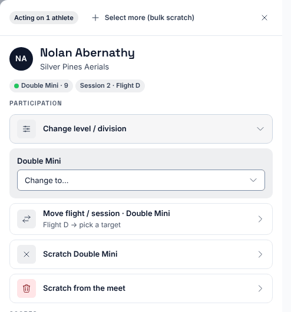
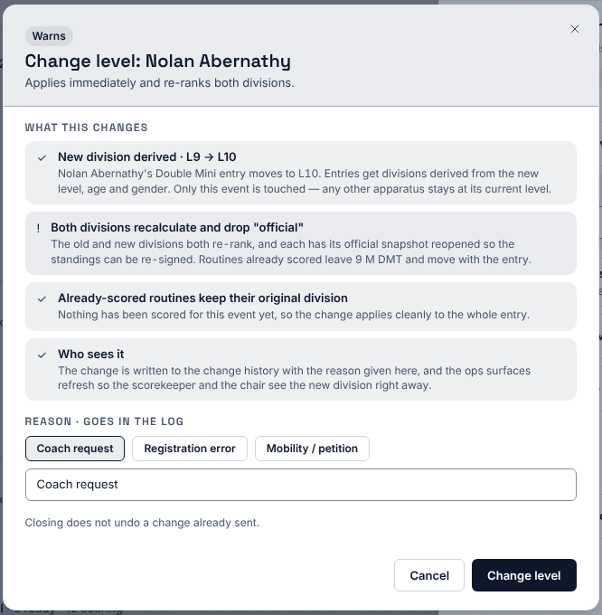
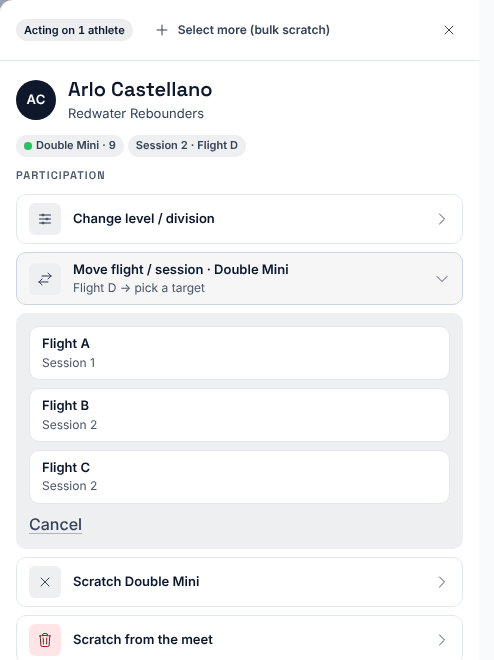
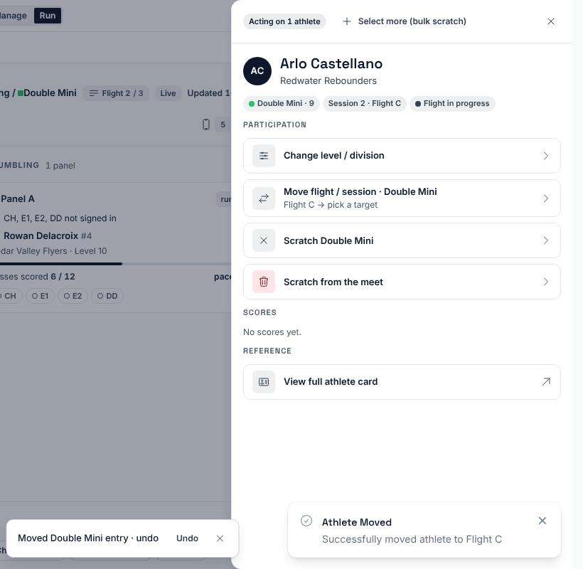

**Who it's for:** Host (meet director) · Scorsync Cloud and Scorsync Desktop

Use this when an athlete is entered at the wrong level, or needs to compete in a different flight. Do it from **Run** in Meet Control: once the schedule is locked, Meet Builder won't let you.

| You want to | Use | What it does |
| -- | -- | -- |
| Put the athlete in another level | **Change level / division** | Moves them to the new level's division and re-ranks both. They stay in the same flight. |
| Put the athlete in another flight | **Move flight / session** | Moves them to the other flight. Their level doesn't change. |

If the new level competes in a different flight, do both: change the level first, then move the flight.

## Before you start

- You're signed in to Meet Control as the host.

## Change the level

<Steps>

1. In **Run**, press ⌘K (Ctrl+K on Windows), type the athlete's name, and select them.

2. Select **Change level / division**.

3. Under the event, open **Change to…** and choose the new level.

   

4. Read **What this changes**.

5. Choose a reason (**Coach request**, **Registration error** or **Mobility / petition**), or type your own.

   

6. Select **Change level**.

7. Check that the event chip shows the new level. The message "Level changed to … · undo" has an **Undo** button for about 10 seconds.

</Steps>

:::caution[Official divisions reopen]
A level change re-ranks the old and the new division. If either was official, it stops being official and must be signed off again. See [Mark divisions official](/scoring-table/mark-divisions-official/).
:::

## Move to another flight

<Steps>

1. Find the athlete as above, then select **Move flight / session** followed by the event name.

2. Select the flight to move them to. The move happens as soon as you select it: there's no second question. Check the flight's name first.

   

3. Check that the chip shows the new flight. The message "Moved … entry · undo" has an **Undo** button for about 10 seconds.

   

4. Tell the chair of the new flight that the athlete is joining.

</Steps>

:::caution[Don't pick a flight that has finished]
The list shows every flight, including finished and official ones, and Scorsync doesn't warn you. Moving an athlete into a finished flight puts it back in progress, and Run switches to that flight's session. If it happens, select **Undo** straight away.
:::

## If something goes wrong

- **Meet Builder says "The schedule is locked. Level, birth date, gender, flight and scratch go through Triage."** After lock, change the level or flight from Run, as on this page.
- **"Move over capacity?"** The flight is full. Select **Move over capacity** only if you mean to run it with the extra athlete.
- **There's no Move flight / session option.** The athlete is scratched from that event, or isn't in a flight yet. For an athlete who isn't in a flight, see [Add a late entry](/host/meet-day-changes/add-a-late-entry/).
- **"Undo expired. The change is still saved."** Undo lasts about 10 seconds. Change it back the same way you changed it.

## Related

- [Approve or reject requests](/host/meet-day-changes/approve-requests/) (a coach can ask for a level change)
- [Scratch an athlete](/host/meet-day-changes/scratch-an-athlete/)
- [Mark divisions official](/scoring-table/mark-divisions-official/)
- [Reorder, DNS and reinstate](/judges/chair/reorder-dns-reinstate/)
