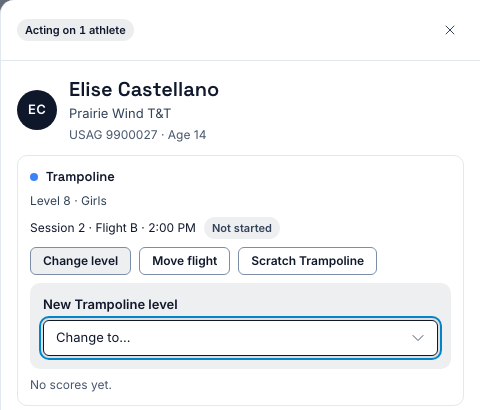
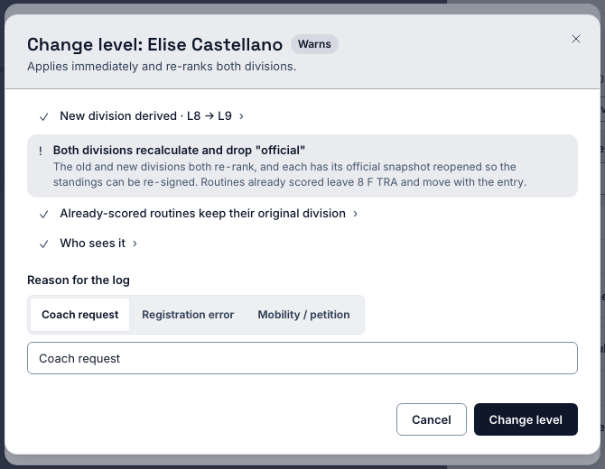
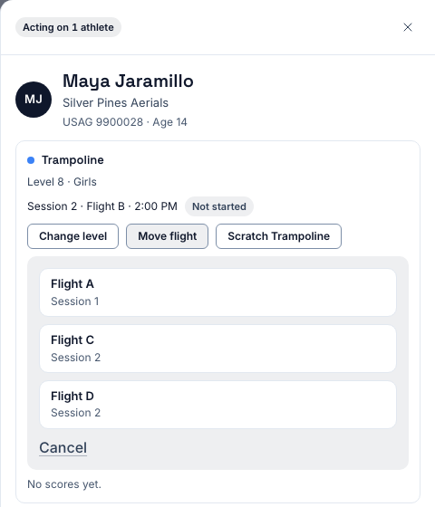

**Who it's for:** Host (meet director) · Scorsync Cloud and Scorsync Desktop

Use this when an athlete is entered at the wrong level, or needs to compete in a different flight. You don't need to unlock the schedule.

| You want to | Use | What it does |
| -- | -- | -- |
| Put the athlete in another level | **Change level** in Command Center | Moves them to the new level's division and re-ranks both. They stay in the same flight. |
| Put the athlete in another flight | **Move flight** in Command Center | Moves them to the other flight. Their level doesn't change. |
| Change the level and the flight in one go | The athlete's **Edit** form in Meet Builder | Suggests the flight where the new division competes. |

## Before you start

- You're signed in to Meet Control as the host.

## Change the level

<Steps>

1. In **Command Center**, press ⌘K (Ctrl+K on Windows), type the athlete's name, and press Enter. Their athlete page opens.

2. Select **Meet-day changes**.

3. On the event's card, select **Change level**.

4. Open **Change to…** and choose the new level.

   

5. Read what changes.

6. Choose a reason (**Coach request**, **Registration error** or **Mobility / petition**), or type your own.

   

7. Select **Change level**.

8. Check that the event card shows the new level. The message "Level changed to … · undo" has an **Undo** button for 10 seconds.

</Steps>

:::caution[Official divisions reopen]
A level change re-ranks the old and the new division. If either was official, it stops being official and must be signed off again. See [Mark divisions official](/scoring-table/mark-divisions-official/).
:::

## Move to another flight

<Steps>

1. Open the athlete's actions as above. On the event's card, select **Move flight**. If the athlete has more than one round in that event, pick the button for the round to move.

2. Select the flight to move them to. Official and finished flights aren't listed. The move happens as soon as you select it: there's no second question. Check the flight's name first.

   

3. Check that the card shows the new flight. The message "Moved … entry · undo" has an **Undo** button for 10 seconds.

4. Tell the chair of the new flight that the athlete is joining.

</Steps>

## Change level and flight together in Meet Builder

<Steps>

1. In Meet Control, select **Manage** to open Meet Builder.

2. Type the athlete's name in **Find athlete** and press Enter. Their edit form opens on the right.

3. On the event's card, choose the new **Level**.

4. Under **Flight**, choose the flight. The flight where most of the new division competes is listed first, under **Suggested**.

5. Select **Apply**, or press Enter.

6. Check the message at the bottom. It says what changed and has **Undo**.

</Steps>

An event that already has a score keeps its flight: the form says "Stays in its flight: it has a score."

The same form has **Foreign (not a U.S. citizen)**. Changing it re-ranks the athlete's divisions when you select **Apply**. The box is greyed out, with the reason, once one of those divisions is official.

:::review
Check how a Foreign change affects placings and awards against the rulebook before you rely on this. Also confirm that a level change made in Meet Builder re-opens an official division the same way Command Center does.
:::

## If something goes wrong

- **The flight you want isn't in the list.** It's official or finished, so athletes can't move into it. Choose a flight that hasn't run yet.
- **"Flight … is official. Athletes cannot be moved into an official flight."** or **"… is finished."** The flight closed while the list was open. Choose another flight.
- **"Move over capacity?"** The flight is full. Select **Move over capacity** only if you mean to run it with the extra athlete.
- **There's no Move flight button.** The athlete is scratched from that event, or isn't in a flight yet. For an athlete who isn't in a flight, see [Add a late entry](/host/meet-day-changes/add-a-late-entry/#place-them-in-a-flight).
- **"No other level to change to."** There's no other level for that event at this meet.
- **"Undo expired. The change is still saved."** Undo lasts 10 seconds. Change it back the same way you changed it.

## Related

- [Approve or reject requests](/host/meet-day-changes/approve-requests/) (a coach can ask for a level change)
- [Scratch an athlete](/host/meet-day-changes/scratch-an-athlete/)
- [Mark divisions official](/scoring-table/mark-divisions-official/)
- [Reorder, mark DNS or reinstate an athlete](/judges/chair/reorder-dns-reinstate/)
