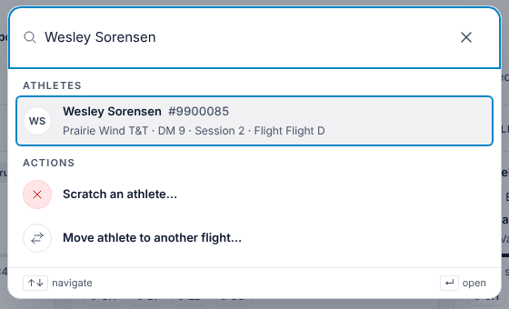
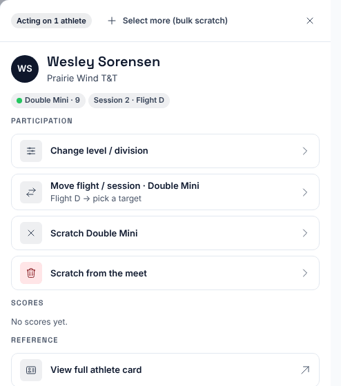
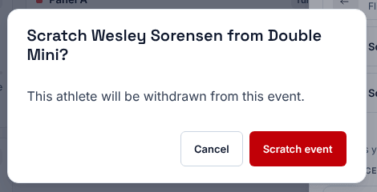
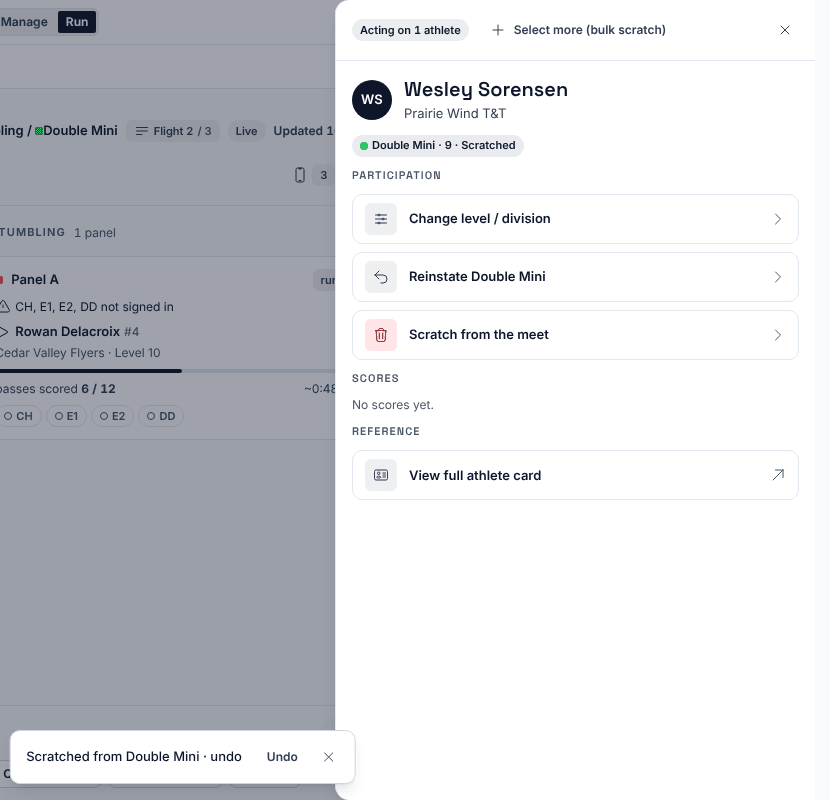
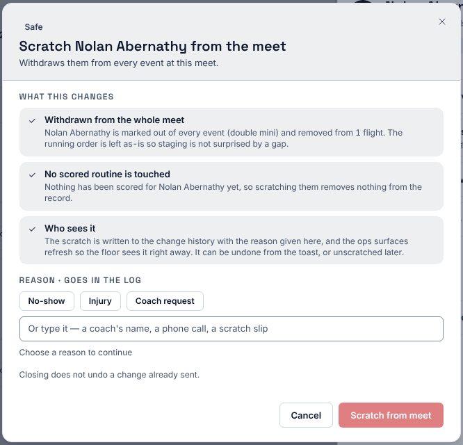

**Who it's for:** Host (meet director) · Scorsync Cloud and Scorsync Desktop

Use this when an athlete withdraws on meet day. Do it from **Run** in Meet Control: once the schedule is locked, Meet Builder won't let you.

## Before you start

- You're signed in to Meet Control as the host.

## Scratch from one event

<Steps>

1. In **Run**, press ⌘K (Ctrl+K on Windows), or select **Search athletes, judges & officials…** at the top right. Type the athlete's name.

   

2. Select the athlete. Their actions open on the right.

   

3. Select **Scratch** followed by the event name, for example **Scratch Double Mini**.

4. Select **Scratch event**. No reason is asked.

   

5. Check that the event now says "Scratched" next to the athlete's name. The message at the bottom has an **Undo** button for about 10 seconds, in case you picked the wrong athlete.

   

6. Tell the chair, and cross the athlete off the flight's paper backup sheet.

</Steps>

The chair's run order marks the athlete **SCR** and skips them. If your meet publishes to scorsync.com, the scratch shows there too.

:::caution[Check the name first]
Scorsync doesn't warn you if the athlete already has scores, or if their flight is already official. Check the name, club and flight before you select **Scratch event**.
:::

## Scratch from the whole meet

<Steps>

1. Find the athlete as above, then select **Scratch from the meet**.

2. Choose a reason (**No-show**, **Injury** or **Coach request**), or type your own. The button stays grey until there's a reason.

   

3. Select **Scratch from meet**.

4. Check that the athlete's actions show "Scratched from meet" and only one option, **Unscratch from the meet**.

</Steps>

For a synchro athlete, this also scratches their synchro pair. The option says so: "Scratches the synchro pair too".

## Undo a scratch later

Find the athlete again, then:

- **One event:** select **Reinstate** followed by the event name, then **Restore event**.
- **The whole meet:** select **Unscratch from the meet**, then **Restore athlete**.

If the flight is already full, Scorsync asks first ("Restore over capacity?").

## If something goes wrong

- **Meet Builder says "The schedule is locked. Level, birth date, gender, flight and scratch go through Triage."** Triage means the requests inbox in Run (see [Approve or reject requests](/host/meet-day-changes/approve-requests/)). After lock, scratch from Run, as on this page.
- **"Undo expired. The change is still saved."** Undo lasts about 10 seconds. Use **Reinstate** or **Unscratch from the meet** instead (see above).
- **"That event was already scratched."** Someone else got there first. Close the athlete's actions and open them again to see where things stand.
- **The athlete only shows "Unscratch from the meet".** They're scratched from the whole meet. Unscratch them first if you only meant to scratch one event.

## Related

- [Change an athlete's level or flight](/host/meet-day-changes/change-level-or-flight/)
- [Approve or reject requests](/host/meet-day-changes/approve-requests/)
- [Reorder, mark DNS or reinstate an athlete](/judges/chair/reorder-dns-reinstate/) (the chair's side)
- [Meet-day runbook: Scorsync Cloud](/runbook/scorsync-cloud/) or [Scorsync Desktop](/runbook/scorsync-desktop/)
