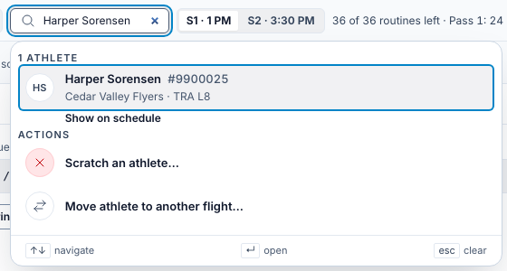
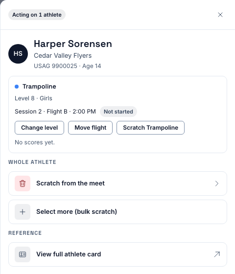
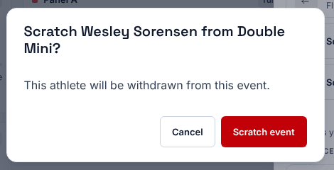
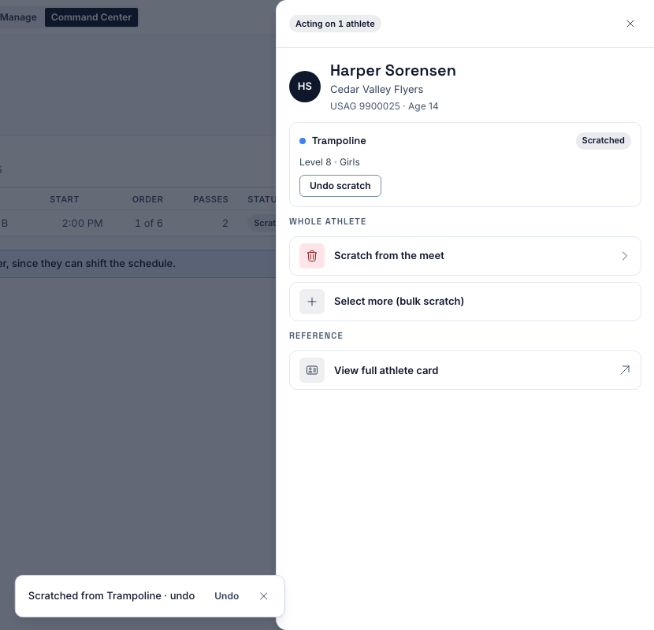
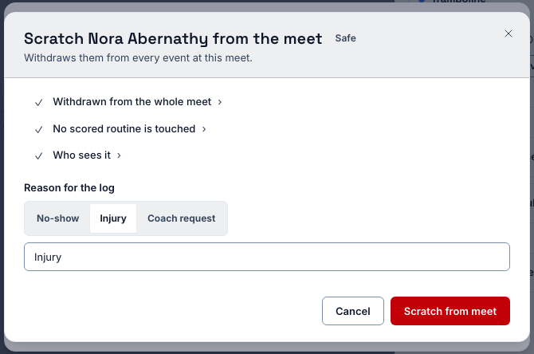

**Who it's for:** Host (meet director) · Scorsync Cloud and Scorsync Desktop

Use this when an athlete withdraws on meet day. Do it from **Command Center** in Meet Control. You don't need to unlock the schedule.

## Before you start

- You're signed in to Meet Control as the host.

## Scratch from one event

<Steps>

1. In **Command Center**, select **Search athletes or gyms** in the toolbar, or press ⌘K (Ctrl+K on Windows). Type the athlete's name.

   

2. Select the athlete, or press Enter. Their athlete page opens.

3. Select **Meet-day changes**. The athlete's actions open on the right, with one card per event.

   

4. On the event's card, select **Scratch** followed by the event name, for example **Scratch Double Mini**.

5. Select **Scratch event**. No reason is asked.

   

6. Check that the event card now says "Scratched". The message at the bottom has an **Undo** button for 10 seconds, in case you picked the wrong athlete.

   

7. Tell the chair, and cross the athlete off the flight's paper backup sheet.

</Steps>

The chair's run order marks the athlete **SCR** and skips them. If your meet publishes to scorsync.com, the scratch shows there too.

:::caution[Check the name first]
Scorsync doesn't warn you if the athlete already has scores, or if their flight is already official. Check the name, club and flight before you select **Scratch event**.
:::

## Scratch from the whole meet

<Steps>

1. Open the athlete's actions as above, then under **Whole athlete** select **Scratch from the meet**.

2. Choose a reason (**No-show**, **Injury** or **Coach request**), or type your own. The button stays grey until there's a reason.

   

3. Select **Scratch from meet**.

4. Check that the athlete's actions show "Scratched from meet" and, under **Whole athlete**, only **Unscratch from the meet**.

</Steps>

For a synchro athlete, this also scratches their synchro pair. The option says so: "Scratches the synchro pair too".

## Undo a scratch later

Open the athlete's actions again, then:

- **One event:** on the event's card, select **Undo scratch**, then **Restore event**.
- **The whole meet:** select **Unscratch from the meet**, then **Restore athlete**.

If the flight is already full, Scorsync asks first ("Restore over capacity?").

## If something goes wrong

- **"Undo expired. The change is still saved."** Undo lasts 10 seconds. Use **Undo scratch** or **Unscratch from the meet** instead (see above).
- **"That event was already scratched."** Someone else got there first. Close the athlete's actions and open them again to see where things stand.
- **The event cards have no Scratch buttons.** The athlete is scratched from the whole meet. Unscratch them first if you only meant to scratch one event.
- **There's no Meet-day changes button.** Only the meet host sees it. Sign in with your own host account.

## Related

- [Change an athlete's level or flight](/host/meet-day-changes/change-level-or-flight/)
- [Approve or reject requests](/host/meet-day-changes/approve-requests/)
- [Reorder, mark DNS or reinstate an athlete](/judges/chair/reorder-dns-reinstate/) (the chair's side)
- [Meet-day runbook: Scorsync Cloud](/runbook/scorsync-cloud/) or [Scorsync Desktop](/runbook/scorsync-desktop/)
