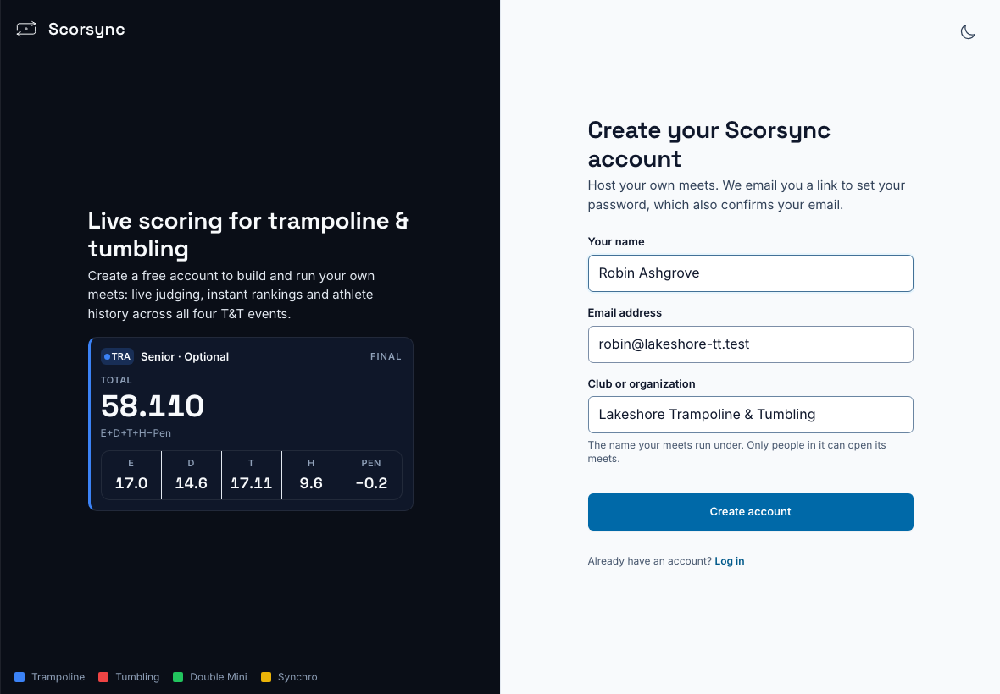

**Who it's for:** Host (meet director) · Scorsync Cloud

Use this page to make your own Scorsync Cloud account. You don't need an invite. Your account comes with its own organization, and only people in it can open its meets.

On Scorsync Desktop you don't sign up: the host account is made during first-run setup. See [Getting started with Scorsync Desktop](/offline-host/).

## Before you start

- You have an email address you can open now. Scorsync sends the link to set your password there.
- You know the name your meets run under: your club or organization.

## Steps

<Steps>

1. Go to app.scorsync.com. On the **Log in** page, under the form, select **Create an account**.

2. On **Create your Scorsync account**, type **Your name**, **Email address** and **Club or organization**.

   

3. Complete the check under the form that confirms you're not a robot.

4. Select **Create account**. Scorsync shows "Check your email. We sent a link to set your password and finish signing up."

5. Open the email "Confirm your email and set your Scorsync password", then select **Set your password**.

6. On the **Welcome** page, type a **Password** (at least 8 characters), type it again in **Type it again**, then select **Save password and continue**.

7. Check that Scorsync opens with "Your account is ready". To build your first meet, select **New meet**, then follow [Build your meet in Meet Builder](/host/before-meet-day/build-your-meet/).

</Steps>

Next time, sign in at app.scorsync.com with your email and that password.

:::review
Self sign-up only shows while the Scorsync team has it switched on (the "Sign-up" switch on the Leads list; #2565). PR #2632 says it is live on production. Check that app.scorsync.com/register opens the form before this page ships, and add a screenshot of the robot check: the form screenshot was taken on a local copy that has no robot check.
:::

## If something goes wrong

- **There's no Create an account link, or the sign-up page sends you back to the home page.** Sign-up is closed right now. Book a walkthrough from the home page, or contact Scorsync support (support@scorsync.com).
- **"We could not confirm you are not a robot. Try the check again."** Complete the check again, then select **Create account**.
- **The email didn't arrive.** Look in your spam folder. If you already had a Scorsync login with that email, you get a password reset email instead: use it to set a new password.
- **"This invitation has run out".** The link works for 7 days. Select **Get a new link**, or use **Forgot password?** on the **Log in** page.
- **"This invitation was already used".** Your password is set. Select **Log in** and sign in with it.

## Related

- [Getting started as a host](/host/)
- [Build your meet in Meet Builder](/host/before-meet-day/build-your-meet/)
- [Invite a co-host](/host/before-meet-day/invite-a-co-host/)
- [Which setup do I have?](/start-here/which-setup/)
