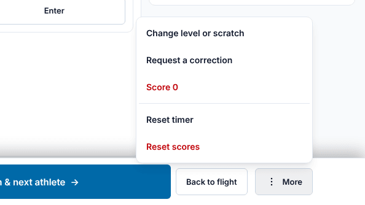
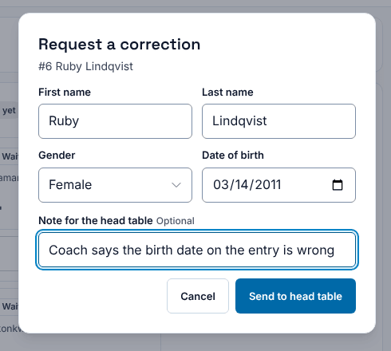
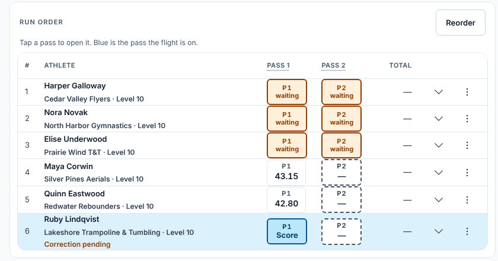

**Who it's for:** The chair · Scorsync Cloud and Scorsync Desktop

Use this when an athlete's name, gender or date of birth is wrong on your screen. For a wrong level or a scratch, use **Change level or scratch** instead: see [Reorder, DNS and reinstate](/judges/chair/reorder-dns-reinstate/).

## Steps

<Steps>

1. With the athlete open, select **More** at the bottom right.

2. Select **Request a correction**.

   

3. Change what's wrong: **First name**, **Last name**, **Gender** or **Date of birth**. For a synchro pair, first choose the athlete under **Which athlete?**.

4. Optional: under **Note for the head table**, say where the fix came from, for example "Coach says the birth date on the entry is wrong".

   

5. Select **Send to head table**.

6. Check for the message "Correction for … sent to the head table." The athlete now shows **Correction pending** on your screens.

   

</Steps>

Keep scoring: nothing changes until the host approves the request in **Run**. **Correction pending** goes away once the host approves, rejects or dismisses it. The host's steps are in [Approve or reject requests](/host/meet-day-changes/approve-requests/).

:::tip
For an athlete who isn't on the floor, open the flight view, select **⋮** on their row, then **Request a correction…**.
:::

## If something goes wrong

- **"Nothing new to send."** You haven't changed anything on the form. Change the wrong detail, then send again.
- **Send to head table is greyed out.** First name and last name can't be empty.
- **Correction pending stays for a long time.** The host hasn't seen it yet. Let the head table know there's a request waiting in Run.

## Related

- [Approve or reject requests](/host/meet-day-changes/approve-requests/)
- [Confirm a flight official](/judges/chair/confirm-flight-official/)
- [Reorder, DNS and reinstate](/judges/chair/reorder-dns-reinstate/)
