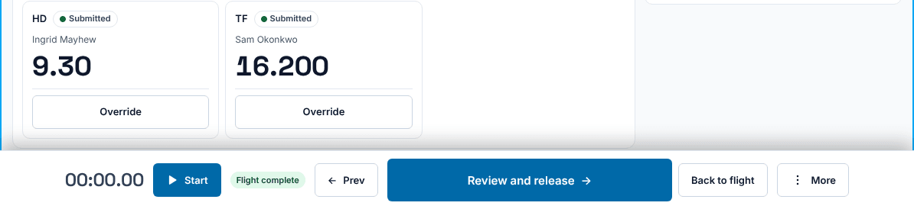
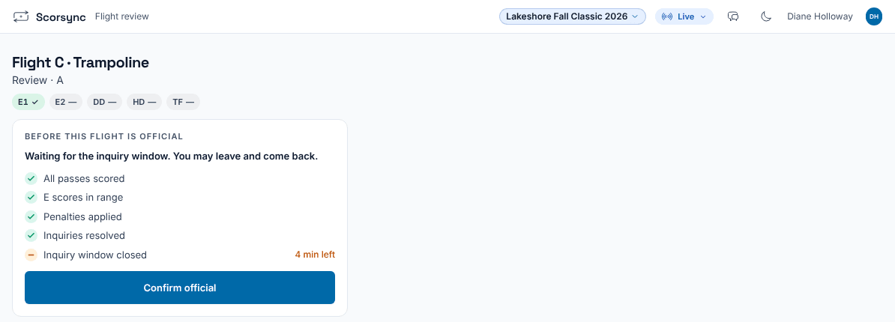
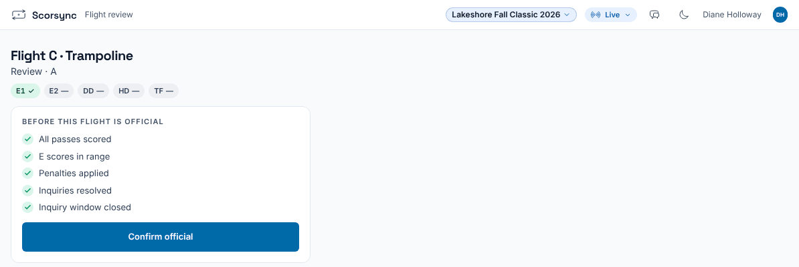
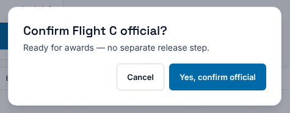
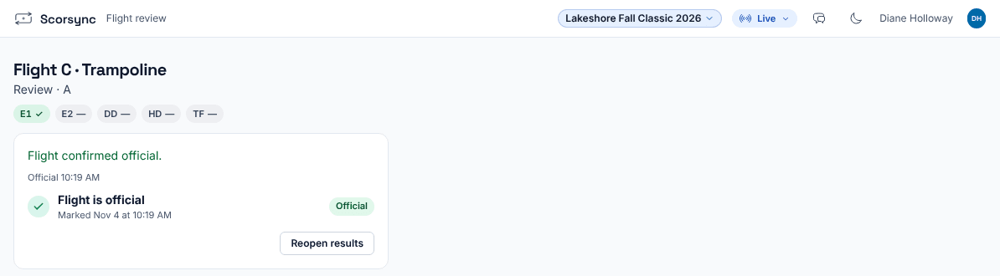
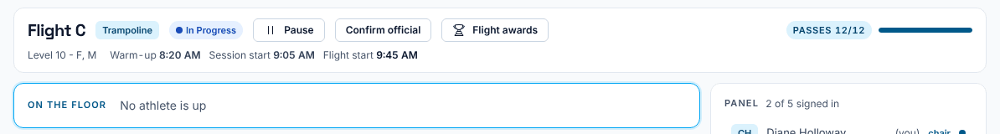

**Who it's for:** The chair · Scorsync Cloud and Scorsync Desktop

Use this when your station's last athlete has finished and your screen says **Flight complete**.

## Before you start

- Every athlete on the flight is scored, or marked DNS or scratched, on every station of the event.
- No inquiry is open for the flight.

## Steps

<Steps>

1. On the last athlete, select **Review and release**. Your judges' tablets open the flight review so they can [check their paper](/judges/check-your-paper/).

   

2. You're now on **Flight review**. The seat labels at the top get a tick as each judge selects **Checked against my paper**. Wait for them, and fix any score a judge reports.

3. Read the checklist under **Before this flight is official**. Wait until "Inquiry window closed" has a tick. Until then it shows "… min left", and the screen says "Waiting for the inquiry window. You may leave and come back."

   

4. When every row has a tick, select **Confirm official**.

   

5. Select **Yes, confirm official**. If some divisions also have athletes in a later flight, the window says how many wait for it instead of "Ready for awards".

   

6. Check that the box now says "Flight is official", with the time. The results go to the awards desk, and to scorsync.com if the meet publishes there.

   

</Steps>

To come back later, open the flight and select **Confirm official** at the top of the flight view.

:::caution
**Confirm official** works before the inquiry window has closed. Nothing stops you, so check that row yourself. Any score change starts the 5 minutes again. After confirming, every score is locked: judges see "Results are official. Ask the meet host to correct a score."
:::

:::rule[What the rulebook says]
The meet referee must be told about a possible inquiry within 5 minutes after the flight ends (or before awards). The written inquiry is due within 10 minutes of that.

**Source:** USA Gymnastics, *Development Program Code of Points: Trampoline* (2025–2029), Section 4, Rule 13.4, page 29.
:::

## If something goes wrong

- **Confirm official is greyed out.** "All passes scored" or "Inquiries resolved" isn't ticked. The note on the right says how many are open, for example "2 open". Score or mark DNS the missing passes, or wait for the meet referee's ruling.
- **"Waiting on …" in the checklist.** Another station of the same event hasn't finished. Wait for its chair.
- **"Cannot release yet" when you select Review and release.** The message names the athletes who still owe a routine on your station. Open them from the flight view and score the pass.
- **A score is wrong after you confirmed.** Select **Reopen results**. See [Reopen an official flight to fix a score](/judges/chair/reopen-official-flight/).

## Related

- [Reopen an official flight to fix a score](/judges/chair/reopen-official-flight/)
- [Check your paper after the flight](/judges/check-your-paper/)
- [Mark divisions official](/scoring-table/mark-divisions-official/)
