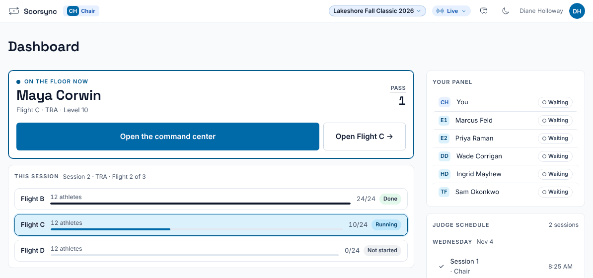
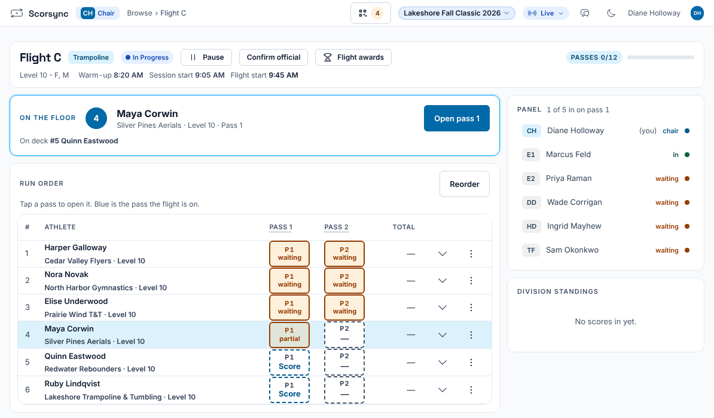
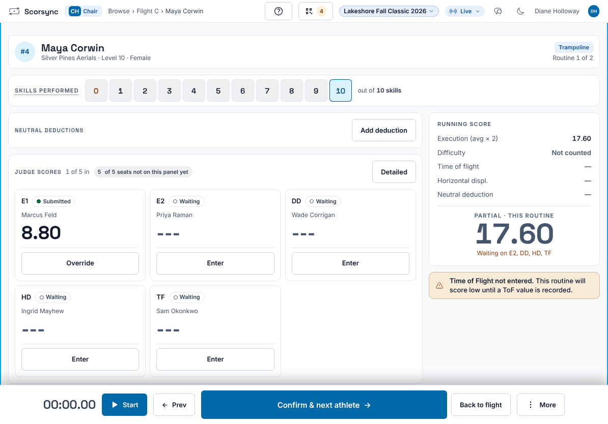

**Who it's for:** The chair · Scorsync Cloud and Scorsync Desktop

Start here if you're chairing a panel for the first time. Your tablet runs the panel: the judges' tablets follow yours.

## Before you start

- You're signed in on your tablet. See [Get judges signed in and scoring](/scoring-table/get-judges-signed-in/).
- You're seated as the chair of your panel. If you're not sure, ask the scoring table.

## Steps

<Steps>

1. On your **Dashboard**, select **Open Flight** (for example **Open Flight C**).

   

2. If your judges aren't signed in yet, sign them in from your tablet. Follow [The chair's panel sign-in](/scoring-table/get-judges-signed-in/#the-chairs-panel-sign-in).

3. Check the **Panel** list on the right: every judge on your panel is there.

   

4. Select **Open pass 1** to call up the athlete on the floor. The command center opens, and your judges' tablets move to their scoring screens by themselves.

5. Watch each judge's card change from **Waiting** to **Submitted**, and the running score fill in.

   

6. Select **Confirm & next athlete**. The next athlete opens on your tablet and the judges' tablets.

7. After the last athlete, your screen says **Flight complete**. Confirm the flight official: see [Confirm a flight official](/judges/chair/confirm-flight-official/).

</Steps>

## When the routine needs you

| I need to... | Go to |
| -- | -- |
| Move on when a judge hasn't submitted ("Incomplete Submissions") | [Move on when a judge hasn't submitted](/judges/chair/move-on-missing-judge/) |
| Fix a mark, add a deduction, time the start, or score 0 | [Override a mark, apply penalties or score 0](/judges/chair/override-and-penalties/) |
| Deal with the red **E-range** flag | [Check an out-of-range flag](/judges/chair/out-of-range-flag/) |
| Move an athlete who isn't ready, or mark them DNS | [Reorder, mark DNS or reinstate an athlete](/judges/chair/reorder-dns-reinstate/) |
| Get an athlete's name or date of birth fixed | [Ask the host to fix an athlete's details](/judges/chair/ask-host-to-fix-details/) |
| Fix a score after the flight is official | [Reopen an official flight to fix a score](/judges/chair/reopen-official-flight/) |

## If something goes wrong

- **There's no Open Flight button.** You're not signed in as the chair, or not seated on this panel. Ask the scoring table to check your seat.
- **A judge's tablet didn't move to the scoring screen.** Ask the judge to select **Enter Score** on their dashboard.

## Related

- [Confirm a flight official](/judges/chair/confirm-flight-official/)
- [Move on when a judge hasn't submitted](/judges/chair/move-on-missing-judge/)
- [Getting started as a judge](/judges/)
