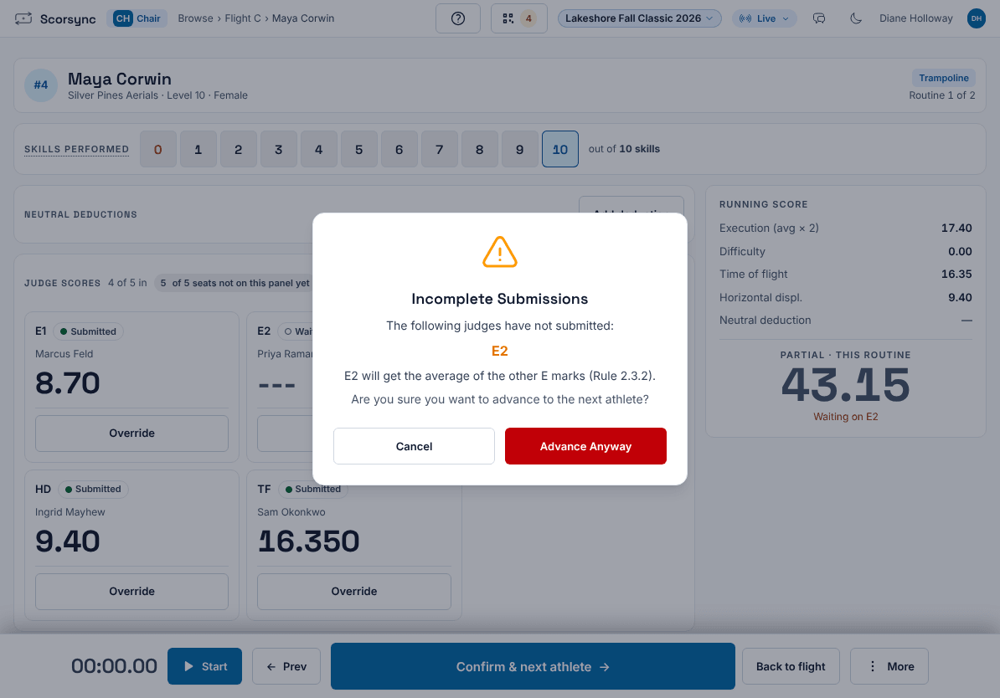
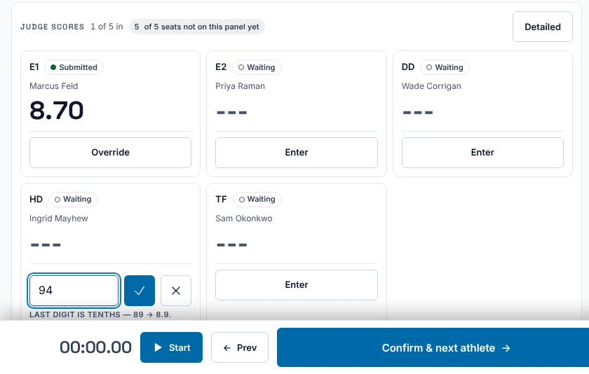
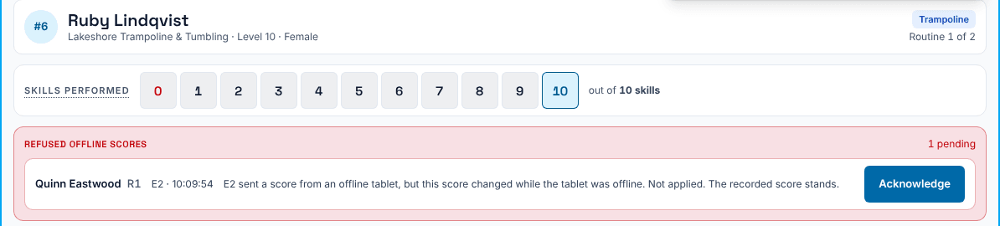

**Who it's for:** The chair · Scorsync Cloud and Scorsync Desktop

Use this when you select **Confirm & next athlete** and Scorsync says **Incomplete Submissions**.

## Before you start

- Ask the judge first. A judge whose tablet is offline may already have submitted: their score is held on the tablet and you can't see it. Wait for the Wi-Fi if you can.

## Steps

<Steps>

1. Select **Confirm & next athlete**. If a judge is missing, **Incomplete Submissions** lists their seat.

   

2. Choose what to do:

   | If | Do this |
   | -- | -- |
   | The judge has the mark on paper | Select **Cancel**, then go to step 3. |
   | The judge's tablet is offline but they submitted | Select **Cancel** and wait for the score to arrive. |
   | There's no mark to wait for | Select **Advance Anyway**. You're done. |

3. On the missing judge's card, select **Enter**.

4. Type the judge's mark from their paper, then select the tick (or press Enter). The last digit is tenths: type 94 for 9.4, or type the decimal point.

   

5. Check that the card now says **Submitted** with the mark, then select **Confirm & next athlete**. The next athlete opens.

</Steps>

When you select **Advance Anyway**, a missing execution (E) seat gets the average of the other E marks. Other missing seats get nothing. Scores for that athlete don't go to scorsync.com until you advance.

:::rule[What the rulebook says]
If an execution judge fails to show their mark when the chair signals, the remaining mark(s) are averaged or doubled and used for the missing mark.

**Source:** USA Gymnastics, *Development Program Code of Points: Trampoline* (2025–2029), Section 4, Rule 2.3.2, page 24.
:::

:::review
Rules statement: the missing E mark, and when the chair should enter a mark from paper instead of advancing. Not yet signed off.
:::

## If something goes wrong

- **"Refused offline scores" appears above the scores.** A judge's held score arrived after you advanced or changed it. Scorsync kept your recorded score. Check the judge's paper, fix the mark with **Override** if needed, then select **Acknowledge**. See [Override a mark, Score 0 and penalties](/judges/chair/override-and-penalties/).

  

- **The same seats are listed for every athlete.** At Level 8, some seats have nothing to score. See [Get judges signed in and scoring](/scoring-table/get-judges-signed-in/#at-level-8).
- **A judge's card says "Connected" but they've submitted on their tablet.** Their tablet may be offline holding the score. Ask them to check for the red **OFFLINE** banner. See [Score when the Wi-Fi drops](/judges/score-when-wifi-drops/).

## Related

- [Override a mark, Score 0 and penalties](/judges/chair/override-and-penalties/)
- [Score when the Wi-Fi drops](/judges/score-when-wifi-drops/)
- [Replace a judge mid-meet](/scoring-table/replace-a-judge/)
- [Getting started as the chair](/judges/chair/)
