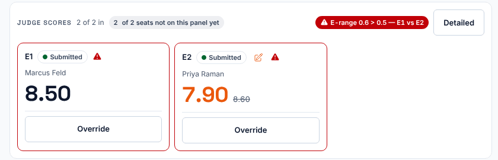
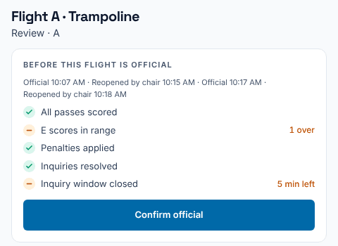

**Who it's for:** The chair · Scorsync Cloud and Scorsync Desktop

Use this page when the red **E-range** flag shows on your screen: the execution judges' marks are further apart than Scorsync allows.

## What you see

- A red flag above the judge cards, such as "E-range 0.6 > 0.5 — E1 vs E2": the gap between the marks, the allowed gap, and the judges involved.
- A red border and a warning sign on those judges' cards.

**Only you see the flag.** The execution judges' tablets show nothing, so tell them yourself if you want them to look again.

The flag is a warning. It doesn't stop you moving on or making the flight official.

## Before you start

- You're signed in as the chair, with the athlete open on your screen. See [Getting started as the chair](/judges/chair/).

## Deal with the flag

<Steps>

1. Look at the marks on the flagged cards.

2. If a judge mis-keyed, ask them to fix it on their tablet before you move on (see [Fix a score you submitted](/judges/fix-a-score/)), or change the mark yourself with **Override** (see [Override a mark, apply penalties or score 0](/judges/chair/override-and-penalties/)).

3. Check the flag has gone. It clears by itself once the marks are close enough.

4. Select **Confirm & next athlete**. If the flag is still showing, Scorsync asks again, for example "E-range 0.6 > 0.5 — E1 vs E2. Scores are out of range. Confirm and move to the next athlete anyway?" Select **OK** to move on, or **Cancel** to stay.

</Steps>

## Before the flight goes official

When you confirm the flight official, the checklist has a row **E scores in range**. If any pass is still out of range, the row says how many, such as "1 over". It doesn't stop **Confirm official**.

:::rule[What the rulebook says]
When total E scores are used, the two E scores must be within 0.5 points (0.2 in Double Mini). If they aren't, the chair decides what is best and fairest so the range is met. With three E judges, each must be within 0.5 of the middle score.

**Source:** USA Gymnastics, *Development Program Code of Points: Trampoline* (2025–2029), Section 2, Rule 5.6, page 11, and Rule 2.13, page 8. Double Mini: *Development Program Code of Points: Double Mini* (2025–2029), Section 2, Rule 2.13, page 8, and Rule 5.5.6, page 12.
:::

## If something goes wrong

- **"Scores are out of range" each time you select Confirm & next athlete.** A flagged mark is still there. Fix it, or select **OK** to move on anyway.
- **The flag stays after a judge fixed their mark.** The other judge's mark is still too far away. Look at both cards.

## Related

- [Override a mark, apply penalties or score 0](/judges/chair/override-and-penalties/)
- [Move on when a judge hasn't submitted](/judges/chair/move-on-missing-judge/)
- [Confirm a flight official](/judges/chair/confirm-flight-official/)
