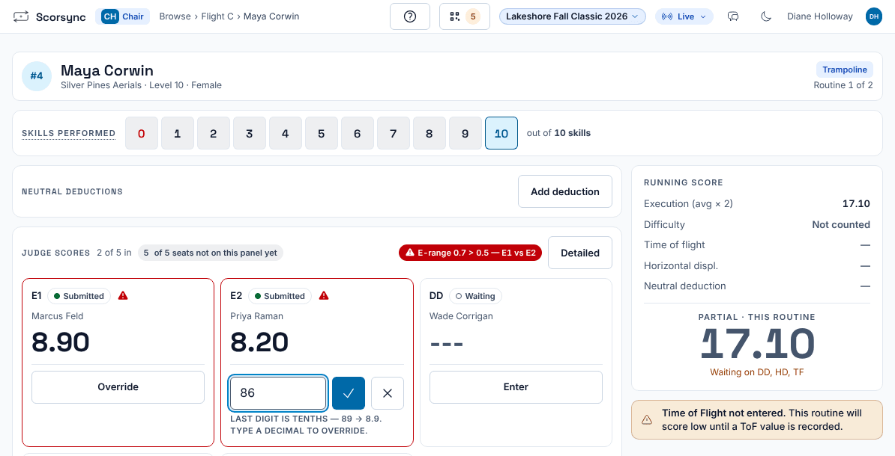
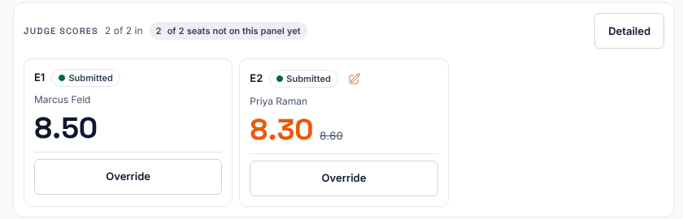
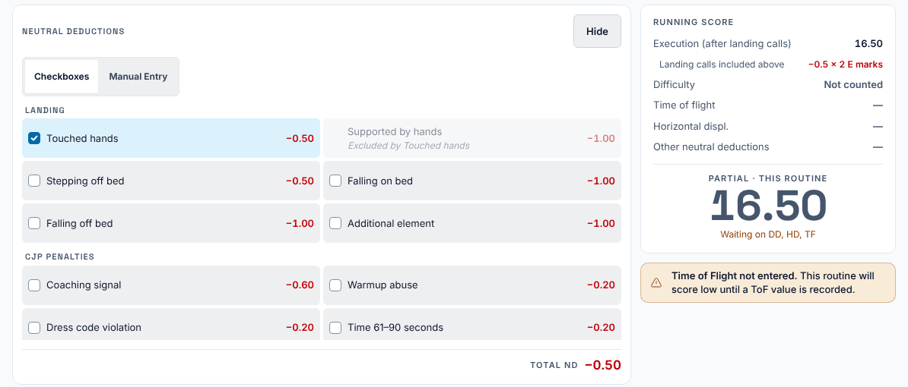
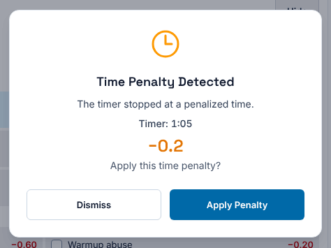
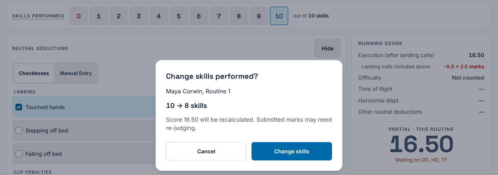
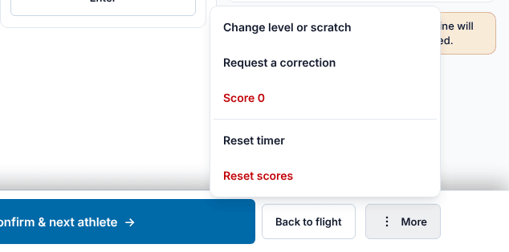

**Who it's for:** The chair · Scorsync Cloud and Scorsync Desktop

Use this page when a routine's score needs the chair's hand: a wrong mark, a deduction, a time penalty or an interrupted routine.

| You need to | Use | Where |
| -- | -- | -- |
| Change a mark a judge sent | **Override** | The judge's card. For an athlete you've moved past, see [below](#fix-an-athlete-youve-already-moved-past) |
| Undo your override | The small orange pencil next to "Submitted" | The judge's card |
| Take a landing deduction or a chair penalty | **Add deduction** | Neutral deductions |
| Take a time penalty | **Apply Penalty** | Pops up when you stop the timer |
| Set how many skills were done | The number buttons | Skills performed |
| Give the routine 0 | **More** → **Score 0** | The bar at the bottom |

## Before you start

- You're signed in as the chair, with the athlete open on your screen. See [Getting started as the chair](/judges/chair/).
- The flight isn't official yet. If it is, see [Reopen an official flight to fix a score](/judges/chair/reopen-official-flight/).

## Override a mark

<Steps>

1. On the judge's card, select **Override**.

2. Tap the box that appears. Typing does nothing until you do.

3. Type the new mark. The last digit is tenths: type `86` or `8.6` for 8.6.

   

4. Select the tick, or press Enter.

5. Check the card: your mark shows in orange, with the judge's mark struck through beside it. The judge's tablet says "Chair changed your score".

   

</Steps>

:::caution[Don't tap the orange pencil]
It isn't an edit button: one tap puts the judge's own mark back, with no question asked. To change your override, select **Override** again and type the new mark.
:::

If a judge hasn't sent a mark at all, their card shows **Enter** instead. See [Move on when a judge hasn't submitted](/judges/chair/move-on-missing-judge/).

## Fix an athlete you've already moved past

Do this between athletes, while no routine is being scored.

<Steps>

1. Select **Back to flight** in the bottom bar (on a phone, it's under **More**).

2. In the run order, tap the athlete's pass (**P1** or **P2**). The scoring screen opens for that athlete.

3. Select **Override** on the judge's card, and follow [Override a mark](#override-a-mark).

4. Select **Back to flight**, then carry on with the next athlete's pass.

</Steps>

:::review[Needs Austin's review: going back to an earlier athlete]
Written from the code and the run order's "Tap a pass to open it." Not tried on the bench: check whether opening an earlier pass also moves the judges' tablets to that athlete.
:::

## Add a deduction or penalty

<Steps>

1. Under Neutral deductions, select **Add deduction**.

2. Tick each deduction that applies. Scorsync saves each tick straight away, and greys out deductions that can't go together.

   

3. Check **Running score** on the right: the routine total has gone down.

</Steps>

To remove a deduction, untick it. To type a total instead of ticking boxes, select **Manual Entry**.

## Take a time penalty

<Steps>

1. Select **Start** in the bottom bar when you give the athlete the signal to start. Space does the same.

2. Select **Stop** when the athlete starts their first skill.

3. If the wait was long enough for a penalty, Scorsync shows **Time Penalty Detected** with the amount. Select **Apply Penalty**, or **Dismiss** to leave it off.

   

</Steps>

If the wait went past the limit, the window says **Cannot Start** instead. **Confirm Score of 0** gives the routine 0 and sets **Skills performed** to 0; **Dismiss** leaves the score alone. To undo a Score of 0 from here, select the right number under **Skills performed**.

## Set skills performed

Under **Skills performed**, select the number of skills the athlete did. The red **0** means none. If marks are already in, Scorsync asks first: select **Change skills**. Judges may need to mark the routine again.

## Score 0, or clear the routine

Select **More** in the bottom bar (on a phone, the ⋮ button).

- **Score 0** gives the routine 0.000 and keeps the judges' marks. Select **OK** when asked "Score this routine 0.000? Panel marks are kept." To undo it, select **More** → **Restore computed score**, then **OK**. (The question wrongly says 0.000; **OK** restores the computed score.)
- **Reset scores** clears every mark and deduction for this routine only, so the panel can score it again. Select **Clear routine scores** to confirm. To undo it, select **More** → **Undo reset scores**. That works for 12 hours, and only until a judge scores the routine again.

:::rule[What the rulebook says]
The chair declares the maximum mark for an interrupted routine, and decides and displays the chair's penalties taken from the total score. A coach's signal costs 0.6. After the start signal, a trampoline athlete has one minute to begin: 61–90 seconds costs 0.2, 91–120 seconds 0.4, 121–180 seconds 0.6, and at 181 seconds the athlete can't start and scores 0. In Double Mini and Tumbling the limit is 20 seconds (0.2), and at 61 seconds the athlete can't start.

**Source:** USA Gymnastics, *Development Program Code of Points: Trampoline* (2025–2029), Section 1, Rule 6.3, page 5; Section 2, Rules 2.12 and 2.15, page 8; Rules 4.1.1 and 4.1.7, page 10. Landing deductions: Section 2, Rule 5.9, page 12. *Development Program Code of Points: Double Mini* (2025–2029), Section 1, Rule 6.3, page 5, and Section 2, Rule 4.1.10, page 10. *Development Program Code of Points: Tumbling* (2025–2029), Section 1, Rule 6.3, page 4, and Section 2, Rule 4.1.11, page 9.
:::

:::review
Rules statement: chair penalties, the time-to-start penalty, interrupted routines and Score 0. Not yet signed off. Also check: when a chair should use Override at all (the rulebook has the chair direct E judges to re-evaluate, not change their marks). The app's Double Mini and Tumbling timers match their codes (penalty from 21 seconds, can't start at 61), but for Tumbling the rulebook says "no score will be awarded" where the app gives 0.
:::

## If something goes wrong

- **Typing after Override does nothing.** The box isn't selected yet. Tap the box, then type.
- **"Execution score is too high".** The message says the most the mark can be, for example "Execution score cannot exceed 10.0 for 10 skills performed." Nothing was saved. Select **Override** again and type a lower mark, or check **Skills performed**.
- **"Changed on another device".** Someone changed this override on another screen first. Check the card, then override again if you still need to.
- **The buttons are greyed out, with "Results are official. Ask the meet host to correct a score."** The flight is official. You reopen it yourself: see [Reopen an official flight to fix a score](/judges/chair/reopen-official-flight/).

## Related

- [Move on when a judge hasn't submitted](/judges/chair/move-on-missing-judge/)
- [Check an out-of-range flag](/judges/chair/out-of-range-flag/)
- [Confirm a flight official](/judges/chair/confirm-flight-official/)
- [Fix a score you submitted](/judges/fix-a-score/)
