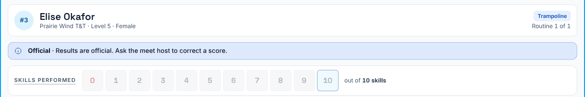
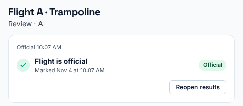
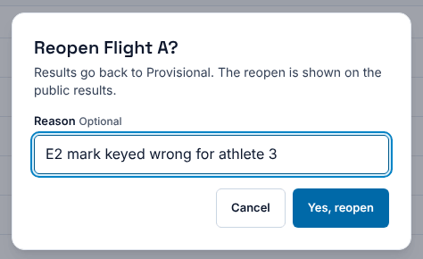
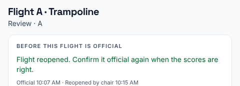
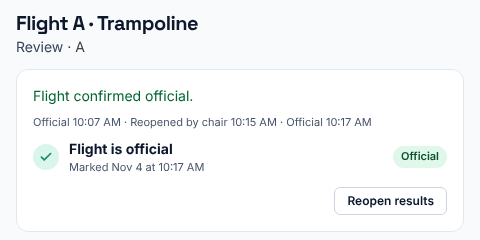

**Who it's for:** The chair · Scorsync Cloud and Scorsync Desktop

Use this page when a score is wrong after the flight is official, for example after an inquiry.

Once a flight is official, nobody can change a score: the chair's screen says "Results are official. Ask the meet host to correct a score." **Only the chair can reopen the flight**, so don't wait for the host.

## Before you start

- You're signed in as the chair of that flight, on your flight view.
- You know which athlete, routine and mark to fix.
- Reopen only to apply an inquiry ruling, or to fix a clear entry error with the meet referee's OK.

## Reopen, fix and confirm again

<Steps>

1. At the top of the flight view, select **Reopen results**. The flight's review screen opens.

2. Under **Flight is official**, select **Reopen results**.

   

3. Type a reason, if you want one. It can appear on your displays: see [Who sees a reopen](#who-sees-a-reopen).

4. Select **Yes, reopen**.

   

5. Check the card says "Flight reopened. Confirm it official again when the scores are right."

   

6. Go back to the flight view and tap the pass you need to fix. Correct the score, for example with **Override**. See [Override a mark, apply penalties or score 0](/judges/chair/override-and-penalties/).

7. On the flight view, select **Confirm official**, then **Confirm official** on the review screen, then **Yes, confirm official**. See [Confirm a flight official](/judges/chair/confirm-flight-official/).

8. Check the card says **Flight is official** again, with the new time.

   

</Steps>

## Who sees a reopen

| Where | What it shows |
| -- | -- |
| The venue results screen (your displays) | The reopen, its time and your reason, word for word |
| scorsync.com | **Unofficial Results** again, with no reason. The corrected score and new places show once you confirm it official again. |

Awards for the flight wait until you confirm it official again.

:::caution[Keep the reason neutral]
Write something like "Score correction", because it can appear on your displays. Never name a judge or a seat.
:::

See [Know what families see on scorsync.com](/start-here/what-families-see/).

## If something goes wrong

- **There's no Reopen results button.** You aren't the chair of this flight, or the meet is archived. Ask the flight's chair, or contact Scorsync support (support@scorsync.com).
- **Confirm official is greyed out after the fix.** A pass is unscored or an inquiry is open. The checklist shows which; see [Confirm a flight official](/judges/chair/confirm-flight-official/).
- **"Inquiry window closed · 5 min left" after the fix.** The window starts again after a correction. Wait for it to close before you confirm: Scorsync only reminds you.

## Related

- [Confirm a flight official](/judges/chair/confirm-flight-official/)
- [Override a mark, apply penalties or score 0](/judges/chair/override-and-penalties/)
- [Mark divisions official](/scoring-table/mark-divisions-official/)
- [Know what families see on scorsync.com](/start-here/what-families-see/)
