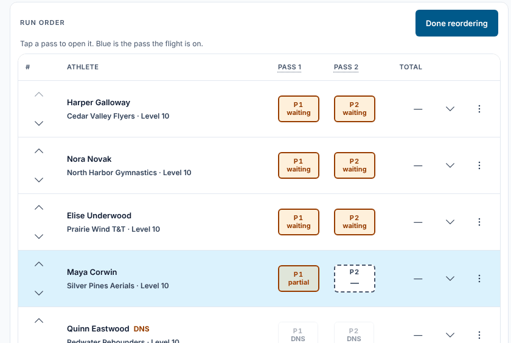
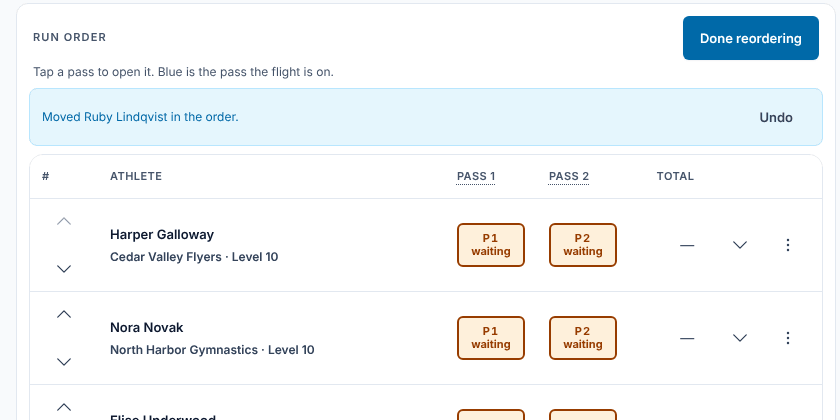
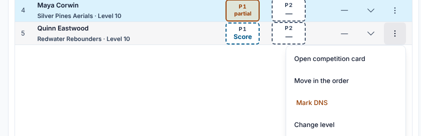
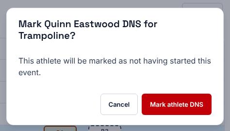
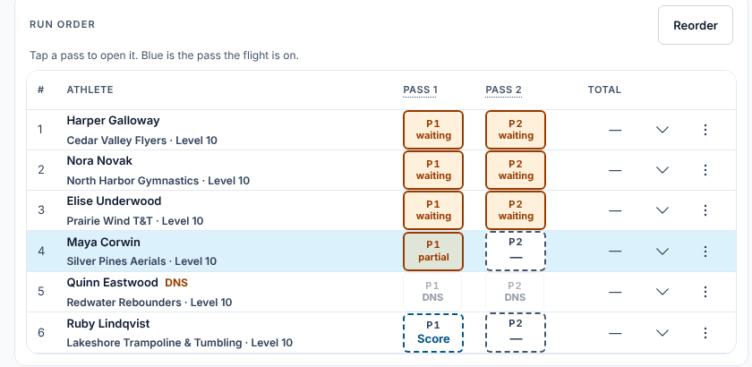
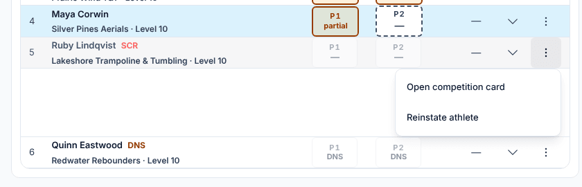

**Who it's for:** The chair · Scorsync Cloud and Scorsync Desktop

Use this page when an athlete isn't ready in their turn, didn't start, or comes back after a DNS or a scratch.

| You need to | Use | What happens |
| -- | -- | -- |
| Let an athlete go later or earlier | **Reorder**, then the arrows | The run order changes for your panel, with **Undo** |
| Record that an athlete didn't start | ⋮ → **Mark DNS** | Their passes show DNS and need no score |
| Bring back an athlete marked DNS | ⋮ → **Clear DNS** | Their passes can be scored again |
| Bring back a scratched (SCR) athlete | ⋮ → **Reinstate athlete** | Their passes can be scored again |

## Before you start

- You're signed in as the chair, on your flight view (**Open Flight** on your dashboard).
- The flight isn't official yet. Once it is, you can't make these changes.

## Move an athlete in the order

<Steps>

1. Above the run order, select **Reorder** (or ⋮ → **Move in the order** on the athlete's row). Up and down arrows appear on each row.

   

2. Tap the up arrow to move the athlete earlier, or the down arrow to move them later. Each tap moves them one place.

3. Check the blue bar: "Moved … in the order." If you moved the wrong athlete, select **Undo**. It reverses your last tap only.

   

4. Select **Done reordering**.

</Steps>

## Mark an athlete DNS

<Steps>

1. On the athlete's row, select the ⋮ button at the right.

   

2. Select **Mark DNS**.

3. Check the name and event, then select **Mark athlete DNS**.

   

4. Check the row: the name has an orange DNS tag, and each pass shows DNS.

   

</Steps>

## Bring back an athlete you marked DNS

Use this if the athlete turns up after all, or you marked the wrong one.

<Steps>

1. On the athlete's row, select ⋮.

2. Select **Clear DNS**.

3. When it asks "Clear DNS for …?", select **Clear athlete DNS**.

4. Check that the orange DNS tag has gone, and the passes show **P1 Score** again.

</Steps>

## Reinstate a scratched (SCR) athlete

A scratched athlete shows a red **SCR** tag after their name.

<Steps>

1. On the athlete's row, select ⋮.

2. Select **Reinstate athlete**. There's no question: it happens straight away. Reinstate only on the host's or meet referee's word.

   

3. Check the row: the SCR tag has gone, and you can tap the athlete's passes again.

</Steps>

If the flight is already full, Scorsync asks **Restore over capacity?** first. Select **Restore over capacity** only if the host agrees.

To scratch an athlete from your screen, select ⋮ → **Scratch from event** and pick a reason. See [Scratch an athlete](/host/meet-day-changes/scratch-an-athlete/).

:::rule[What the rulebook says]
Athletes must be ready at the time and in the order of the start list. For an extenuating circumstance, the chair (with the meet referee if needed) may let an athlete compete out of order; otherwise the athlete gets Did Not Start.

**Source:** USA Gymnastics, 2026–27 rule update (2026–27 Coaches T210, slide 6). The FIG rule it follows: *FIG Code of Points: Trampoline Gymnastics* (2025–2028), Part I, Rule 12.5, page 13.
:::

## If something goes wrong

- **"… already has a scored pass — correct the score instead of marking DNS."** (or **Mark DNS** is greyed out). The athlete has a scored pass, so they started. Fix the score instead: see [Override a mark, apply penalties or score 0](/judges/chair/override-and-penalties/).
- **"The order has changed — undo is no longer available."** Someone else changed the order after your move. Use the arrows to put it right.
- **An arrow is greyed out.** The athlete is already first or last on your panel.

## Related

- [Ask the host to fix an athlete's details](/judges/chair/ask-host-to-fix-details/)
- [Move on when a judge hasn't submitted](/judges/chair/move-on-missing-judge/)
- [Scratch an athlete](/host/meet-day-changes/scratch-an-athlete/)
- [Confirm a flight official](/judges/chair/confirm-flight-official/)
