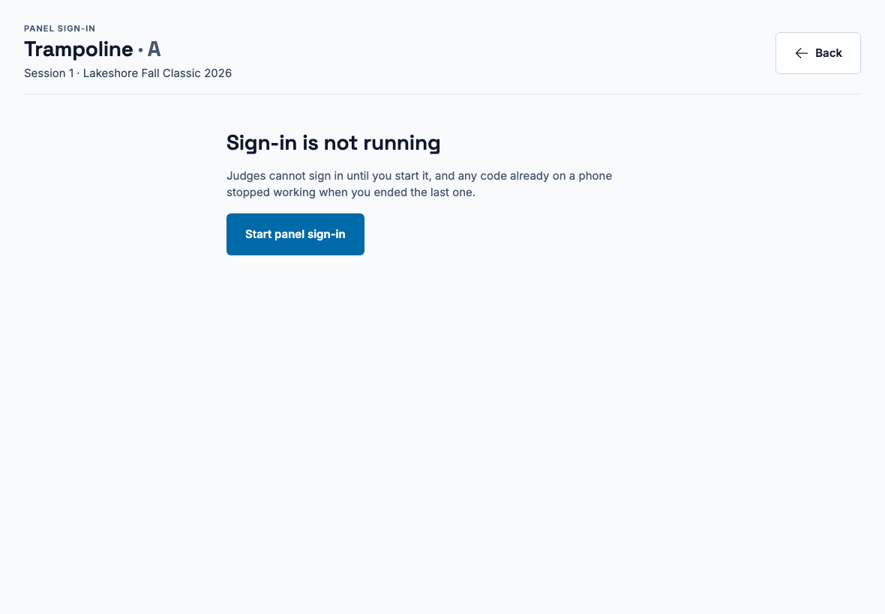
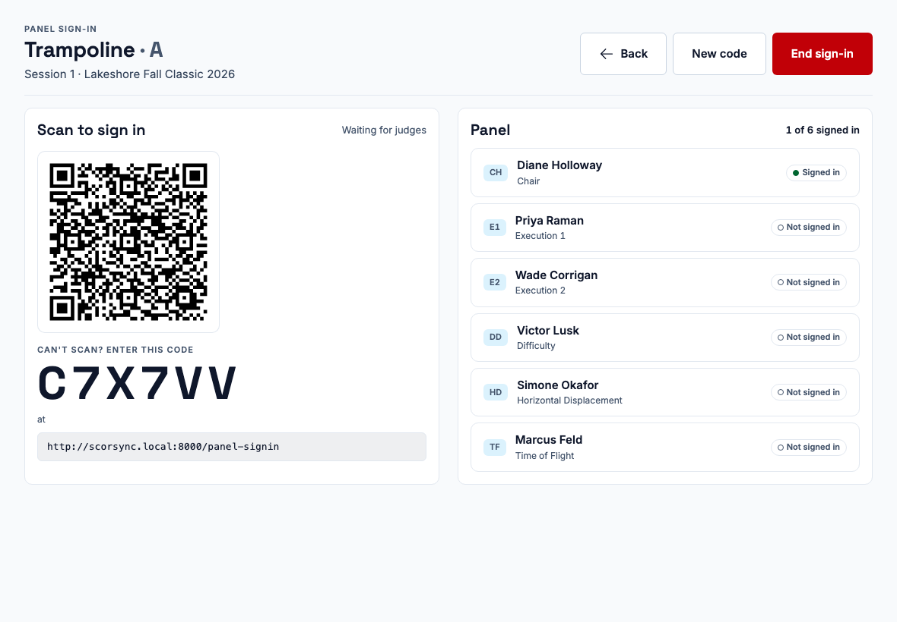
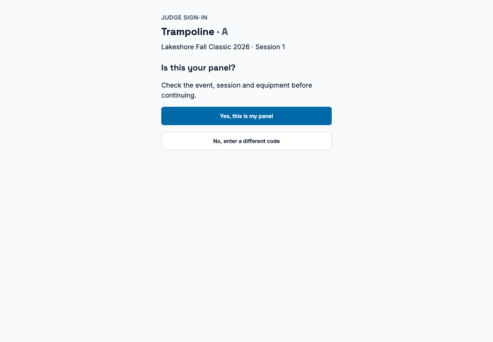
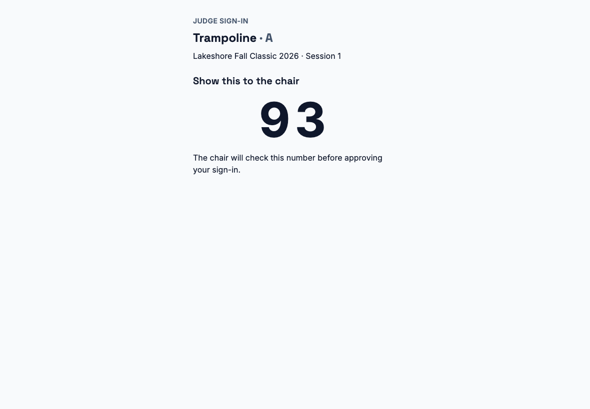
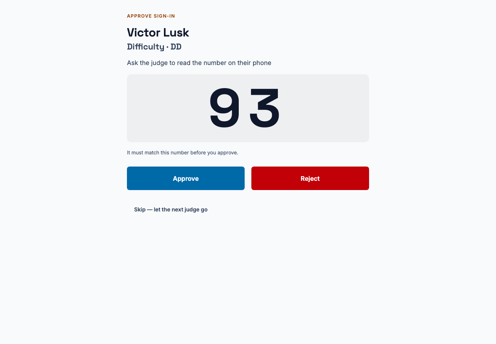

**Who it's for:** The chair · Scorsync Cloud and Scorsync Desktop

Use this when the whole panel arrives at once and you want to sign everyone in from your tablet.

## Before you start

- You're signed in on your own tablet. If not, ask the scoring table for a desk code. See [Get judges signed in and scoring](/scoring-table/get-judges-signed-in/).
- Your judges are seated on your panel, and their tablets can open the judges' address.

## Steps

<Steps>

1. On your **Dashboard**, select **Open Flight**.

2. At the top of the screen, left of the meet name, tap the sign-in button: a small QR-code icon with a number next to it.

   

3. Select **Start panel sign-in**.

   

4. Put your tablet on the table, so judges can see the QR code and the six-character code.

   

5. Each judge scans the QR code, or opens the address shown under the code and types the code.

6. On their tablet, the judge selects **Yes, this is my panel**, then their own name.

   

7. The judge reads out the number on their tablet.

   

8. On your tablet, check that the number matches, then select **Approve**. If it doesn't match, select **Reject**, then **Reject request**.

   

9. Check the **Panel** list on your flight view: each judge you approved shows **signed in**.

</Steps>

:::note
If a judge already signed in with a desk code, PIN or QR, the panel sign-in list still shows them as "Not signed in". Ignore it: the **Panel** list on your flight view is the one that counts.
:::

## If something goes wrong

- **A judge's tablet can't open the address.** Ask the scoring table to sign that judge in with a desk code. See [Get judges signed in and scoring](/scoring-table/get-judges-signed-in/#a-desk-code).
- **The number on your tablet doesn't match the judge's.** Select **Reject**, then **Reject request**, and ask the judge to scan the code again.

## Related

- [Getting started as the chair](/judges/chair/)
- [Get judges signed in and scoring](/scoring-table/get-judges-signed-in/)
- [Move on when a judge hasn't submitted](/judges/chair/move-on-missing-judge/)
